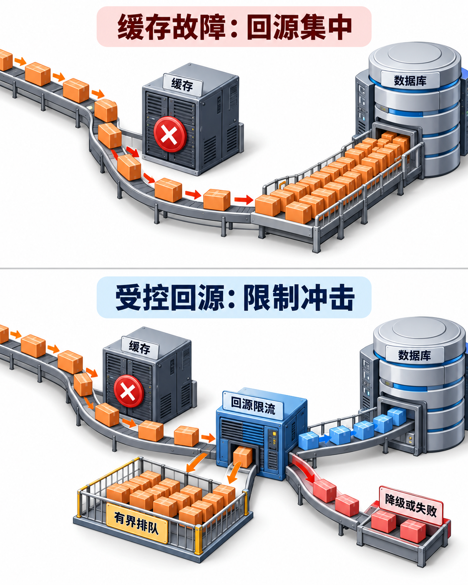

---
{
  "id": "Q-0953",
  "title": "Redis 宕机或缓存失效会有什么影响？",
  "category": "software",
  "topic": "Redis 与缓存",
  "type": "故障排查",
  "level": "基础",
  "priority": "按岗位选读",
  "focus": "缓存故障与回源冲击。大量未命中会冲垮数据库，锁/会话/限流也可能失效；限流降级、受控回源并恢复缓存，按用途决定故障策略。",
  "answerStatus": "ready",
  "updatedAt": "2026-10-19"
}
---

> 在面栈阅读：[Redis 宕机或缓存失效会有什么影响？](https://mianstack.com/question/q-0953)

## 核心回答

Redis 宕机或大量缓存失效，首先会使缓存命中率下降、请求变慢；如果所有未命中都直接回源，数据库可能因连接、CPU、I/O 或锁等待过载，进一步导致整个服务超时。若 Redis 还承担会话、限流、锁或任务状态，影响就不仅是查询变慢，还要分别处理正确性与可用性。

应先区分单个 Key 失效、热点失效、大批 Key 同时过期、单分片故障和整个缓存不可用，不能用同一种处理应对。

## 故障如何放大

假设某读接口平时大部分请求命中缓存，数据库只承担少量回源；缓存突然不可用后，回源量会迅速接近入口请求量。缓存连接等待和反复重试还会占用应用线程或协程，拖慢原本无关的请求。排队越长，超时和重试又越多，形成连锁过载。

高可用切主可以缩短部分故障，但切换期间仍可能超时、出现旧数据或冷缓存，不能替代应用保护。

同样是缓存不可用，回源是否受控会改变故障扩散路径：

箱子代表请求。下层的回源控制独立于故障缓存；超出容量的请求有明确的排队、降级或失败去向，图中数量不代表实测流量比例。

## 当下如何保护系统

对缓存调用设置合理超时，识别持续失败后避免每个请求都长时间等待；回源有并发和速率上限，并与其他业务隔离。根据业务重要性选择返回旧值、本地热点副本、简化结果、排队或明确失败。库存、权限等关键判断不能无条件使用过期值或绕过约束。

热点重建可用请求合并，避免同一个 Key 同时触发大量相同数据库查询；大量 Key 过期可结合 TTL 抖动、分批预热和渐进恢复。保护路径不应只依赖同一个已经故障的 Redis，否则限流和锁本身也会失效。

## 恢复时避免第二轮冲击

缓存恢复后，先确认路由、复制与错误率，再逐步放开流量和预热热点；不能瞬间并发重建全部数据。核对旧缓存、更新事件和事实存储是否一致，对关键状态做对账。

如果 Redis 存放的是不可重建的会话或任务事实，需要独立的持久化与恢复设计；如果只是可重建查询副本，重点是恢复速度和数据库承载。不同用途应单独评估失效策略。

## 常见追问

**直接穿透到 MySQL 是否可行？** 只有在数据库有足够余量且回源受控时才可行，不能默认数据库能接住全部请求。

**熔断后服务就高可用了？** 熔断只限制故障传播，还需要符合业务的降级结果、容量和恢复验证。

## 参考资料

- 国内：[JavaGuide / Snailclimb：Redis 常见问题（下）](https://github.com/Snailclimb/JavaGuide/blob/50f02a5984c062fe7221629d0a6a40ec15c26fd7/docs/database/redis/redis-questions-02.md)：借鉴热点与回源保护的分析，区分正文中单热点失效和大范围缓存故障，并说明回源限流的作用。
- 国内：[JavaGuide / Snailclimb：缓存基础常见面试题](https://github.com/Snailclimb/JavaGuide/blob/50f02a5984c062fe7221629d0a6a40ec15c26fd7/docs/database/redis/cache-basics.md)：参考本地与分布式缓存的分工，解释正文中故障时使用热点副本的降级路径及陈旧数据窗口。
- 国内：[JavaGuide / Snailclimb：服务降级与熔断详解](https://github.com/Snailclimb/JavaGuide/blob/50f02a5984c062fe7221629d0a6a40ec15c26fd7/docs/high-availability/fallback-and-circuit-breaker.md)：熔断和降级部分说明如何阻断持续缓存失败对请求线程及下游的影响。
- 国外：[AWS Builders’ Library：Timeouts, retries, and backoff with jitter](https://aws.amazon.com/builders-library/timeouts-retries-and-backoff-with-jitter/)：重试放大的分析说明缓存故障后为何应限制重试，并在恢复时逐步增加负载。
- 国外：[Microsoft：Cache-Aside pattern](https://learn.microsoft.com/en-us/azure/architecture/patterns/cache-aside)：借鉴旁路缓存的考虑事项，分析正文中未命中回到事实存储时的容量和一致性风险。
