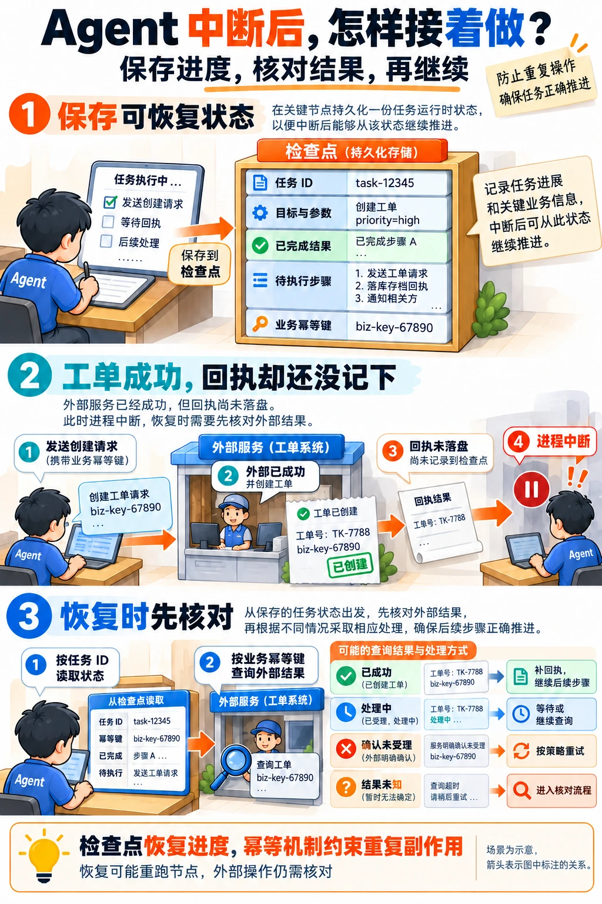

---
{
  "id": "Q-0965",
  "title": "Agent 执行中断后，下一次如何继续任务？",
  "category": "agent",
  "topic": "工作流、状态与执行恢复",
  "type": "方案设计",
  "level": "进阶",
  "priority": "进阶补充",
  "focus": "检查点恢复与副作用重放。任务 ID 关联持久检查点，恢复目标、进度和依赖结果；副作用先查状态再重放，避免再次执行已成功动作。",
  "answerStatus": "ready",
  "updatedAt": "2026-10-18"
}
---

> 在面栈阅读：[Agent 执行中断后，下一次如何继续任务？](https://mianstack.com/question/q-0965)

## 核心回答

Agent 中断后能继续，前提是**把执行进度保存到可靠存储，并知道哪些动作可以重放**。我会这样设计：

1. 用稳定的任务或会话 ID 关联状态，在可恢复步骤边界保存检查点，包括目标、已确认参数、已完成结果、待执行步骤和必要的工具回执。
2. 下次进入时先查任务真实状态，区分后台仍在运行、等待用户输入、执行失败和已完成，避免把浏览器断连当作任务失败再启动一次。
3. 从检查点恢复待执行步骤。普通故障修复后继续；等待输入则补充对应信息。恢复可能重跑节点，所以工具调用要考虑幂等。
4. 对已经发起但结果不明的外部操作，先按业务标识查询或对账；确认结果后再推进，不能统一“再执行一次”。权限和已确认的操作条件也要仍然有效。

在 LangGraph 中通常由 checkpointer 保存图状态，并用同一个 `thread_id` 定位；需要跨进程重启恢复时，要使用数据库等持久化后端，`InMemorySaver` 只能在当前进程内保留检查点。

## 展开说明

### 1. 保存的是执行状态，不只是聊天记录

一次分析任务可以保存原始目标、已确认的时间范围、计划版本、各子任务状态、结果引用、待处理错误、尝试次数和剩余预算。涉及外部操作时，还应保存操作参数、业务幂等键、执行回执及所依据的授权信息。大文件可以保存受控引用，无须把所有正文复制进每个检查点。

这些信息要回答三个问题：现在做到哪里、接下来允许做什么、哪些结果可以复用。只有对话摘要，往往无法判断某个工具是否已经执行；只有日志，也未必能重建路由和状态。身份和访问权限仍由可信入口重新核验，不能仅相信历史状态中的用户名称。

检查点要能与当前图、状态 Schema 和工具接口兼容。升级实现时应验证旧任务怎样读取和迁移，避免恢复后按新字段含义误解旧参数；不兼容的任务需要迁移、重新规划或明确停止，不能静默继续。

下面以“工单创建成功，但回执还没写入检查点就中断”为例：恢复后先用业务幂等键核对外部结果，再根据成功、处理中、确认未受理或状态不明选择下一步。

### 2. LangGraph 怎样定位和恢复

编译图时配置 checkpointer，执行时传入稳定的 `thread_id`。通过 `get_state` 可以查看当前状态、待执行节点和中断信息，历史检查点则用于排障或回放。

图状态的完整检查点通常在 **super-step 边界**保存，不是保存 Python 函数的每个局部变量。一个 super-step 中可以有多个并行节点；已成功节点的写入也可被记录，用于失败后的恢复，避免无条件重跑整个分支。实际能恢复到哪里，还要看所用后端与落盘方式：当前 LangGraph 的同步落盘在下一步之前完成，异步落盘存在进程突然退出时尚未写完的窗口，只在退出时保存则不能覆盖执行中的进程崩溃。

普通故障与主动暂停的恢复输入也不同。对于已有可恢复状态、且没有待处理人工输入的运行，通常沿原配置以 `invoke(None, config)` 继续；对于 `interrupt()` 等待的输入，使用同一 `thread_id`，通过 `Command(resume=...)` 提供相应结果。不是把原问题再当作一个新任务提交。

尤其要注意：`interrupt` 所在节点恢复时会从节点开头重新执行，再把恢复值交给对应中断调用。因此暂停前已经发生的文件写入或接口请求可能再次执行；把副作用拆成独立步骤并设计幂等，才有明确的恢复边界。

### 3. 检查点不能替代外部业务事实

假设 Agent 已请求创建一张工单，外部服务成功了，但进程在保存成功回执前崩溃。检查点里仍显示“待创建”，若恢复后直接重发，就可能产生两张工单。

更可靠的方式是在调用前持久化操作意图和稳定的业务幂等键，服务端通过唯一约束或相应幂等接口处理重复请求。恢复后先用这个键核对：确认已成功，就补记回执并继续；确认未受理，才按规则重试；处理中则等待；结果仍未知时进入核对流程。查询暂时查不到也不一定代表没执行，仍要遵循服务端的查询一致性与状态契约。

授权同样有范围和时效。如果恢复期间参数、目标对象或权限发生变化，原确认不能自动覆盖新动作；已有明确授权仍有效且条件没变时可以继续，无须每次恢复都重复打断用户。取消、补偿和回滚也要分别设计：取消运行不会自动撤销已提交的工单，补偿操作可能是另一个有条件的业务动作。

### 4. 谁来接管，怎样避免两个执行者同时恢复

单进程应用也应防止同一任务被重复启动；跨进程部署则需要由可靠任务状态决定谁持有执行权，可以使用条件更新或有期限的租约。新的执行者接管后，旧执行者迟到的结果不能覆盖较新状态，结果回写应校验任务版本或接管版本。

错误处理按原因选择。短暂限流、连接失败可以在总时限内退避重试；缺少参数进入等待输入；权限失效则停止相关动作并重新取得有效权限；接口不兼容或程序缺陷需要修复。重试次数和时间都要有上限，还应避免框架层和工具层各自重复重试，把一次失败放大成多次写入。

恢复验收应覆盖调用前、调用中和调用成功但回执未落盘等中断位置，并观察任务能否继续、是否产生重复副作用。仅证明“状态文件存在”还不够。

## 常见追问

### 用户关闭页面，任务应该怎么办？

先根据产品规则决定后台继续还是主动取消。任务状态应由服务端持有，浏览器只订阅进度；用户重新进入后按任务 ID 查询，后台还在运行就重新订阅，已经完成就展示结果。若要求离开即停止，也需要独立的取消机制，不能把连接关闭当作所有工具都已停止。

### 研搜参考项目已经支持重启恢复吗？

参考代码配置了 `InMemorySaver`，并用会话 ID 作为 `thread_id` 保存同一进程内的上下文；API 还会创建后台协程并登记活跃任务，因此当前的状态连续性依赖该进程。要支持进程重启后的任务恢复，可以将检查点和任务登记保存到数据库，启动后扫描未完成任务、取得执行权，再核对已发起工具的结果并继续。

### Trace 和 Checkpoint 有什么区别？

Trace 主要记录发生过什么，便于观察调用、耗时和错误；Checkpoint 保存运行时可读取的图状态及继续位置。二者可以关联同一任务，但不能因为存了 Trace 就认定能够恢复，也不能因为存了 Checkpoint 就认定外部操作必然只发生一次。

## 对应教程

- [LangGraph 高级特性](https://github.com/didilili/ai-agents-from-zero/blob/c05fb5979cf0aa3b6b4ed8c29f450f640fb9c18f/25-LangGraph%E9%AB%98%E7%BA%A7%E7%89%B9%E6%80%A7.md)：阅读 checkpointer、thread_id、故障继续和 interrupt 恢复，重点核对“恢复时节点会重新执行”；本文补充外部结果核对、授权有效性和接管并发。
- [研搜配套源码：会话与检查点](https://github.com/didilili/deepsearch-agents/blob/075a5337d855192f8a14543fcbd3b71d7060ce2c/app/agent/main_agent.py)：对照当前 `InMemorySaver` 和会话标识，区分进程内上下文连续与跨进程持久恢复。

## 参考资料

- 国内：[JavaGuide：Workflow、Graph 与 Loop](https://github.com/Snailclimb/JavaGuide/blob/50f02a5984c062fe7221629d0a6a40ec15c26fd7/docs/ai/agent/workflow-graph-loop.md)：依据 State、内存检查点与错误分类，说明正文中恢复所需执行信息及重试、补偿的边界。
- 国内：[WeThinkIn：可持久化、可恢复的 Agent 工作流](https://github.com/WeThinkIn/AIGC-Interview-Book/blob/275fdf1eeb65e3b233081d3b8e74ff5d8eeb2e03/AI%20Agent%E5%9F%BA%E7%A1%80/03_Agent%E8%AE%BE%E8%AE%A1%E6%A8%A1%E5%BC%8F%E4%B8%8E%E5%B7%A5%E4%BD%9C%E6%B5%81%E7%BC%96%E6%8E%92%E9%AB%98%E9%A2%91%E8%80%83%E7%82%B9.md)：借鉴工具调用前后不同崩溃窗口，解释正文中结果未知时为何必须单独核对外部业务事实。
- 国内：[zero2Agent：多 Agent 协作中的调度器恢复](https://github.com/ranxi2001/zero2Agent/blob/0c0eb7693105d281b146bb98f3a7f30da6f1ceea/learn-agent-interview/06-multi-agent-collab/index.md)：参考持久任务账本、租约和过期执行者回写处理，解释部署多个执行进程后由谁接管任务。
- 国外：[LangChain：Checkpointers](https://docs.langchain.com/oss/python/langgraph/checkpointers)：依据 thread、super-step、待执行状态、pending writes 与保存方式，说明正文中框架实际保存和恢复的粒度。
- 国外：[LangChain：Interrupts](https://docs.langchain.com/oss/python/langgraph/interrupts)：依据同一 thread 的恢复输入与节点重跑语义，说明正文中人工暂停的恢复方式及副作用幂等要求。
