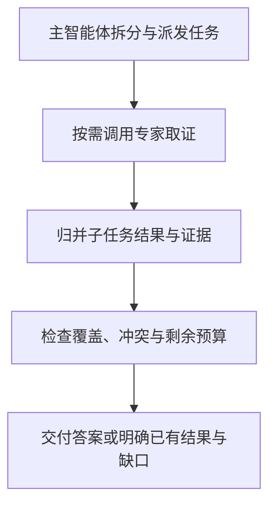

---
{
  "id": "Q-0966",
  "title": "多 Agent 系统如何设计和协作？",
  "category": "agent",
  "topic": "多 Agent 编排与协作",
  "type": "系统设计",
  "level": "进阶",
  "priority": "进阶补充",
  "focus": "角色分工、上下文交接与结果合并。以检索、分析和写作分工为例，为各角色定义输入与产物；按依赖并行或串行，交接证据与状态，由主控检查并合并结果。",
  "answerStatus": "ready",
  "updatedAt": "2026-10-17"
}
---

> 在面栈阅读：[多 Agent 系统如何设计和协作？](https://mianstack.com/question/q-0966)

## 核心回答

设计多 Agent 系统，先确定**谁负责什么、谁决定下一步、交付什么结果、失败后怎样继续**，再选择框架和 Agent 数量。每个角色要能独立完成一个可验收的子目标，单纯把提示词换成几个角色名，不能解决协作问题。

以研搜系统为例，我会采用“主智能体协调、专家取证、统一汇总”的结构：网络、数据库和内部知识库专家分别获取不同来源的信息，主智能体理解目标、派发任务、检查信息是否齐全并组织最终答案。具体把协作落到五件事上：

1. **职责与任务契约**：给每个专家明确目标、输入、可用工具、输出格式和完成条件，避免重复检索或遗漏问题。
2. **控制流与依赖**：固定步骤由代码编排，不确定的搜索方向交给模型；输入齐备且互不依赖的任务才并行，有依赖的任务按顺序执行。
3. **通信与上下文**：传必要背景、结论和证据引用，各自保留局部上下文，不把所有原始对话广播给每个 Agent。
4. **状态与恢复**：编排器记录任务状态和产物，约定并行结果如何合并，对超时、重试、总预算和停止条件做硬限制；涉及外部写操作时保证幂等。
5. **汇总与验证**：统一检查来源、缺失项和冲突，必要时补查；用任务成功率、事实与引用准确性、延迟和费用评估，确认多 Agent 的收益覆盖协调成本。

模型负责在子目标内探索，编排层负责约束执行和推进状态。这样既能利用专业分工，也能在部分任务失败或意见不一致时有明确处理路径。

## 展开说明

### 1. 先选控制方式，再决定怎样拆角色

常见方案可以按“谁拥有下一步控制权”区分：

- **固定工作流**：阶段和依赖已知，由代码控制执行。例如查到业务数据后才能生成报告。节点内部仍可以运行会自主选工具的 Agent。
- **Supervisor / 主从模式**：主智能体根据当前结果动态委派，子智能体完成后返回，由主管决定补查和汇总，适合开放式研搜。
- **Router / 路由模式**：先识别请求类型，再交给相应专家，适合领域清楚的客服或企业助手。
- **Handoff / 交接模式**：当前角色把控制权和必要上下文转给下一个角色，适合用户需要继续与某个专家对话的场景。

这些方式可以组合。对研搜来说，资料获取可以动态规划；工具权限、预算检查和最终交付条件适合由确定性逻辑控制。不是每个步骤都需要新增 Agent：PDF 转换这种输入输出明确的操作，作为工具就够了。

沿用网络、数据库、RAGFlow 三类专家时，角色的提示词、工具集合和局部上下文分别配置；可以共用模型，也可以按任务效果选择模型。Agent 是逻辑执行单元，并不要求一个角色对应一个独立进程。

### 2. 任务派发与结果返回都要有明确契约

派发任务时，除了“查什么”，还需要给出对象、范围、口径、上游依赖、允许的数据源、截止时间和验收条件。例如“统计本季度各药品销售额，币种为人民币，保留 SQL 与数据时间”，比“去查销售数据”更容易执行和核验。

返回结果则应包含任务标识、执行状态、主要发现、来源或产物引用、缺失项。编排器检查这些字段后，才把结果交给下游。输出符合 JSON Schema 只说明交接格式可用，结论是否正确仍要检查证据。

原始网页、查询结果和较大的文件可以保存为产物，通过引用按需读取。共享摘要应保留关键原文位置、时间和统计口径，避免多次压缩后只剩一句失去依据的结论。用户和租户身份从可信入口传入，不能让模型通过消息内容自行指定权限。

### 3. 并行执行要同时设计状态归并和结果判定

每次运行使用独立的运行标识，每个子任务再有自己的任务标识。全局状态记录目标、依赖、任务进度、预算和产物引用；专家自己的消息与工具记录留在局部上下文。并行专家分别写自己的结果槽，最终报告由一个汇总节点写入，避免后返回的结果覆盖前一份答案。

若用 LangGraph，共享字段如何更新由 reducer 决定：可以按任务标识归并结果、按来源标识去重；没有合并规则时，不能假设并发写会自动得到正确集合。reducer 解决数据归并，两个专家的观点是否矛盾仍需业务判断。

下面概括研搜场景中的协作过程。“专家取证”可以由一个或多个角色完成，只有被选中且输入齐备的专家才会执行，互不依赖的任务可以并行。

归并之后再判断是否达标，能把“任务已返回”和“信息足够回答”分开。资料不足且预算允许时，可以重新派发补查；预算耗尽则返回已有结果和缺口。发生观点冲突时，先比较来源、时间与适用范围；例如计划销量与实际销量不应投票合成一个数字。确有冲突时补查权威证据，无法消除就保留分歧。

### 4. 把异常恢复和停止条件交给执行层

网络超时、短期限流可以在剩余预算内退避重试；参数缺失应补输入，权限拒绝不能靠不断重试解决。一个可选来源失败时，可以保留其他结果并说明缺口；如果关键数据缺失，就停止相关结论生成。

编排层同时限制单次工具调用、单个专家的迭代、最大并发、全局截止时间和费用。对补查循环，还要检测是否新增了有效证据，连续重复且没有进展时结束或请求补充信息。只在提示词里写“不要死循环”不足以限制实际消耗。

长任务要持久保存已确认的子任务状态、产物位置和检查点。LangGraph 的 checkpointer 管理线程范围内的图状态，但 `InMemorySaver` 在进程重启后会丢失；需要重启恢复时应采用持久化实现。恢复也可能重跑某个节点，因此生成文件、发通知或写业务数据时，应使用稳定的操作标识和幂等处理，已经提交但回执未知的操作先核对结果，不能盲目再执行。

运行记录至少能关联请求、子任务、模型与提示词版本、工具参数、错误、耗时和 Token。评估既要看最终答案，也要看是否重复派发、是否遗漏来源，以及失败恢复是否会产生重复操作。这里的设计方法可用于扩展研搜系统，不代表示例工程已经实现了全部机制。

## 常见追问

### 多 Agent 是否必须通过消息队列或 A2A 通信？

不必须。同一应用里可以直接调用子 Agent，把参数、返回值接到共享状态上。只有需要跨服务异步调度、跨团队或跨安全域协作时，才根据需求引入消息系统或 A2A。传输协议不会替系统决定职责、验收标准、状态冲突和幂等策略。

### 两个 Agent 同时写同一个文件怎么办？

优先让它们各自产出独立文件或结果，由唯一汇总者生成最终文件。确实需要共同更新时，使用版本检查或受控合并；锁只能约束访问时机，不能判断哪份内容在业务上正确。文件生成与其他外部副作用也要纳入重试和恢复设计。

### 怎样证明多个 Agent 比单 Agent 更好？

用相同任务集、可比的模型和资源预算做对照，覆盖简单请求、多来源请求、来源冲突和工具失败。比较任务完成情况、事实与引用准确性、人工纠正次数、延迟和费用。不能只展示一个成功 Demo，也不能把使用更多 Token 带来的收益全部归因于角色拆分。

## 对应教程

- [LangGraph 多智能体与 A2A](https://github.com/didilili/ai-agents-from-zero/blob/c05fb5979cf0aa3b6b4ed8c29f450f640fb9c18f/26-LangGraph%E5%A4%9A%E6%99%BA%E8%83%BD%E4%BD%93%E4%B8%8EA2A.md)：对照 Supervisor、Router、Handoff 和应用内编排，理解控制权、上下文交接与跨系统协议的区别。
- [深度研搜：项目总览与工程初始化](https://github.com/didilili/ai-agents-from-zero/blob/c05fb5979cf0aa3b6b4ed8c29f450f640fb9c18f/%E5%AE%9E%E6%88%98%E9%A1%B9%E7%9B%AE-%E6%B7%B1%E5%BA%A6%E7%A0%94%E6%90%9C/8-%E9%A1%B9%E7%9B%AE%E6%80%BB%E8%A7%88%E4%B8%8E%E5%B7%A5%E7%A8%8B%E5%88%9D%E5%A7%8B%E5%8C%96.md)：从网络、数据库、RAGFlow 三类业务专家的实际分工出发，理解主智能体为何反复派发和回收结果。
- [深度研搜：主智能体搭建与异步执行](https://github.com/didilili/ai-agents-from-zero/blob/c05fb5979cf0aa3b6b4ed8c29f450f640fb9c18f/%E5%AE%9E%E6%88%98%E9%A1%B9%E7%9B%AE-%E6%B7%B1%E5%BA%A6%E7%A0%94%E6%90%9C/13-%E4%B8%BB%E6%99%BA%E8%83%BD%E4%BD%93%E6%90%AD%E5%BB%BA%E4%B8%8E%E5%BC%82%E6%AD%A5%E6%89%A7%E8%A1%8C.md)：查看主从组装、会话上下文和进度推送；本文进一步讨论任务契约、并行归并、持久化恢复和预算控制。

## 参考资料

- 国内：[JavaGuide：多 Agent 协作系统设计](https://github.com/Snailclimb/JavaGuide/blob/50f02a5984c062fe7221629d0a6a40ec15c26fd7/docs/ai/agent/multi-agent.md)：借鉴任务契约、并行归并、冲突分类与失败恢复的设计，说明正文中结果交接后的执行和验收规则。
- 国内：[zero2Agent：多智能体协作：角色分工、通信机制与冲突仲裁](https://github.com/ranxi2001/zero2Agent/blob/0c0eb7693105d281b146bb98f3a7f30da6f1ceea/learn-agent-interview/06-multi-agent-collab/index.md)：依据职责隔离、共享状态与循环终止，说明正文中通信需保留的任务背景和结果。
- 国内：[Datawhale：第六章 框架开发实践](https://github.com/datawhalechina/hello-agents/blob/36f583c233ea5cee4537ef93455702b55053af18/docs/chapter6/%E7%AC%AC%E5%85%AD%E7%AB%A0%20%E6%A1%86%E6%9E%B6%E5%BC%80%E5%8F%91%E5%AE%9E%E8%B7%B5.md)：借鉴对话驱动、消息驱动与图式编排案例，说明正文中控制方式如何影响协作流程和状态管理。
- 国内：[WeThinkIn：Agent 设计模式与工作流编排高频考点](https://github.com/WeThinkIn/AIGC-Interview-Book/blob/275fdf1eeb65e3b233081d3b8e74ff5d8eeb2e03/AI%20Agent%E5%9F%BA%E7%A1%80/03_Agent%E8%AE%BE%E8%AE%A1%E6%A8%A1%E5%BC%8F%E4%B8%8E%E5%B7%A5%E4%BD%9C%E6%B5%81%E7%BC%96%E6%8E%92%E9%AB%98%E9%A2%91%E8%80%83%E7%82%B9.md)：依据多 Agent 控制模式、恢复与运行时职责，说明正文中检查点和外部业务操作为何分开处理。
- 国外：[LangChain：Deep Agents Subagents](https://docs.langchain.com/oss/python/deepagents/subagents)：依据子任务委派、局部上下文与精简结果回传，说明正文中专家如何独立执行并避免广播完整对话。
- 国外：[LangChain：LangGraph Graph API overview](https://docs.langchain.com/oss/python/langgraph/graph-api)：依据 State、条件路由与 reducer，说明正文中并行更新如何进入共享状态，以及恢复重跑的幂等要求。
- 国外：[LangChain：LangGraph Persistence](https://docs.langchain.com/oss/python/langgraph/persistence)：采用线程检查点与跨线程存储的区分，说明正文中 `InMemorySaver` 的进程内限制及持久恢复条件。
