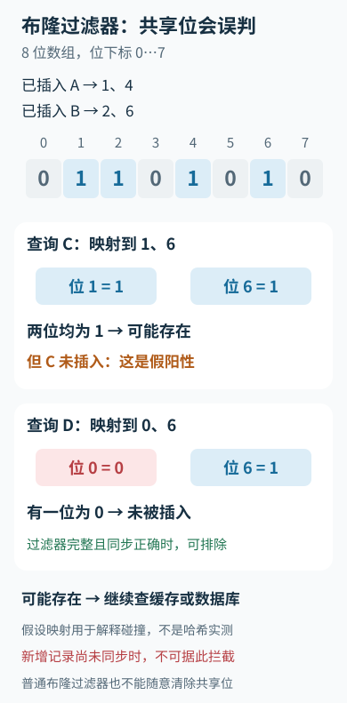

---
{
  "id": "Q-0969",
  "title": "布隆过滤器在项目中如何使用，判断存在或不存在时业务如何处理？",
  "category": "coding",
  "topic": "数组、字符串与哈希",
  "type": "原理机制",
  "level": "进阶",
  "priority": "按岗位选读",
  "focus": "确定不存在与可能存在。过滤器判不存在可挡回源，判可能存在仍查缓存/库；新增数据先同步，误判不能直接当存在。",
  "answerStatus": "ready",
  "updatedAt": "2026-10-19"
}
---

## 核心回答

布隆过滤器适合作为**精确查询之前的快速存在性过滤**：返回“不存在”时，在过滤器完整、同步正确的前提下可以跳过后端查询；返回“可能存在”时，继续查缓存或数据库，不能直接当作数据真实存在。

## 项目里的请求路径

以防止查询不存在的商品 ID 造成缓存穿透为例：

1. 先完成参数校验、身份与权限检查；命中缓存即可按业务规则返回。
2. 缓存未命中，再查布隆过滤器。判断“不存在”且当前过滤器可靠时，返回约定的未找到结果，减少无效数据库请求。
3. 判断“可能存在”时查数据库。查到就返回并回填缓存；查不到属于可能的假阳性，可以结合短期空值缓存、限流等减少重复回源。

布隆过滤器保存的是某类业务 ID 是否被登记，不能替代鉴权、数据内容和状态校验。放在 RAG 文档抓取前，也只能帮助判断 URL 或文档键是否可能见过，不能证明文档与查询相关。

## 为什么存在会误判，不存在通常可靠

底层是位数组和多个哈希映射。插入元素时，把它映射到的位都设为 1；查询时，只要有一位为 0，就能排除它已被插入。若所有位都是 1，这些位也可能由其他元素共同置位，所以只能说“可能存在”。

例如插入 A 时设置位 1、4，插入 B 时设置位 2、6。未插入的 C 如果恰好映射到 1、6，也会被判为可能存在；映射到 0、6 的 D 则会被排除。这是说明碰撞的假设映射，不代表真实哈希函数的实测结果。

**算法没有假阴性，不等于业务永远不会误拦。** 新增记录尚未同步到过滤器、加载不完整、误清位、读到落后副本或键编码不一致，都可能把数据库里已有的数据错误排除。

沿用 A、B、C、D 的假设映射，可以直接看到误判来自哪里：

C 的两个 1 分别来自其他元素，不能据此确认 C 存在。D 的排除结论以过滤器完整且同步正确为前提；图中位置用于解释机制。

## 新增、删除和重建怎样处理

- **新增：** 明确数据库记录何时可对外查询，并保证该时间点对应 ID 已进入可用过滤器。异步同步存在窗口时，应提供增量集合、回源降级等补偿，不能仍按完整过滤器直接拦截。
- **删除：** 普通布隆过滤器不能随意把相关位清零，因为其他元素可能共享这些位。保留旧位只会增加不必要的回源，最终由数据库确认已删除；需要删除时可评估计数布隆或其他结构，并遵守其使用条件。
- **重建：** 基于一致快照装载，补齐期间增量，核验后切换版本。重建未完成、更新延迟过大或过滤器不可用时，应按业务容量采用受限回源或明确降级，不应把故障解释成数据不存在。

## 怎样确定业务是否适合

缓存穿透场景中，假阳性主要代价是多查一次数据库，通常可以承受。精确去重、用户名唯一或支付幂等场景中，若把“可能存在”直接当成重复并丢弃，可能损失合法请求，应再查精确集合或由数据库唯一约束兜底。

上线时预估元素数量和目标假阳性率，并观察容量、位占用、回源率、更新延迟与重建状态。元素持续增加而不扩容或重建，过滤效果会变差。过滤器降低的是后端无效查询量，不会自动解决热点键过期、并发回填或所有缓存故障。

## 参考资料

- 国内：[JavaGuide：布隆过滤器](https://github.com/Snailclimb/JavaGuide/blob/50f02a5984c062fe7221629d0a6a40ec15c26fd7/docs/cs-basics/data-structure/bloom-filter.md)：借鉴位数组、多哈希与碰撞机制，解释正文中假阳性从何而来。
- 国内：[WeThinkIn：布隆过滤器为什么会误判但不会漏判](https://github.com/WeThinkIn/AIGC-Interview-Book/blob/275fdf1eeb65e3b233081d3b8e74ff5d8eeb2e03/数据结构%26算法基础/05_字符串与高级数据结构高频考点.md#q-011)：依据插入完整性与抓取前置去重的使用条件，说明正文中无漏判前提以及过滤器不能证明文档相关的边界。
- 国内：[小林coding：什么是缓存雪崩、击穿、穿透](https://xiaolincoding.com/redis/cluster/cache_problem.html)：参考缓存穿透的查询路径，组织正文中缓存未命中后依过滤器结果决定是否回源的业务流程。
- 国外：[Redis：Bloom filter](https://redis.io/docs/latest/develop/data-types/probabilistic/bloom-filter/)：借鉴业务误判容忍度、容量与目标误判率的关系，说明正文中精确去重需后端确认及运行容量监测的取舍。
- 国外：[Google Guava：BloomFilter 33.4.8-jre](https://guava.dev/releases/33.4.8-jre/api/docs/com/google/common/hash/BloomFilter.html)：依据 mightContain 的真假语义与超容量退化，说明正文中可能存在仍需精确查询、容量增加会降低过滤效果的原因。
