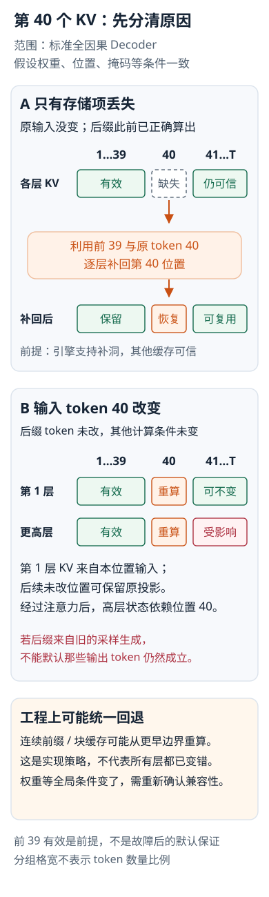

---
{
  "id": "Q-0982",
  "title": "因果模型中第 40 个 token 的 KV Cache 缺失或失效后，应从哪里重新计算？",
  "category": "llm",
  "topic": "推理优化与模型压缩",
  "type": "原理机制",
  "level": "进阶",
  "priority": "按岗位选读",
  "focus": "缓存依赖与重算起点。前39个有效缓存可复用，从40位置补算；若40 token/依赖改变，后续缓存也失效，单纯丢缓存与改输入要分开。",
  "answerStatus": "ready",
  "updatedAt": "2026-10-19"
}
---

> 在面栈阅读：[因果模型中第 40 个 token 的 KV Cache 缺失或失效后，应从哪里重新计算？](https://mianstack.com/question/q-0982)

## 核心回答

如果前 39 个 token 的各层缓存完整且仍然有效，通常可以**复用这段前缀，从第 40 个位置开始恢复计算**。但“第 40 个缓存单纯丢失”与“第 40 个 token 或其依赖改变”不同，后者才会使相应后缀的旧缓存失去复用依据。

## 为什么不用从第 1 个 token 重算

标准因果 Decoder 在第 `i` 个位置只能读取不晚于 `i` 的信息。每层保存的 `K[i]`、`V[i]` 来源于该位置进入这一层的隐藏状态，不依赖未来 token。因此，只要模型、输入前缀、位置和掩码等条件一致，第 40 个位置的变化不会反过来影响前 39 个位置。

恢复第 40 个位置时，输入对应 token 与位置，逐层计算，并读取前 39 个位置在各层的历史 KV，得到第 40 个位置的新 KV。不能简单跳过它，因为后续位置通常需要把它纳入注意力的键和值集合。

## 缓存丢失与缓存失效分别怎么处理

**只有存储缺失，原始输入没有改变。** 如果第 40 个位置的 KV 被丢掉，但后续缓存是在它丢失之前、基于完整相同上下文正确计算的，那么这些后续缓存不会因为“存储少了一项”而在数学上自动变错。若引擎支持补洞，可以恢复第 40 个位置的各层 KV，并继续使用经过确认的其他缓存。

不过，很多服务引擎按连续前缀或完整块复用，未提供任意位置补洞接口。这时实现上通常截断到最后一个完整有效前缀，再重新处理后面的 token。按块管理时，起点还可能早于逻辑上的第 40 个位置，例如回退到包含它的缓存块之前。

**第 40 个 token 或其依赖确实改变。** 后面的隐藏状态可能已经混入旧的第 40 个位置的信息，需要使受影响的后缀缓存失效。常用而稳妥的做法是保留有效前缀，重算第 40 个位置及后续需要的各层状态。如果后缀是模型此前采样生成的文本，后续生成分布也可能改变，不能默认原来的输出 token 仍然成立。

严格按层分析时，受影响范围并不完全相同：第一层 K/V 由本位置的输入表示得到，未改变的后续位置在这一层可能仍相同；经过因果注意力后，更高层的后缀状态会受到变化影响。工程上的整段回退是统一恢复策略，不表示每一层每个后缀张量在数学上都必然改变。

把“存储里少了一项”和“输入真的变了”分别画开：

两种情况都先确认前 39 个位置有效。输入变化的影响按层传播；图中的整段回退表示常用工程策略，不表示每层每个后缀张量都必然改变。

## 如果失效原因更早，恢复起点也要更早

前 39 个位置若也有缺口，就退到更早的完整前缀。若模型权重、LoRA、输入模板、位置编号或掩码改变，原有缓存可能整体不兼容，不能只因为首次发现问题在第 40 个位置，就继续相信前面的缓存。

vLLM 的前缀缓存块哈希包含前序块、当前 token 和其他必要标识，正是在记录这种依赖：后面文字相同，不代表在不同前缀下计算的 KV 可以混用。

## 面试时如何准确收束

可以回答：“先确认前 39 个位置各层 KV 有效，再从第 40 个位置或对应块边界恢复。若是输入改变，要重算受影响的后缀；若只是单个缓存项丢失，后缀是否必须重算取决于它是否仍然正确以及引擎是否支持补洞。”

决定恢复范围的是**依赖是否改变、哪些中间状态仍可信，以及缓存实现支持什么操作**。不能仅凭 softmax 非线性，就断言任何单项缺失都使所有后缀缓存必然失效。

## 对应教程

- [1-1-大模型认知与工程概览](https://github.com/didilili/ai-agents-from-zero/blob/c05fb5979cf0aa3b6b4ed8c29f450f640fb9c18f/1-1-%E5%A4%A7%E6%A8%A1%E5%9E%8B%E8%AE%A4%E7%9F%A5%E4%B8%8E%E5%B7%A5%E7%A8%8B%E6%A6%82%E8%A7%88.md)：理解逐 token 解码中 KV Cache 的作用；缓存失效恢复与逐层依赖由本题继续展开。

## 参考资料

- 国内：[wdndev：Llama 2代码详解：KV Cache与GQA](https://github.com/wdndev/llm_interview_note/blob/581d54dd9a72e1d0a4eb28ae50859db83901b783/02.大语言模型架构/llama%202代码详解/llama%202代码详解.md)：依据每层 KV 写入与增量解码，说明正文中第 40 个位置如何利用前 39 个位置的完整缓存恢复。
- 国内：[WeThinkIn：大模型部署技术](https://github.com/WeThinkIn/AIGC-Interview-Book/blob/275fdf1eeb65e3b233081d3b8e74ff5d8eeb2e03/模型部署基础（精华版）/6.3大模型部署技术.md)：依据 prefill 与 decode 的分工，说明正文中恢复缓存与输入变化后重新生成后缀的不同工作。
- 国内：[DeepSeek-AI：DeepSeek-V2](https://arxiv.org/html/2405.04434v5)：依据注意力投影对模型和输入的依赖，说明正文中权重、位置或模板变化时缓存可能不兼容的原因。
- 国外：[Hugging Face：Caching v4.57.1](https://huggingface.co/docs/transformers/v4.57.1/cache_explanation)：依据因果注意力与缓存位置、mask 的要求，解释正文中未来位置变化不影响有效前缀的依据。
- 国外：[vLLM：Automatic Prefix Caching](https://docs.vllm.ai/en/stable/design/prefix_caching/)：依据缓存块哈希的前缀依赖，说明正文中后文相同也不能跨前缀混用 KV，以及按完整有效块回退的工程策略。
