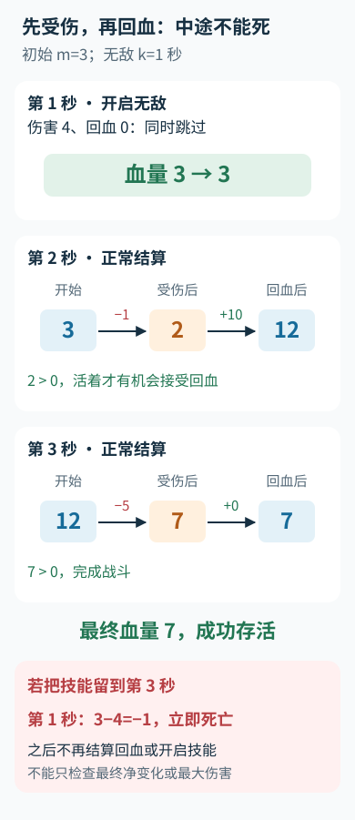

---
{
  "id": "Q-0983",
  "title": "角色每秒先受伤后回血，可开启一段连续无敌且不能回血的技能，判断能否存活到战斗结束。",
  "category": "coding",
  "topic": "动态规划、贪心与回溯",
  "type": "代码题",
  "level": "深入",
  "priority": "按岗位选读",
  "focus": "时序生存约束与技能窗口。每秒先查受伤后是否仍活，再回血；枚举技能窗口，用前缀和与最低血量信息验证技能前后，不能只看终值。",
  "formatTags": ["现场编码"],
  "answerStatus": "ready",
  "updatedAt": "2026-10-19"
}
---

> 在面栈阅读：[角色每秒先受伤后回血，可开启一段连续无敌且不能回血的技能，判断能否存活到战斗结束。](https://mianstack.com/question/q-0983)

## 核心回答

这道题不能只检查战斗结束时的血量，也不能只把每秒合并成“回血减伤害”：**角色在当秒受伤后若血量已经不大于 0，就没有机会再接受回血。** 可以枚举技能开始时间，用净变化前缀和，以及受伤后最低血量的前缀、后缀最小值，把每个方案的检查降为 O(1)，总时间 O(n)。

下面按这些条件实现：初始血量为 `m`，伤害与回血均非负，没有额外的血量上限；技能最多开一次，从某秒受伤前开始，连续 `k` 秒同时跳过伤害和回血，血量全程严格大于 0。技能持续到战斗结束之后的部分不影响结果。函数返回布尔值，需要输出时再对应成 `yes` 或 `no`。

## 把完整过程转成两个量

用从 0 开始的下标，定义净变化前缀和：

```text
P[0] = 0
P[i+1] = P[i] + b[i] - a[i]
```

不使用技能时，第 `i` 秒受伤后的血量为：

```text
low[i] = m + P[i] - a[i]
```

因为随后回血 `b[i] >= 0`，只要所有受伤后的血量都大于 0，该段就能存活。即使不使用技能的过程会死亡，也可以把 `P[i]`、`low[i]` 当成代数基准预先计算；实际可行性由后面的条件检查。

## 枚举无敌窗口如何检查

假设跳过左闭右开区间 `[left, right)`，其中 `right = left + k`。这段原本的净变化为 `skipped_delta = P[right] - P[left]`。跳过后：

- 窗口之前，血量与原过程相同，要求 `pre_min[left] > 0`。
- 窗口之内，伤害与回血都不发生，血量保持在进入窗口时的正值。
- 窗口之后，所有血量相对原过程统一减少 `skipped_delta`，要求 `suf_min[right] - skipped_delta > 0`。

预处理前缀最小值、后缀最小值后，这两项都能 O(1) 检查。空前缀或空后缀的最小值记为正无穷。

注意 `skipped_delta` 可以为正。跳过一段净回血区间，会让后续血量更低，所以不能一律把无敌看成增加血量。

当 `k >= n` 时，从战斗开始覆盖全程即可。若 `k < n`，只枚举完整落在战斗中的长度 `k` 窗口也足够：任何向战斗结束后延伸的可行窗口，都可以提前到 `[n-k, n)`，角色在更早的开始时刻仍活着，此后一直无敌直到结束。

## Python 实现

```python
def can_survive(m, damage, heal, k):
    n = len(damage)
    if len(heal) != n or k < 0:
        raise ValueError("invalid lengths or duration")
    if any(x < 0 for x in damage) or any(x < 0 for x in heal):
        raise ValueError("damage and heal must be nonnegative")
    if m <= 0:
        return False
    if n == 0 or k >= n:
        return True

    prefix = [0] * (n + 1)
    low = [0] * n
    for i in range(n):
        low[i] = m + prefix[i] - damage[i]
        prefix[i + 1] = prefix[i] + heal[i] - damage[i]

    inf = float("inf")
    pre_min = [inf] * (n + 1)
    suf_min = [inf] * (n + 1)
    for i in range(n):
        pre_min[i + 1] = min(pre_min[i], low[i])
    for i in range(n - 1, -1, -1):
        suf_min[i] = min(suf_min[i + 1], low[i])

    if pre_min[n] > 0:
        return True
    for left in range(n - k + 1):
        right = left + k
        skipped_delta = prefix[right] - prefix[left]
        if pre_min[left] > 0 and suf_min[right] - skipped_delta > 0:
            return True
    return False
```

前缀和、两侧最小值和窗口枚举都只各遍历常数次，时间复杂度 O(n)，额外空间 O(n)。`k=0` 等价于没有技能；空战斗和非正初始血量也单独处理。

## 用例子检查先后顺序

初始血量 3，伤害为 `[4, 1, 5]`，回血为 `[0, 10, 0]`，技能持续 1 秒。若在第一秒开启技能，血量保持 3；第二秒先降为 2，再恢复到 12；第三秒降为 7，可以存活。若只盯着最大的伤害 5，把技能留到第三秒，第一秒已经死亡。

把上述三秒按“受伤、判生死、回血”的次序展开：



这里只比较正文给出的两个技能时机。受伤后不大于 0 就终止，后面的回血不能挽救本秒已死亡的角色；算法仍需检查所有候选窗口。

再看初始血量 5、当秒伤害 5、随后回血 100，且没有技能的情况：受伤后恰好为 0，应判定死亡，不能因为最终净变化为正而通过。

本解法依赖血量变化可以线性相加。若增加最大血量、技能期间仍可回血、技能次数或触发时机等条件，需要重新推导状态，不能直接沿用“后缀统一平移”的公式。

## 参考资料

- 国内：[OI Wiki：前缀和与差分](https://oi-wiki.org/basic/prefix-sum/)：依据前缀和的区间差分公式，推导正文中被技能跳过窗口的净变化。
- 国内：[labuladong：小而美的算法技巧：前缀和数组](https://labuladong.online/zh/algo/data-structure/prefix-sum/)：依据 n+1 前缀数组与半开端点的定义，确定正文中窗口和及 low[i] 的下标关系。
- 国内：[WeThinkIn：和为K的连续子数组：前缀和与枚举](https://github.com/WeThinkIn/AIGC-Interview-Book/blob/275fdf1eeb65e3b233081d3b8e74ff5d8eeb2e03/大厂高频面试题（实时更新）/百度高频面试题.md)：依据区间净变化可正可负的性质，解释正文中跳过净回血窗口反而降低后续血量的情况。
- 国外：[USACO Guide：Introduction to Prefix Sums](https://usaco.guide/silver/prefix-sums)：借鉴线性预处理与常数查询，说明正文中每个技能窗口只查两侧最小值、总计 O(n) 的优化。
- 国外：[cp-algorithms：Sparse Table](https://cp-algorithms.com/data_structures/sparse-table.html)：参考静态区间最值的预处理思路，说明正文中仅查询前缀与后缀时使用扫描即可得到最小值的原因。
