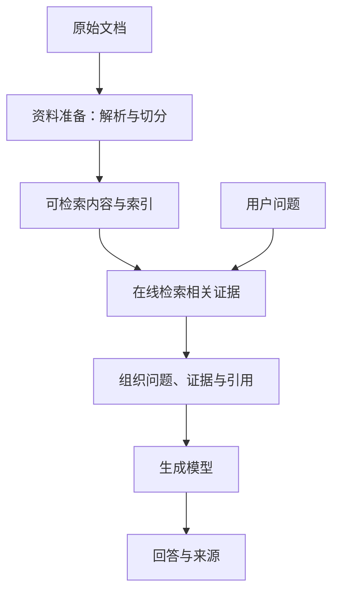

---
{
  "id": "Q-1421",
  "title": "RAG 是什么，有什么作用？",
  "category": "rag",
  "topic": "RAG 架构与生成链路",
  "type": "概念解释",
  "level": "基础",
  "priority": "按岗位选读",
  "focus": "外部知识与生成证据。检索外部相关资料放入模型上下文再生成，补私有/新知识与出处；检索错仍会影响回答。",
  "answerStatus": "ready",
  "updatedAt": "2026-10-17"
}
---

> 在面栈阅读：[RAG 是什么，有什么作用？](https://mianstack.com/question/q-1421)

## 核心回答

**RAG（Retrieval-Augmented Generation，检索增强生成）**是一种把外部信息检索与模型生成结合起来的方法：根据用户问题找到相关资料，将资料作为上下文提供给模型，再生成回答。

它主要有三个作用：补充模型原本不了解的私有知识；通过更新外部资料提高知识时效性；保留来源，让回答更容易核对。例如运维助手回答某个版本的服务故障，可以先检索对应手册，再根据处理步骤与适用条件给出建议，而不是只凭模型已有知识回答。

RAG 的效果依赖资料、检索和生成三个环节。它能为回答提供依据，但不保证消除幻觉；检索错、漏掉条件或模型误读资料，都可能产生错误答案。

## 检索、增强、生成分别做什么

**检索**负责找到与当前问题相关且用户可访问的信息。来源可以是文档、网页、数据库或已有内部系统，检索方式可以是关键词、向量、混合检索或结构化查询。

**增强**负责把结果组织成模型能使用的上下文，包括问题、相关片段、来源、版本和必要指令。这里要筛选内容并控制长度，避免无关或过期材料挤掉关键证据。

**生成**负责阅读上下文、组织解释、总结或对比，并按要求给出引用。仅仅返回文档列表属于搜索；进一步依据检索内容生成答案，才体现检索与生成的结合。

## 一个知识库问答怎样运行

常见知识库 RAG 分为资料准备和在线问答两个阶段。

资料准备时，先加载并解析文档，按内容结构切成适合检索的片段，保存来源、章节和版本等信息，再建立索引。采用向量检索时，需要用 Embedding 模型将内容编码成向量。

在线问答时，根据问题检索候选，必要时过滤、去重或重排，把相关证据与问题组织成上下文，交给生成模型回答。下面以这类知识库为例，索引的实现可以按数据和查询特点选择。

图中的索引负责帮助找到资料，生成模型负责根据资料形成回答。资料更新后，还要同步相关索引；若使用现有数据库查询或在线搜索，也可以复用其检索能力，不一定另建一套文档索引。

例如用户问“服务 A 的 v2 版本出现 E1027 应怎样处理”，系统先找到对应版本的故障说明，再将处理步骤、前置条件和出处一起交给模型。若只找到 v1 的相似故障，或者只找到处理结论而丢了适用条件，回答就可能不可靠。

## RAG 为什么不一定需要向量数据库

RAG 描述的是检索信息辅助生成的方式，向量数据库是其中一种实现工具。精确查错误码、编号或字段时，关键词和结构化查询可能更直接；语义表达差异较大时，向量检索有助于找到相关内容；也可以结合多种方式。

数据规模、已有系统、过滤要求和检索效果决定是否需要向量数据库。向量库也不负责最后的自然语言回答，生成仍由模型完成。

## 和微调、Agent 有什么关系

RAG 在回答时引入外部资料，适合知识持续变化、资料较多或需要来源的任务。微调通过训练调整模型参数，可用于改善特定任务行为、格式或表达，两者可以结合。常见应用可以直接使用现成模型构建 RAG，不必为每次文档更新重新训练生成模型；也有训练检索器或生成器的 RAG 方案。

Agent 可以根据任务决定是否检索、检索什么、是否继续查证，RAG 则为其中需要外部证据的回答提供支持。固定的检索后生成流程也可以独立工作，无需先搭建复杂 Agent。

## 追问：加了 RAG 为什么还会答错

先检查正确资料是否存在并已更新，再看是否被召回、是否完整进入上下文，最后检查模型是否按证据回答。引用还需要核对是否真的支撑结论，不能只看答案里有没有链接。

证据不足或彼此冲突时，应表达不确定性、补充检索或澄清问题。评估既要看检索能否找全必要证据，也要看最终答案是否正确、有依据，并考虑增加的检索、上下文和维护成本。具体排查可看[知识库召回与上下文匹配优化](/question/q-2270/)。

## 对应教程

- [《AI Agents 从零到一》：RAG 检索增强生成](https://github.com/didilili/ai-agents-from-zero/blob/c05fb5979cf0aa3b6b4ed8c29f450f640fb9c18f/19-RAG检索增强生成.md)：定义、作用和两阶段流程小节说明资料如何进入模型上下文；后续文档处理与运维助手案例可继续看具体实现。本文保留基础主线，并说明检索不限定为向量数据库。

## 参考资料

- 国内：[Guide / JavaGuide：RAG 基础概念](https://github.com/Snailclimb/JavaGuide/blob/50f02a5984c062fe7221629d0a6a40ec15c26fd7/docs/ai/rag/rag-basis.md)：依据定义、用途与搜索的区别，说明正文中 RAG 用外部证据辅助生成及其时效、溯源和幻觉边界。
- 国内：[Datawhale：Hello Agents 第八章“记忆与检索”](https://github.com/datawhalechina/hello-agents/blob/36f583c233ea5cee4537ef93455702b55053af18/docs/chapter8/第八章%20记忆与检索.md)：RAG 基础概念与文档处理示例，把资料准备、上下文注入和生成职责联系起来。
- 国内：[Onefly / zero2Agent：RAG 与检索](https://github.com/ranxi2001/zero2Agent/blob/0c0eb7693105d281b146bb98f3a7f30da6f1ceea/learn-agent-interview/09-rag-retrieval/index.md)：依据外部知识与参数适配的分工，说明正文中推理查资料与训练调整行为可以组合的原因。
- 国外：[Lewis 等：Retrieval-Augmented Generation for Knowledge-Intensive NLP Tasks](https://arxiv.org/abs/2005.11401)：依据原论文的检索器、生成器及联合训练，说明正文中外部文本参与生成且 RAG 不等于永远不训练的边界。
- 国外：[Microsoft：RAG and generative AI](https://learn.microsoft.com/en-us/azure/search/retrieval-augmented-generation-overview)：参考外部内容、预算和访问控制，说明正文中证据组织与工程约束；具体服务功能不是所有 RAG 的必选组件。
