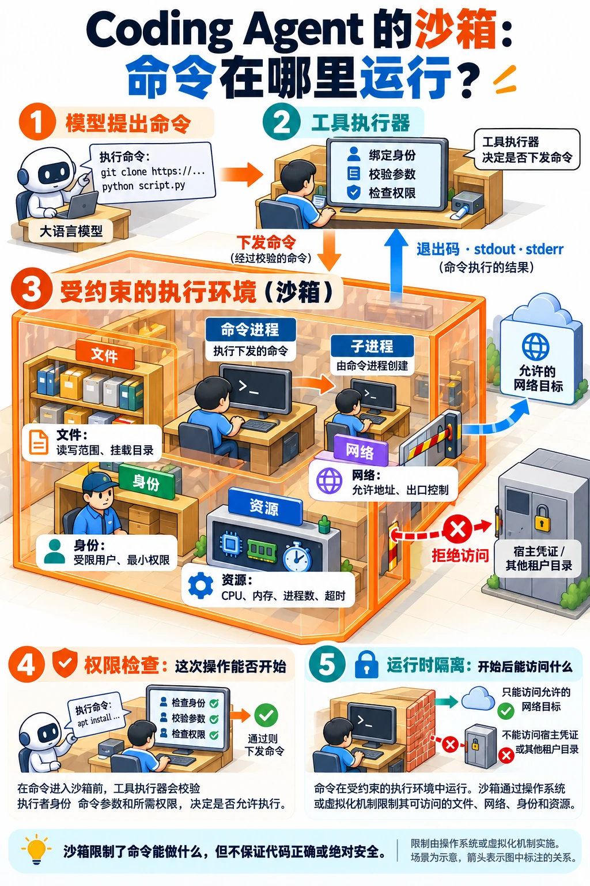

---
{
  "id": "Q-1634",
  "title": "Coding Agent 的沙箱机制如何工作？",
  "category": "ai_engineering",
  "topic": "安全、权限与人工介入",
  "type": "原理机制",
  "level": "进阶",
  "priority": "按岗位选读",
  "focus": "系统隔离与执行权限。执行进程受文件、网络、权限和资源边界约束，调用前验授权，系统隔离在模型判断错误时仍生效。",
  "answerStatus": "ready",
  "updatedAt": "2026-10-18"
}
---

## 核心回答

Coding Agent 的沙箱，是给**实际执行代码和命令的进程**设定文件、网络、权限和资源边界。模型可以提出操作，工具执行器先检查权限，再把命令放入受约束的环境；操作系统或虚拟化机制在运行期间实施限制，子进程也应处于相应边界内。

例如让 Agent 修复仓库并运行测试，可以只开放项目目录和必要临时空间，限制访问凭证、其他项目及不需要的网络地址，同时限制 CPU、内存、进程数和执行时间。测试产生的结果再返回给 Agent，供它决定下一步。

具体可用本地系统沙箱、受加固的容器、gVisor 或 microVM，取决于是否执行不可信代码、是否多人共用及兼容性要求。**切换工作目录、写提示词或弹一次确认，都不能代替执行隔离**；沙箱也不保证代码正确，更不能撤销已经完成的外部业务操作。

从一次命令执行看沙箱怎样起作用：执行器先核对身份、参数和权限，再在受限环境里启动进程。图中分别标出文件、网络、身份与资源限制，以及执行结果的返回路径。

## 展开说明

### 1. 从命令请求到受限进程

工具执行器接收命令、工作区和超时等参数，把它们与可信的用户身份、任务和权限配置关联。允许执行后，环境仅挂载所需文件，使用受限身份，控制网络出口，再启动进程并收集退出码、标准输出和错误输出。取消或超时时，需要处理进程及其后代，不能只让上层不再等待。

需要分别控制读和写：只限制写入项目目录，仍可能让代码读到宿主凭证。环境变量、挂载目录、容器管理接口和本地服务也都是实际能力，不能仅检查文件名。资源限制则防止死循环或大量子进程耗尽机器，它与数据访问隔离承担不同职责。

把目录命名为 session、给每个 Agent 创建不同文件夹，主要解决文件组织。只要进程仍能访问其他路径或网络，这些文件夹就不是安全边界；同样，给子 Agent 分开消息历史也不能隔离其代码执行。

### 2. Docker、gVisor 和 microVM 有什么不同？

普通 Linux 容器通常通过 namespaces 隔离进程、挂载和网络视图，结合 cgroups 限制资源，并使用 capabilities、seccomp 等缩小权限。容器仍共享宿主内核，过宽挂载、特权配置或 Docker socket 都可能破坏预期边界。

gVisor 在工作负载与宿主之间增加用户态应用内核 Sentry，处理许多原本由宿主内核处理的系统调用，再以受限方式访问宿主。它可通过 `runsc` 接入容器生态；由于要实现相应系统接口，需要验证工具链兼容性与性能。

microVM 则提供虚拟机边界和独立客体内核，并精简传统虚拟机的设备与功能。以 Firecracker 为例，它基于 KVM 创建轻量虚拟机。它与容器不是只能二选一：容器工具链也可以与更强的执行隔离组合。选型仍需结合启动、资源、存储、调试和运维成本，不能仅按名称给出所有场景的安全排名。

### 3. Claude Code 的本地沙箱怎样理解？

按当前官方文档，其内置命令沙箱在 macOS 使用 Seatbelt，在 Linux 和 WSL2 使用 bubblewrap，约束命令及其子进程的文件和网络访问。权限规则决定某次工具调用能否开始，系统沙箱限制进程开始后能访问什么，两者配合使用。

这里要注意覆盖范围：内置命令沙箱不自动把 Read、Edit、MCP Server、Hooks 等全部工具进程包在同一边界里。默认读权限、继承环境变量以及排除命令、脱离沙箱重试等设置，也会影响实际保护范围。部署时应核对生效配置和不可用时的行为；若要统一隔离整个 Agent 进程及其辅助工具，可以再使用外层容器或虚拟机。

### 4. 多人 SaaS 还需要管理环境生命周期

按租户、项目和任务分配执行环境，避免不同用户共享可写文件、凭证或残留进程。环境可以按需要预热和复用，但复用前要确认身份、挂载、数据清理与权限重新绑定，不能把上一位用户的工作空间直接交给下一位。

环境管理还应区分沙箱实例与里面的容器或任务进程：沙箱负责隔离和资源范围，任务管理负责具体进程的启动、退出与清理。进程结束不一定等于整个沙箱已回收。

正式代码和需要保留的产物应进入独立的持久存储或版本系统，临时磁盘只承担运行过程。任务结束后终止进程、回收环境、撤销临时凭证；实例销毁与用户文件删除应有各自明确的规则。

验证时，除了正常构建，还要检查越界读写、符号链接、禁止网络、子进程、资源耗尽及环境复用后的数据残留。安装依赖和运行仓库测试本身可能执行代码，也应处于设定边界内。

## 常见追问

### 只用 Docker 就够了吗？

取决于任务风险和配置。受限用户、最小挂载与权限、网络和资源限制，是容器方案的重要部分。面对多人上传的不可信代码，还应评估共享内核的风险，决定是否增加 gVisor 或 microVM，并验证兼容性；“用了 Docker”本身没有说明实际开放了哪些能力。

### 用户批准了一条命令，就能放开沙箱吗？

批准表示同意某个操作，沙箱限制该操作的实际影响范围。若确实需要额外目录或网络能力，应明确授权范围；无差别改为宿主全权限会改变整个执行边界。

### 会话目录和沙箱在项目里有什么区别？

会话目录便于归档上传文件和产物，沙箱约束进程能够访问的资源。研搜参考实现使用会话目录和路径解析组织文件；扩展到不可信代码执行时，还需要在执行环境补上文件、网络、身份和资源限制。

## 参考资料

- 国内：[JavaGuide：Harness Engineering](https://github.com/Snailclimb/JavaGuide/blob/50f02a5984c062fe7221629d0a6a40ec15c26fd7/docs/ai/agent/harness-engineering.md)：借鉴命令环境、文件系统与沙箱的职责划分，说明正文中执行约束为何由运行环境实施。
- 国内：[zero2Agent：Agent 文件访问边界](https://github.com/ranxi2001/zero2Agent/blob/0c0eb7693105d281b146bb98f3a7f30da6f1ceea/learn-agent-interview/16-agent-infra/index.md)：依据受限身份、目录授权与越界验证，解释正文中会话目录组织和操作系统隔离的区别。
- 国内：[WeThinkIn：编码 Agent 与 AgentOS](https://github.com/WeThinkIn/AIGC-Interview-Book/blob/275fdf1eeb65e3b233081d3b8e74ff5d8eeb2e03/AI%20Agent%E5%9F%BA%E7%A1%80/02_%E7%BC%96%E7%A0%81Agent%E4%B8%8EAgentOS%E5%B7%A5%E7%A8%8B%E9%AB%98%E9%A2%91%E8%80%83%E7%82%B9.md)：借鉴 Workspace、挂载范围与外部副作用的区分，补充正文中多租户任务环境的授权及复用边界。
- 国外：[Anthropic：命令沙箱](https://code.claude.com/docs/en/sandboxing)：依据官方沙箱实现与工具覆盖范围，说明正文中 Claude Code 的 Seatbelt、bubblewrap、子进程及未覆盖工具。
- 国外：[gVisor：隔离架构](https://gvisor.dev/docs/architecture_guide/intro/)：对照宿主内核、用户态应用内核和虚拟化，说明 gVisor 的机制与兼容性边界。
- 国内：[阿里云：安全沙箱概述](https://www.alibabacloud.com/help/zh/ack/ack-managed-and-ack-dedicated/user-guide/overview-10/)：参考共享宿主内核与独立客体内核的比较，说明正文中容器、虚拟机及多租户隔离的选择条件。
- 国内：[华为云：Kuasar 架构](https://bbs.huaweicloud.com/blogs/399344)：借鉴 Sandboxer 与 Task 的职责，说明正文中沙箱实例和内部容器进程的生命周期分工。
- 国外：[Docker Engine 安全](https://docs.docker.com/engine/security/)：依据 namespaces、cgroups、capabilities 与宿主挂载的机制，解释正文中容器实际边界为何取决于配置。
- 国外：[Firecracker 工作机制](https://firecracker-microvm.github.io/)：依据 Firecracker 基于 KVM 的实现，说明正文中 microVM 的客体内核、精简设备及与容器工具链的组合。
