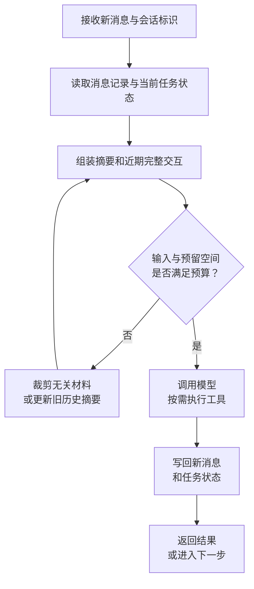

---
{
  "id": "Q-17827",
  "title": "Agent 的短期记忆如何实现，怎样管理消息窗口与摘要？",
  "category": "agent",
  "topic": "记忆系统",
  "type": "方案设计",
  "level": "进阶",
  "priority": "按岗位选读",
  "focus": "会话状态与输入预算。说明消息保存、窗口选择及摘要触发方式，保留任务约束和完整交互关系，并验证压缩后可以继续执行。",
  "answerStatus": "ready",
  "updatedAt": "2026-11-18"
}
---

> 在面栈阅读：[Agent 的短期记忆如何实现，怎样管理消息窗口与摘要？](https://mianstack.com/question/q-17827)

## 核心回答

Agent 的短期记忆由应用维护，通常是**当前会话的消息、任务状态和阶段摘要**。每次调用前，系统按会话标识读取这些状态，选择本轮需要的历史与资料组成模型输入；调用结束后，再写回回复、工具结果和状态变化。

长对话可以采用“任务状态＋旧历史摘要＋近期完整交互”的组合。窗口按 token 预算选择，不只按轮数；摘要在预算接近阈值或阶段结束时更新，保留当前目标、有效约束、已完成与待完成事项，以及原文位置。原始历史独立保存，摘要不能替代完整记录。

例如售后对话中，用户把收货地址从 A 改为 B，摘要要保留最新地址及确认状态；如果退货工具仍未返回，就继续记录“待处理”，不能写成“已经退货”。

## 一轮交互怎样读写？

下面是常见设计，存储和模型窗口是两个不同边界。

工具返回后如果还要再次调用模型，就重新检查预算；单条巨大工具结果应先限制返回范围或外置，避免只压旧历史仍然超限。

## 消息、摘要和状态分别存什么？

- **消息记录**保留角色、内容、消息 ID、顺序、时间和工具调用关联，附件与大结果可以使用受控引用。按用户、会话和权限隔离。
- **任务状态**记录仍生效的目标、输入条件、待办、已确认事实及执行状态。订单是否真正提交，应由工具或业务存储确认。
- **摘要**压缩较早的交流与已结束过程，标明覆盖到哪条消息、版本和原文位置。
- **近期窗口**保留当前讨论的原始表达和完整工具交互。需要精确引用的金额、日期或确认内容，另存结构化值或及时回读。

用户偏好可来自长期记忆，但只注入当前相关且有效的部分；本轮更正应更新适用状态，不能把旧偏好和新要求无差别拼在一起。

## 窗口大小与摘要触发怎样设置？

先核对目标模型的窗口与输入、输出限制，再扣除系统规则、工具定义、当前问题、预留输出和余量，剩下的才是历史与证据预算。近期消息占多少，用任务回放决定；“最后两三轮”只是一个起点，一轮可能包含多次工具调用或很长结果。

触发摘要的阈值与摘要后的目标大小要分开。若只压到刚好低于阈值，下一步又会触发；应为预期工具返回留出空间。摘要请求本身也需要满足摘要模型的输入限制，大段旧历史可分区或分批处理。

`LangChain` 提供消息裁剪与 `SummarizationMiddleware` 等机制；`LangGraph` 的检查点可以保存线程状态。检查点不扩大上下文，进程内的 `InMemorySaver` 也不等于服务重启后可恢复的持久存储。

## 摘要如何更新才不会漏消息？

维护摘要版本和 `summarized_through_message_id`，选择尚未覆盖且已经结束的区间生成候选摘要。检查关键约束、事实更正和待办状态后，将摘要内容与覆盖水位一起提交；同会话并发更新可以串行化或采用版本比较，避免旧任务覆盖新摘要。

保留近期工具交互时，要按目标接口要求保留调用、返回及关联 ID，不能只留下一个孤立工具结果。尚未完成的调用留在状态中，不能随旧对话一起总结成完成。

## 怎样验证短期记忆有效？

让同一批任务跨越多次窗口切换，检查初始约束、中途更正、久远数字、工具失败及未完成动作能否延续；同时测试会话隔离、重试重复写入与恢复。质量达标后，再比较输入token、摘要调用、回读次数和总延迟。

## 对应教程

- [16-记忆与对话历史（含Redis基础）](https://github.com/didilili/ai-agents-from-zero/blob/96e115d510c76cec7e22598fe6f0449e99b344fd/16-%E8%AE%B0%E5%BF%86%E4%B8%8E%E5%AF%B9%E8%AF%9D%E5%8E%86%E5%8F%B2%EF%BC%88%E5%90%ABRedis%E5%9F%BA%E7%A1%80%EF%BC%89.md)：回看按会话读历史、注入消息和写回的链路；本文进一步组织窗口、摘要与原文存档。
- [7-中间件机制与Skills配置](https://github.com/didilili/ai-agents-from-zero/blob/96e115d510c76cec7e22598fe6f0449e99b344fd/%E5%AE%9E%E6%88%98%E9%A1%B9%E7%9B%AE-%E6%B7%B1%E5%BA%A6%E7%A0%94%E6%90%9C/7-%E4%B8%AD%E9%97%B4%E4%BB%B6%E6%9C%BA%E5%88%B6%E4%B8%8ESkills%E9%85%8D%E7%BD%AE.md)：回看摘要中间件在模型调用前的作用，以及摘要触发与近期消息保留的配置。

## 参考资料

- 国内：[Guide / JavaGuide：AI Agent 记忆系统](https://github.com/Snailclimb/JavaGuide/blob/50f02a5984c062fe7221629d0a6a40ec15c26fd7/docs/ai/agent/agent-memory.md)：采用短期状态、长期存储以及缩减、卸载、隔离的划分，解释消息保存与本轮模型输入的不同职责。
- 国内：[Guide / JavaGuide：上下文工程是什么](https://github.com/Snailclimb/JavaGuide/blob/50f02a5984c062fe7221629d0a6a40ec15c26fd7/docs/ai/agent/context-engineering.md)：采用预算、按需加载和任务质量评估的方法，说明何时保留原文、何时压缩以及怎样验证取舍。
- 国内：[WeThinkIn：Agent记忆与上下文工程高频考点](https://github.com/WeThinkIn/AIGC-Interview-Book/blob/275fdf1eeb65e3b233081d3b8e74ff5d8eeb2e03/AI%20Agent%E5%9F%BA%E7%A1%80/05_Agent%E8%AE%B0%E5%BF%86%E4%B8%8E%E4%B8%8A%E4%B8%8B%E6%96%87%E5%B7%A5%E7%A8%8B%E9%AB%98%E9%A2%91%E8%80%83%E7%82%B9.md)：采用完整交互单元、摘要覆盖区间与更正处理，说明窗口边界、摘要更新和状态连续性。
- 国内：[Datawhale：第九章 上下文工程](https://github.com/datawhalechina/hello-agents/blob/36f583c233ea5cee4537ef93455702b55053af18/docs/chapter9/%E7%AC%AC%E4%B9%9D%E7%AB%A0%20%E4%B8%8A%E4%B8%8B%E6%96%87%E5%B7%A5%E7%A8%8B.md)：对照ContextBuilder的分区、预算和字符裁剪实现，解释按token管理输入及结构完整不等于语义完整。
- 国外：[Anthropic：Effective context engineering for AI agents](https://www.anthropic.com/research/effective-context-engineering-for-ai-agents)：采用压缩、结构化笔记和按需回读的机制，说明长任务怎样保留决策与未完成事项。
- 国外：[LangChain：Short-term memory](https://docs.langchain.com/oss/python/langchain/short-term-memory)：依据短期状态、消息裁剪与摘要机制，说明摘要替换旧消息和近期工具交互应保持有效结构。
