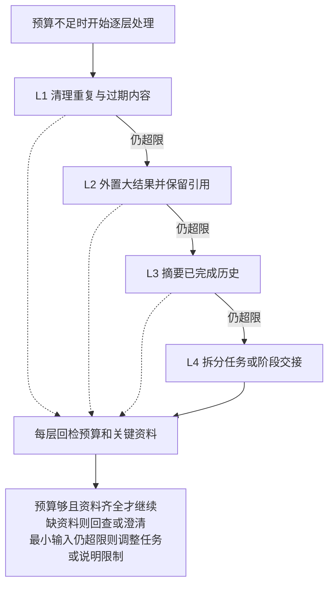

---
{
  "id": "Q-2061",
  "title": "项目四层上下文压缩各层逻辑是什么，分别解决哪些问题？",
  "category": "agent",
  "topic": "上下文工程",
  "type": "项目深挖",
  "level": "进阶",
  "priority": "进阶补充",
  "focus": "分层触发与信息保留。按项目实际实现，逐层说明触发条件、裁剪内容、保留信息及下一层输入，再用工具结果外置或历史摘要说明处理过程。",
  "contextTags": ["项目语境"],
  "answerStatus": "ready",
  "updatedAt": "2026-11-04"
}
---

> 在面栈阅读：[项目四层上下文压缩各层逻辑是什么，分别解决哪些问题？](https://mianstack.com/question/q-2061)

## 核心回答

四层压缩需要按项目实际实现说明，`L1`～`L4` 没有统一标准。下面以一个按处理代价递进的 Coding Agent 设计为例：**先清理冗余，再外置大结果，再压缩历史，最后在任务边界重建上下文**。

1. **L1 冗余清理**：去掉重复检索、已被新版本替代的文件内容和无用日志，减少没有信息增量的输入。
2. **L2 大结果外置**：完整文件和长工具输出保存到外部，只保留关键片段、执行状态和可回查位置。
3. **L3 历史摘要**：把已完成步骤整理成目标、约束、决定、证据和未完成事项，保留近期必要原文。
4. **L4 任务交接**：单一窗口已不适合继续时，按子任务或阶段重建上下文，交接状态和产物，再按需读取细节。

每层处理后重新计算预算，够用就停止升级。硬约束、实际执行状态和未完成工具调用的配对关系要保住，不能为了压短而把任务含义改掉。

## 一次代码排障怎样经过四层

假设 Agent 已读多个文件并运行多次测试，接下来还要定位失败原因：

| 层级 | 具体处理                                       | 释放什么                   | 仍需保留什么                           |
| ---- | ---------------------------------------------- | -------------------------- | -------------------------------------- |
| L1   | 合并重复文件读取，保留当前有效版本             | 重复与过期片段             | 版本位置、当前失败与相关代码           |
| L2   | 测试完整日志落盘，只带失败摘要及位置           | 大段中间输出               | 运行命令、退出状态、失败用例和日志引用 |
| L3   | 汇总已排除原因、改动和待验证假设               | 旧步骤的冗长叙述           | 用户约束、结论依据、未完成项           |
| L4   | 将单个模块修复交给独立子任务，或在阶段边界续接 | 主任务中不再需要的探索细节 | 交付目标、相关文件版本、产物与验收条件 |

这里的L1、L2是减少活跃输入，不等于删除原始轨迹。摘要也有损，不能让它成为唯一证据。例如“所有测试通过”不能概括掉“只运行了其中一个测试文件”。

下图看的是升级条件：实线表示仍超限时继续处理，虚线表示每层都要回检，预算够用就停止升级。

如果连最小任务说明、必要工具定义和当前证据都放不下，应缩小子任务、改用更适合的窗口或明确当前限制，不能无上限地反复摘要。

## 触发条件与保留契约

触发依据是目标模型允许的输入、输出预留和下一步可能返回的资料大小，不能把某个固定百分比当作所有模型的标准。摘要调用本身也需要空间，应在请求已经无法发出之前安排处理。

压缩前后重点对照：当前目标、禁止事项、资源与时间范围、已发生外部操作、未确认结果、文件版本和证据位置。工具调用和结果必须形成合法的消息序列；对仍在等待的调用，不能只保留结果或只保留一个失去关联的ID。

`Checkpointer` 保存执行状态快照；完整原始日志、文件和工具大结果按需另存，保留可回查位置。活跃上下文只取当前任务需要的信息。压缩失败时可回退到先前记录重新组装；这不等于撤销已经发生的外部操作。

## 常见追问

**四层是不是比一层摘要更好？**

不一定。任务短、结果小时，一层简单处理就可能足够。分层的意义是先采用损失较小、成本较低的手段，并能定位哪次处理丢了信息；是否值得增加复杂度，要看相同任务上的完成率、约束保留、延迟与成本。

**怎样证明压缩有效？**

保留同一任务的原始轨迹和各层输入输出，检查关键事实能否回查，再比较完成结果。要加入早期否定条件、用户修正、长日志和未完成调用等样本；Token下降只是资源收益，不能代替结果正确。

## 对应教程

- [25-LangGraph高级特性：§2.1、2.4～2.7](https://github.com/didilili/ai-agents-from-zero/blob/c05fb5979cf0aa3b6b4ed8c29f450f640fb9c18f/25-LangGraph%E9%AB%98%E7%BA%A7%E7%89%B9%E6%80%A7.md)：回看状态快照与历史记录，理解压缩不等于删除执行事实。
- [16-记忆与对话历史（含Redis基础）：§1.1～1.3](https://github.com/didilili/ai-agents-from-zero/blob/c05fb5979cf0aa3b6b4ed8c29f450f640fb9c18f/16-%E8%AE%B0%E5%BF%86%E4%B8%8E%E5%AF%B9%E8%AF%9D%E5%8E%86%E5%8F%B2%EF%BC%88%E5%90%ABRedis%E5%9F%BA%E7%A1%80%EF%BC%89.md)：理解每轮模型只获得程序实际组装的输入。

## 参考资料

- 国内：[JavaGuide：上下文工程](https://github.com/Snailclimb/JavaGuide/blob/50f02a5984c062fe7221629d0a6a40ec15c26fd7/docs/ai/agent/context-engineering.md)：借鉴输入筛选、上下文卸载与长任务交接的职责划分，组织递进式处理示例。
- 国内：[WeThinkIn：记忆与上下文工程](https://github.com/WeThinkIn/AIGC-Interview-Book/blob/275fdf1eeb65e3b233081d3b8e74ff5d8eeb2e03/AI%20Agent%E5%9F%BA%E7%A1%80/05_Agent%E8%AE%B0%E5%BF%86%E4%B8%8E%E4%B8%8A%E4%B8%8B%E6%96%87%E5%B7%A5%E7%A8%8B%E9%AB%98%E9%A2%91%E8%80%83%E7%82%B9.md)：参考约束、未完成动作和证据引用的保留要求，制定压缩前后核对项。
- 国内：[Datawhale：ContextBuilder上下文构建](https://github.com/datawhalechina/hello-agents/blob/36f583c233ea5cee4537ef93455702b55053af18/docs/chapter9/%E7%AC%AC%E4%B9%9D%E7%AB%A0%20%E4%B8%8A%E4%B8%8B%E6%96%87%E5%B7%A5%E7%A8%8B.md)：采用原创GSSC实践中先汇集选择、再组装压缩的处理顺序，解释逐层重新核算输入。
- 国内：[zero2Agent：记忆与上下文](https://github.com/ranxi2001/zero2Agent/blob/0c0eb7693105d281b146bb98f3a7f30da6f1ceea/learn-agent-interview/04-memory-context/index.md)：参考摘要、子任务、结果外置及按需回溯的组合方式，形成代码排障的四类处理。
- 国外：[Anthropic：Effective context engineering for AI agents](https://www.anthropic.com/engineering/effective-context-engineering-for-ai-agents)：借鉴compaction、结构化笔记和子代理隔离的取舍，解释摘要有损与任务边界重建。
- 国外：[LangGraph：Checkpointers](https://docs.langchain.com/oss/python/langgraph/checkpointers)：依据检查点和执行快照说明，区分原始执行记录、活跃上下文及外部副作用。
