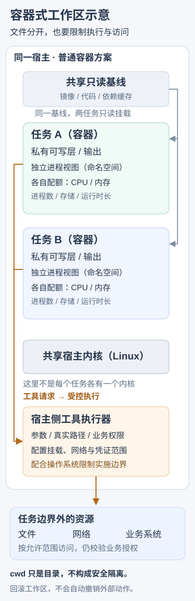

---
{
  "id": "Q-2067",
  "title": "Agent 沙箱工作区如何设计和实现？",
  "category": "ai_engineering",
  "topic": "安全、权限与人工介入",
  "type": "系统设计",
  "level": "进阶",
  "priority": "按岗位选读",
  "focus": "工作区初始化与执行隔离。用户/任务独立工作区和执行账号，从指定版本初始化，工具限制文件网络资源，结束保产物再回收。",
  "answerStatus": "ready",
  "updatedAt": "2026-10-19"
}
---

> 在面栈阅读：[Agent 沙箱工作区如何设计和实现？](https://mianstack.com/question/q-2067)

## 核心回答

Agent沙箱工作区要同时解决**任务文件放在哪里、代码在什么环境执行、允许访问哪些资源，以及结束后怎样保留产物和回收环境**。可以按用户和任务建立独立工作区，从指定代码版本或输入快照初始化，在受限执行环境中运行工具，把任务状态与最终产物保存到可恢复的位置。

目录负责组织文件，沙箱负责限制进程和资源。只给每个Agent换一个工作目录，并不能阻止它读取其他目录、访问网络或启动宿主机命令；这些边界要由工具执行器和操作系统隔离共同实施。

## 从一个任务的生命周期设计

创建任务时记录用户、任务ID、代码版本、输入文件、运行镜像和资源配置，准备独立的可写层或存储卷。共享依赖可以复用只读缓存，用户输入、临时文件和输出目录则按任务隔离，避免两个任务互相覆盖。

工具执行器根据任务ID找到对应环境，传递受控参数、工作目录和短期凭证，记录命令结果、退出状态与资源消耗。任务调度状态存放在可靠状态库，不能只依赖容器里的聊天记录；容器退出后仍能知道任务是否完成、哪些产物已经确认。

结束时先检查产物，再按策略保存文件、日志和版本信息，最后回收进程、挂载、临时凭证及执行环境。超时、取消和异常退出也走清理路径。长任务可以保存检查点，但恢复前仍需确认输入版本和已发生的外部动作。

## 隔离具体怎样实现

文件访问只挂载任务所需目录，源数据可只读，输出目录可写；路径校验考虑规范化、符号链接和挂载语义。不要把宿主机根目录、容器管理socket或整套长期密钥交给任务。

进程与网络通过命名空间及相应策略限制，CPU、内存、进程数、存储和运行时长设置配额。网络访问按任务需要开放目标和服务身份，访问外部业务系统时继续校验用户权限；容器里的请求也不能天然越过业务授权。

普通容器共享宿主内核，适合环境复现和基本隔离，但隔离强度仍取决于配置。运行不可信代码、面对多租户攻击时，可评估gVisor或微虚机等方案，同时验证系统调用兼容性、启动耗时和运维成本。不是每项任务都需要最重隔离，也不能把容器名称当作安全保证。

以两个容器任务为例，区分文件布局、进程隔离与外部访问控制：

这是一种容器部署示意。宿主工具执行器与操作系统共同限制资源，图不表示每个系统调用都由工具执行器转发；外部业务动作也不会随工作区回滚。

## 多个Agent怎样共享产物

同一任务可以共享一个只读基线，由各执行者写独立分支或目录，最后由明确的归并者处理结果。需要并发修改同一文件时，应有版本检查、锁或冲突合并策略；共享盘只提供存储，不自动解决并发覆盖。

文件系统抽象可以把本地磁盘、对象存储和远端环境统一为读写接口，但仍要定义原子写、版本和权限。对象存储的重命名、目录和一致性语义可能与本地文件系统不同，不能只换一个路径就假定行为完全一致。

## 常见追问

**沙箱快照能撤销所有操作吗？** 可以恢复相应文件或环境状态，但发信、退款等外部动作不会随工作区回滚。它们需要幂等记录、状态查询或明确的补偿流程。

**怎样验证这套设计？** 分别检查正常任务、越界路径、软链接、任务间读写、资源超限、断线恢复和异常清理；同时测量环境就绪时间、执行耗时与产物恢复成功率，区分启动优化和隔离有效性。

## 对应教程

- [第8章：Docker快速入门与Dify部署排障](https://github.com/didilili/ai-agents-from-zero/blob/c05fb5979cf0aa3b6b4ed8c29f450f640fb9c18f/8-Docker快速入门与Dify部署排障.md)：§1.2–1.3说明容器的可复现性与共享内核特点；本文在此基础上展开任务工作区、权限和生命周期设计。

## 参考资料

- 国内：[Harness工程中的执行环境](https://github.com/Snailclimb/JavaGuide/blob/50f02a5984c062fe7221629d0a6a40ec15c26fd7/docs/ai/agent/harness-engineering.md)：借鉴执行环境与文件系统的职责，说明正文中模型动作如何接到工作区、可靠任务状态与沙箱约束。
- 国内：[Agent文件系统边界与隔离](https://github.com/ranxi2001/zero2Agent/blob/0c0eb7693105d281b146bb98f3a7f30da6f1ceea/learn-agent-interview/16-agent-infra/index.md)：文件系统访问边界一节解释工作目录为何不是安全边界，以及路径穿越、符号链接、挂载和并发任务需要怎样验证。
- 国内：[Workspace与抽象文件系统](https://github.com/WeThinkIn/AIGC-Interview-Book/blob/275fdf1eeb65e3b233081d3b8e74ff5d8eeb2e03/AI%20Agent%E5%9F%BA%E7%A1%80/02_%E7%BC%96%E7%A0%81Agent%E4%B8%8EAgentOS%E5%B7%A5%E7%A8%8B%E9%AB%98%E9%A2%91%E8%80%83%E7%82%B9.md)：Workspace与抽象文件系统部分说明文件、产物、配置和远端存储的分工，并提醒文件回滚不能撤销外部业务写入。
- 国外：[Docker Engine security](https://docs.docker.com/engine/security/)：依据 namespaces、cgroups、挂载与 capabilities 的机制，说明正文中进程可见范围、资源配额和宿主访问限制。
- 国外：[Introduction to gVisor security](https://gvisor.dev/docs/architecture_guide/intro/)：参考 Sentry 应用内核与保护范围，解释正文中普通容器与更强隔离方案的取舍条件。
