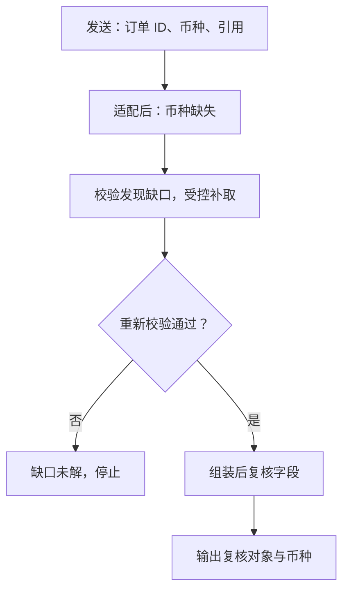

---
{
  "id": "Q-2299",
  "title": "如何解决 Agent 之间上下文丢失？",
  "category": "agent",
  "topic": "多 Agent 编排与协作",
  "type": "方案设计",
  "level": "进阶",
  "priority": "进阶补充",
  "focus": "必要事实交接与原文回查。交接目标、硬约束、输入版本和证据引用，关键事实结构化，大材料可回查，接收方核缺项再执行。",
  "answerStatus": "ready",
  "updatedAt": "2026-10-19"
}
---

> 在面栈阅读：[如何解决 Agent 之间上下文丢失？](https://mianstack.com/question/q-2299)

## 核心回答

解决Agent之间上下文丢失，关键是**明确交接契约，把关键事实结构化，把长材料保留为可回查产物**。不能只传一段自由摘要，也不宜把所有Agent的完整历史互相复制。

派发时传子目标、必要约束、输入字段、上游证据和预期输出；返回时传结果、证据引用、未解决项和状态。编排层校验必需字段与版本，再推进下游。会话状态、任务状态和大文件分别保存，恢复时按同一任务标识重新加载。

## 先判断丢在了哪里

可以比较发送前、接收后、上下文组装后和模型输出四个位置：消息本来就没带订单ID，是任务构造问题；消息带了但Schema转换漏掉，是适配问题；字段存在却被裁剪，是上下文预算问题；信息完整但结论忽略它，才进一步看模型理解。

追踪时保留`task_id`、`parent_task_id`、消息ID、输入输出版本及产物引用，不需要复制全部敏感业务数据。这样能够定位哪次交接、哪个字段开始缺失。

以适配器漏传币种为例，沿着交接过程定位缺口：

补取沿用接收方已有访问权限，并设重试上限；补取后仍缺失就报告具体缺口。图只展示适配漏字段，其他丢失位置仍按上文逐站检查。

## 摘要如何不漏关键字段

以订单诊断为例，订单ID、币种、时间范围、状态和用户约束直接作为必填字段传递；分析过程压成摘要，完整订单列表保存到受控存储，用产物引用和分页读取。下游需要重新核查时读取原始记录，避免摘要成为唯一证据。

接收方校验格式、必填字段和业务一致性，例如退款金额是否与币种、订单对应。字段缺失时返回具体缺口，补取源数据或重新派发；重复生成一段更长摘要不能可靠修复缺失。

## 共享状态与独立上下文如何并存

每个Agent保留自己的工具轨迹，跨角色只共享协作必要字段。多个分支分别写自己的结果槽，再由归并节点生成最终状态，避免互相覆盖；异步消息通过版本号、幂等键和确认机制处理过期、乱序与重投。

`LangGraph`可以用`checkpointer`保存`thread`范围内的图状态，`Store`保存应用定义的跨`thread`数据。子图有自己的状态边界，必要时显式映射输入输出；不是接入`checkpointer`后所有Agent就自动共享上下文。内存保存器在进程重启后也无法恢复。

## 常见追问

**共享越多越安全吗？** 不是。完整广播会增加干扰、成本和串会话风险；按角色提供最小充分信息，并保留授权回查路径，通常更容易定位和修复交接问题。

## 对应教程

- [26-LangGraph多智能体与A2A](https://github.com/didilili/ai-agents-from-zero/blob/c05fb5979cf0aa3b6b4ed8c29f450f640fb9c18f/26-LangGraph%E5%A4%9A%E6%99%BA%E8%83%BD%E4%BD%93%E4%B8%8EA2A.md)：回看角色上下文隔离与共享边界。
- [实战项目-深度研搜/1-DeepAgents基础与核心概念](https://github.com/didilili/ai-agents-from-zero/blob/c05fb5979cf0aa3b6b4ed8c29f450f640fb9c18f/%E5%AE%9E%E6%88%98%E9%A1%B9%E7%9B%AE-%E6%B7%B1%E5%BA%A6%E7%A0%94%E6%90%9C/1-DeepAgents%E5%9F%BA%E7%A1%80%E4%B8%8E%E6%A0%B8%E5%BF%83%E6%A6%82%E5%BF%B5.md)：回看子智能体交付摘要与文件工作区。

## 参考资料

- 国内：[JavaGuide：多Agent协作系统设计](https://github.com/Snailclimb/JavaGuide/blob/50f02a5984c062fe7221629d0a6a40ec15c26fd7/docs/ai/agent/multi-agent.md)：采用任务契约与 RoleResult 的设计，说明正文中结果、证据、缺失项和产物引用如何交接。
- 国内：[zero2Agent：多Agent通信与共享状态](https://github.com/ranxi2001/zero2Agent/blob/0c0eb7693105d281b146bb98f3a7f30da6f1ceea/learn-agent-interview/06-multi-agent-collab/index.md)：依据共享状态的字段归属、任务命名空间与版本机制，说明正文中共享信息如何管理。
- 国内：[WeThinkIn：Agent Harness工程](https://github.com/WeThinkIn/AIGC-Interview-Book/blob/275fdf1eeb65e3b233081d3b8e74ff5d8eeb2e03/AI%20Agent%E5%9F%BA%E7%A1%80/08_Agent_Harness_Engineering%E9%AB%98%E9%A2%91%E8%80%83%E7%82%B9.md)：采用 Task 与 Expected Outcome 的区分，说明正文中交接必需字段和结果校验条件如何定义。
- 国外：[Anthropic：Multi-agent research system](https://www.anthropic.com/engineering/multi-agent-research-system)：借鉴独立上下文的任务边界与摘要回传实践，说明正文中交接应保留的关键信息。
- 国外：[LangGraph：Persistence](https://docs.langchain.com/oss/python/langgraph/persistence)：依据 checkpointer 与 Store 的范围，区分正文中的线程恢复状态和跨 Agent 共享数据。
