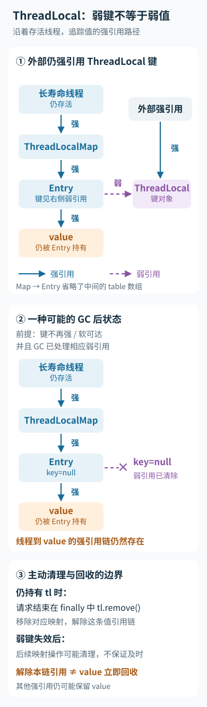

---
{
  "id": "Q-2427",
  "title": "ThreadLocal 是否线程安全，使用时有哪些内存泄漏等风险？",
  "category": "software",
  "topic": "并发与异步编程",
  "type": "原理机制",
  "level": "进阶",
  "priority": "按岗位选读",
  "focus": "线程隔离、共享对象与值清理。ThreadLocal 把变量值放在线程自己的映射中，隔离变量不等于让共享对象线程安全；在线程池中用完后在 finally 调用 remove，避免值长期滞留和串用。",
  "answerStatus": "ready",
  "updatedAt": "2026-10-19"
}
---

> 在面栈阅读：[ThreadLocal 是否线程安全，使用时有哪些内存泄漏等风险？](https://mianstack.com/question/q-2427)

## 核心回答

ThreadLocal 通过**线程隔离**减少共享状态竞争：每个线程在自己的映射中保存该变量的值。它不是锁，也不会把值指向的对象自动变成线程安全；若两个线程存入的是同一个可变对象，仍可能发生数据竞争。

主要风险是线程池复用造成上下文串用、长生命周期线程保留值导致内存滞留，以及异步切换后上下文没有正确传递。请求级数据应在使用结束时清理，通常放在 finally 中执行 remove，并明确异步任务的上下文传播边界。

## 为什么弱引用仍会泄漏

HotSpot常见实现中，Thread 持有 ThreadLocalMap，Entry 的 key 是对 ThreadLocal 的弱引用，value 则被强引用。ThreadLocal 不再被其他地方强引用后，key可能被GC清空，但只要存活线程的映射还保留该Entry，value及其对象图就可能继续占用内存。

映射操作会清理部分失效Entry，但不能依赖未来一定发生某次访问来及时清理。即使ThreadLocal是静态字段、key一直存活，不主动清除请求数据也会长期保留value。线程池工作线程往往长时间不退出，因此风险更明显。

沿着存活线程的引用链看，key 被回收并不会自动切断 value 的强引用：

实线表示强引用，虚线表示弱引用。remove 清理的是当前线程中对应条目的保留路径；value 还有其他引用时，不会因此立即被回收。

## 使用时怎样控制边界

一次请求设置用户、租户或trace信息，正常返回和异常退出都清理；否则下一个请求复用线程时可能读到上一请求的数据，带来隔离问题。嵌套调用还需明确谁拥有清理职责，必要时保存并恢复外层上下文，不能内层随意清掉外层的值。

普通ThreadLocal不会自动跨线程传播。InheritableThreadLocal在创建子线程时继承，不能自然解决线程池每次提交的新上下文；异步框架应在提交、执行及退出时显式捕获、安装和恢复上下文。

## 追问

- **能用它共享计数器吗？** 每线程独立计数可以，但跨线程汇总与一致性需要另外设计。
- **remove 等于关闭资源吗？** 不等于，连接、文件等仍按资源协议关闭；删除一个引用不能代替资源释放。
- **怎样排查？** 查看存活工作线程和ThreadLocalMap保留路径，结合请求切换测试检查残留值，不能只看一次GC后的堆大小。

## 参考资料

- 国内：[一枝花算不算浪漫 / JavaGuide收录：ThreadLocal 详解](https://github.com/Snailclimb/JavaGuide/blob/50f02a5984c062fe7221629d0a6a40ec15c26fd7/docs/java/concurrent/threadlocal.md)：采用线程映射和线程池复用的例子，解释正文中内存滞留、上下文串用与异步传播的不同风险。
- 国内：[JavaGuide / Snailclimb：Java 内存区域详解](https://github.com/Snailclimb/JavaGuide/blob/50f02a5984c062fe7221629d0a6a40ec15c26fd7/docs/java/jvm/memory-area.md)：借鉴运行时内存区域的划分，解释正文中线程存活时 value 对象仍可因引用路径占用堆内存的现象。
- 国内：[Alibaba：TransmittableThreadLocal 2.x：功能与线程池传递](https://github.com/alibaba/transmittable-thread-local/blob/2.x/README.md)：参考线程池任务提交时捕获上下文的说明，解释正文中 InheritableThreadLocal 无法自然传递每次请求新值的原因。
- 国外：[Oracle：ThreadLocal — Java SE21](https://docs.oracle.com/en/java/javase/21/docs/api/java.base/java/lang/ThreadLocal.html)：独立线程副本和remove后的重新初始化约定说明隔离能力与清理职责。
- 国外：[Oracle：WeakReference — Java SE21](https://docs.oracle.com/en/java/javase/21/docs/api/java.base/java/lang/ref/WeakReference.html)：弱引用清除语义说明key可回收不代表value的其他强引用也一起消失。
