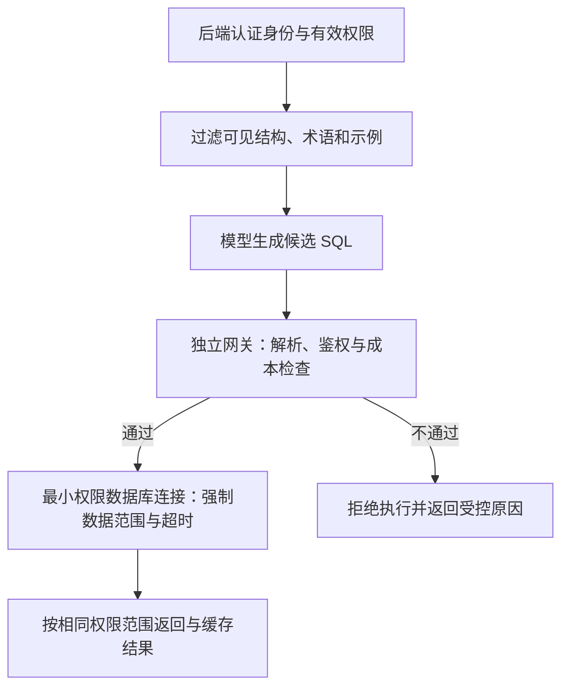

---
{
  "id": "Q-2470",
  "title": "NL2SQL 生成 SQL 时怎样处理角色权限？",
  "category": "rag",
  "topic": "结构化知识与 Text-to-SQL",
  "type": "方案设计",
  "level": "进阶",
  "priority": "按岗位选读",
  "focus": "可见数据范围与 SQL 执行约束。把用户身份映射为允许的库表列和行过滤，生成前提供可见schema，生成后再校验，并由数据库只读账号或行级策略强制执行。",
  "answerStatus": "ready",
  "updatedAt": "2026-10-27"
}
---

> 在面栈阅读：[NL2SQL 生成 SQL 时怎样处理角色权限？](https://mianstack.com/question/q-2470)

## 核心回答

角色权限要由业务后端和数据库执行层决定，不能交给模型自行遵守。**生成前只提供可见元数据，生成后独立校验 `SQL`，执行时继续用最小权限和数据范围策略约束。** 提示词中的“禁止越权”只能帮助模型生成合适语句，不能作为授权检查。

用户身份、租户和角色来自可信登录态。模型返回的 `user_id`、`tenant_id` 或“用户已授权”等文本，不能改变这次查询的权限。

## 三层分别限制什么

**生成前限制可见知识。** 后端把当前身份映射为允许的数据源、表、列和业务范围，再过滤可检索的表结构、示例及字段值。禁止访问的字段即使最终没有查，也不应先被送入模型上下文。业务口径和权限规则分开维护，不能让同义词配置顺带扩大权限。

**生成后检查整个语句。** 按对应数据库方言解析语法树，解析真实表、列及别名关系，覆盖子查询、公共表表达式、集合操作等结构；拒绝无法可靠解析或无法确定权限的查询。不能仅检查开头是 `SELECT`，还要限制多语句、写入、文件导出、锁定查询、危险函数和系统对象等行为。具体允许集合应由执行网关配置。

**数据库继续强制执行。** 使用不具备写入、管理或额外文件权限的账号，只开放所需对象。行级范围可以通过经过验证的查询代理、受控视图或数据库原生策略落实；不能声称加上只读账号就实现了租户隔离。若通过语法树注入范围条件，需验证别名、连接和嵌套查询下的语义，并防止绕过代理直连。

`PostgreSQL` 可采用行级安全策略，但要注意表所有者、超级用户及具有绕过权限的角色可能不受普通策略限制。不能把这一能力直接套称为 `MySQL` 的同名原生功能。

## 从提问到执行的权限链

图中模型只负责生成候选语句，独立网关和数据库继续执行权限约束：

校正后的候选语句也回到网关检查。生成时隐藏字段能减少无关信息暴露，执行时的强制约束负责防止越权，两者不能互相替代。

## 查询后的边界也要守住

查询结果、下载接口、缓存和日志要沿用相同的数据范围。缓存键应包含租户、有效权限范围及相关版本，权限变化时使受影响缓存失效，避免通过共享缓存拿到其他用户结果。

权限用后端策略和拒绝用例验证：跨租户聚合、未授权列出现在过滤或排序中、通过子查询读取敏感表、撤权后命中旧缓存，都应被拦截。单纯让模型回答“我无权访问”不能证明系统已阻断访问。

## 对应教程

- [《21-Agent智能体》](https://github.com/didilili/ai-agents-from-zero/blob/main/21-Agent%E6%99%BA%E8%83%BD%E4%BD%93.md)：第4.8节介绍工具调用前的参数、权限与业务规则守护；本文展开`SQL`对象、行级范围及数据库执行约束。

## 参考资料

- 国内：[阿里云：DMS权限](https://www.alibabacloud.com/help/zh/dms/permissions/)：采用库、表、列、行及查询、导出等权限分层，避免把只读等同于完整授权。
- 国内：[飞致云：配置MySQL数据源](https://www.dataease.cn/sqlbot/v1/user_manual/datasource_mysql.html)：采用专用查询账号的连接方式，说明执行账户需要最小权限。
- 国内：[飞致云：数据源概览](https://www.dataease.cn/sqlbot/v1/user_manual/datasource_description.html)：采用可配置表字段范围，说明生成前的元数据过滤。
- 国内：[阿里云：数据库开发SQL审核](https://www.alibabacloud.com/help/zh/dms/sql-review)：参考解析`SQL`并依据独立规则审查的机制，说明生成后需要再次检查。
- 国外：[PostgreSQL：Row Security Policies (PostgreSQL 18)](https://www.postgresql.org/docs/18/ddl-rowsecurity.html)：核对行级安全的默认拒绝及所有者、超级用户等绕过条件。
- 国外：[OWASP：AI Agent Security Cheat Sheet](https://cheatsheetseries.owasp.org/cheatsheets/AI_Agent_Security_Cheat_Sheet.html)：采用代理外的工具授权、可信身份与最小权限原则，避免模型自报授权。
