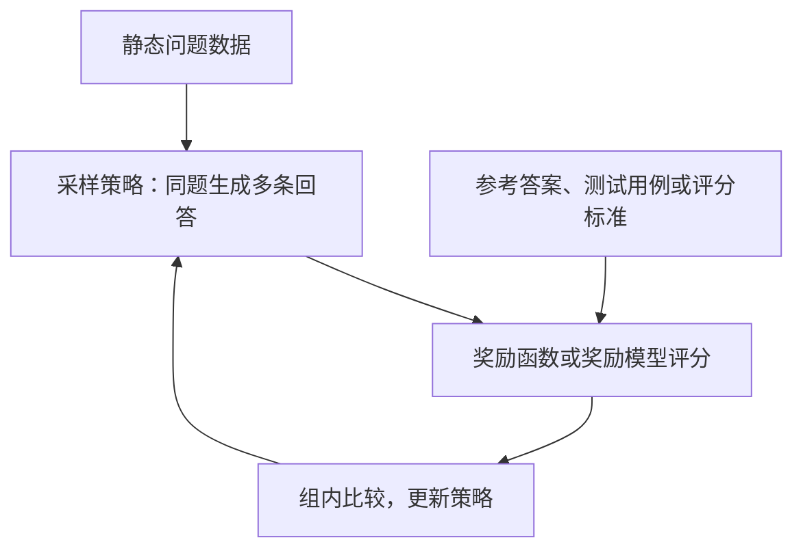

---
{
  "id": "Q-2474",
  "title": "GRPO 训练实际使用什么数据？",
  "category": "training",
  "topic": "强化学习与奖励",
  "type": "项目深挖",
  "level": "进阶",
  "priority": "按岗位选读",
  "focus": "训练问题、在线采样与奖励。训练输入通常是待解问题，策略现场采样多条回答再打分；结合实际任务交代问题来源、奖励规则及是否混入预生成数据。",
  "note": "本题询问实际使用的数据，与数据应如何构造的要求不同。",
  "contextTags": ["项目语境"],
  "answerStatus": "ready",
  "updatedAt": "2026-10-27"
}
---

> 在面栈阅读：[GRPO 训练实际使用什么数据？](https://mianstack.com/question/q-2474)

## 核心回答

`GRPO` 训练要分清三样材料：**待解问题、评价回答的依据，以及训练时由策略生成的回答**。典型在线流程从数据集中取问题，让当前采样策略针对同一问题生成多条回答，按奖励函数或奖励模型打分，再用组内相对表现更新策略。它不等于把一份预先写好的问答全文按 `SFT` 方式反复拟合。

回答自己的项目时，先交代任务与问题来源，再说明筛选和划分、奖励如何计算、是否使用了额外的离线生成数据。数据集名称、样本量和处理规则都应对应实际训练记录。

## 数据中通常需要什么

- **问题或任务输入**：如数学题、代码题、业务请求；有对话时还要说明角色、模板与哪些信息送给模型。
- **奖励所需信息**：可核验答案、测试用例、约束条件或评分标准。它们可以给奖励函数使用，但不代表应把参考答案直接放进模型输入。
- **在线产生的训练样本**：某个策略版本生成的回答及其奖励、长度、完成状态等。策略会变化，因此要能区分静态问题数据和每轮新采样的回答。

例如做代码任务，可以把题意交给模型，在隔离环境用测试检查回答，再把结果转换为奖励；是否覆盖边界、超时和错误实现，取决于测试与评分设计。若评分只看是否输出指定标记，模型可能学会格式而没有学会解题。

下面以典型在线训练说明三样材料怎样分工；参考答案或测试用例用于评分，不应被误当成自动附在题意后的模型输入。

图中循环会不断产生新回答；静态问题集、评分依据和在线回答是不同材料。具体实现还可能记录旧策略概率、参考策略约束等训练信息，这里只展示数据与评分的主线。

## 与 SFT 数据怎样关联

两阶段可以使用有重合的问题，也可以使用不同来源，关键是说明实际设计。`DeepSeekMath` 论文中的强化学习问题选自其数学 `SFT` 数据；`DeepSeek-R1` 则有冷启动、推理强化学习、拒绝采样与后续训练等不同阶段。它们是公开实现例子，不能据此替任何项目指定数据来源。

最后还应说明训练、验证和测试怎样去重，数据难度是否能让组内出现有区分度的奖励，以及业务目标是否能被当前评分可靠衡量。

## 参考资料

- 国内：[DeepSeek：DeepSeekMath，强化学习与讨论章节](https://arxiv.org/html/2402.03300v3)：使用论文4.2节的数学问题来源作为公开例子，并与在线生成回答分开。
- 国内：[DeepSeek：DeepSeek-R1，冷启动、强化学习与实验](https://arxiv.org/html/2501.12948v1)：依据论文2.3节区分冷启动数据、推理训练问题和拒绝采样后的`SFT`数据。
- 国内：[字节跳动与清华等：DAPO](https://arxiv.org/html/2503.14476v2)：采用问题与参考答案配对、在线采样和可验证结果奖励的流程。
- 国内：[ModelScope：ms-swift 3.10 GRPO 文档](https://swift.readthedocs.io/zh-cn/v3.10/Instruction/GRPO/GetStarted/GRPO.html)：借鉴`prompt`、`completion`、`solution`和分项奖励的日志区分。
- 国外：[Hugging Face：TRL GRPO Trainer](https://huggingface.co/docs/trl/grpo_trainer)：依据 `prompt` 与奖励函数额外字段的约定，区分模型输入和评分材料。
- 国外：[Unsloth：Reinforcement Learning Guide](https://unsloth.ai/docs/get-started/reinforcement-learning-rl-guide)：采用验证器检查结果、奖励函数将结果映射为分数的区分。
