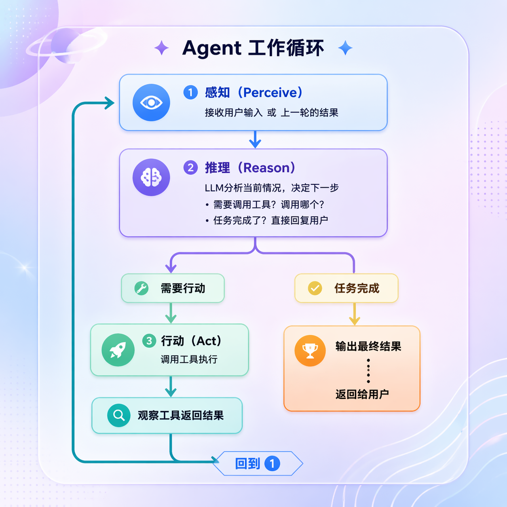

---
{
  "id": "Q-2537",
  "title": "Agent 的基本工作流程是什么？",
  "category": "agent",
  "topic": "工作流、状态与执行恢复",
  "type": "概念解释",
  "level": "基础",
  "priority": "进阶补充",
  "focus": "目标、行动、观察与结束判断。接收目标后规划下一步，调用工具取得观察，再据观察继续或修正；用完成检查决定结束，而非一直生成文本。",
  "answerStatus": "ready",
  "updatedAt": "2026-11-04"
}
---

> 在面栈阅读：[Agent 的基本工作流程是什么？](https://mianstack.com/question/q-2537)

## 核心回答

Agent 的基本流程是：接收目标，组织当前上下文，由模型判断下一步；需要外部信息或操作时提出工具调用，运行程序执行工具并把结果回填；模型再根据新观察继续、调整或结束。

`ReAct` 是常见实现，强调推理、行动和观察交替。模型负责决定“下一步做什么”，宿主或框架负责执行动作、保存状态并驱动下一轮。结束既要看任务完成条件，也要看步数、时间、费用等运行限制；不能一直循环，也不能把一句“完成了”直接当成功。

例如查询“最受欢迎的耳机是否有货”，先搜索并取得产品标识，再查询该产品库存，最后根据两次真实结果回答。第二步依赖第一步得到的标识，不能凭模型猜一个产品名直接查。

## 循环中的状态与反馈

初始上下文至少包括目标、约束、可用工具说明和必要历史。每轮模型可以直接回答、提出工具请求，或者说明缺少关键条件。

工具请求需要有工具名与结构化参数；执行端检查工具是否存在、参数是否有效及操作是否允许，再执行。返回值不只包含业务内容，还应表达成功、失败或尚未确认的状态。

运行程序把工具结果与原请求关联，写入当前状态。下一轮模型据此决定补查、换路线还是结束。`LangChain` 中常见表现是含 `tool_calls` 的 `AIMessage`、对应的 `ToolMessage` 和最终回答；其他框架的消息格式可能不同。即使不显示完整推理文字，这条反馈循环仍然存在。

看图时重点关注左侧回路：工具结果会成为下一轮判断的依据。

图源：[AI Agents from Zero 第21章](https://github.com/didilili/ai-agents-from-zero/blob/c05fb5979cf0aa3b6b4ed8c29f450f640fb9c18f/images/21/21-4-1-1.png)。图中的“行动”由宿主执行工具；是否结束还要核对任务完成条件与运行预算，不能只看模型声称完成。

## 用一个有条件的例子理解

用户要求“找最受欢迎且有库存的无线耳机”：

1. 搜索工具返回候选及排序依据。
2. Agent 提取当前第一名的产品标识，调用库存工具。
3. 若第一名缺货，就继续检查后续候选，而不是照抄第一名结果。
4. 找到符合条件的商品后，返回候选、库存查询依据和适用时间；没有符合条件的结果则说明未找到。

如果改成“最受欢迎的那一款有没有货”，第一名缺货时应直接告知缺货，不能擅自换成第二名。目标中的条件决定怎样继续，这也是状态与用户约束需要保留的原因。

## 什么情况下停止

- 信息足够或动作完成后，按验收条件检查并返回结果。
- 缺少决定结果的参数时，保存进度并请求补充。
- 工具持续失败、重复动作没有新信息或达到预算时，停止并说明当前进度与未完成部分。

对于有外部副作用的动作，返回成功还应核对业务状态；超时则可能是结果未知，需要先查实际结果，再决定是否重试。

## 追问

**每次都必须先生成一份完整计划吗？**

不需要。简单任务可以逐步判断，复杂任务可以先拆计划再执行；也可以在固定工作流中只让部分节点做动态决策。

**怎么避免死循环？**

设置明确运行预算，记录重复工具和参数，判断观察是否带来进展。达到阈值后反馈失败原因或请求补条件，而不只让模型自行反思。

**有长期记忆才算 Agent 吗？**

不是。最小系统只需维护当前任务状态并完成动作反馈；跨会话记忆根据业务需求增加。

## 对应教程

- [第 21 章：Agent 智能体](https://github.com/didilili/ai-agents-from-zero/blob/c05fb5979cf0aa3b6b4ed8c29f450f640fb9c18f/21-Agent%E6%99%BA%E8%83%BD%E4%BD%93.md)：回看模型、工具、状态和运行循环，以及 classic 与 create_agent 的分工。
- [产品搜索与库存查询示例](https://github.com/didilili/ai-agents-from-zero/blob/c05fb5979cf0aa3b6b4ed8c29f450f640fb9c18f/%E6%A1%88%E4%BE%8B%E4%B8%8E%E6%BA%90%E7%A0%81-2-LangChain%E6%A1%86%E6%9E%B6/12-agent/AgentReact.py)：观察搜索、提取产品标识、查库存，以及工具消息回填的完整过程。

## 参考资料

- 国内：[JavaGuide：AI Agent 核心概念详解](https://javaguide.cn/ai/agent/agent-basis.html)：采用目标、工具、状态与反馈循环的划分，解释每轮如何把观察带入下一步。
- 国内：[Datawhale：智能体经典范式构建](https://github.com/datawhalechina/hello-agents/blob/36f583c233ea5cee4537ef93455702b55053af18/docs/chapter4/%E7%AC%AC%E5%9B%9B%E7%AB%A0%20%E6%99%BA%E8%83%BD%E4%BD%93%E7%BB%8F%E5%85%B8%E8%8C%83%E5%BC%8F%E6%9E%84%E5%BB%BA.md)：采用推理、行动、观察交替的主线，组织有条件搜索与库存查询例子。
- 国内：[小林：Agent 推理模式有哪些？ReAct 是啥？](https://xiaolinnote.com/ai/agent/5_react.html)：采用模型做决策、程序驱动循环的分工，纠正模型自动执行动作的误解。
- 国内：[AgentScope：Create ReAct Agent](https://doc.agentscope.io/tutorial/quickstart_agent.html)：借鉴工具请求与结果关联、迭代上限和运行控制，说明循环不仅是连续生成文本。
- 国外：[Anthropic：Building effective agents](https://www.anthropic.com/research/building-effective-agents)：采用环境反馈、清晰成功条件和复杂度取舍，说明结果检查与动态执行的边界。
- 国外：[LangChain：Agents](https://docs.langchain.com/oss/python/langchain/agents)：核对工具请求、工具结果消息及后续模型调用的关系，说明现代消息形式不要求展示完整推理。
