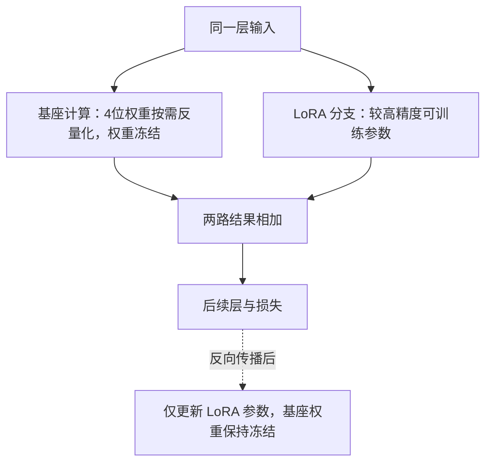

---
{
  "id": "Q-2716",
  "title": "QLoRA 如何工作，与 LoRA 有什么关系？",
  "category": "training",
  "topic": "参数高效微调",
  "type": "原理机制",
  "level": "进阶",
  "priority": "按岗位选读",
  "focus": "量化基座与低秩增量训练。QLoRA把冻结基座量化存储，在其上训练LoRA低秩增量；减少基座显存但仍有反量化、激活和优化器开销，并非训练全量低比特权重。",
  "answerStatus": "ready",
  "updatedAt": "2026-10-27"
}
---

> 在面栈阅读：[QLoRA 如何工作，与 LoRA 有什么关系？](https://mianstack.com/question/q-2716)

## 核心回答

`QLoRA` 把 `LoRA` 与量化存储结合起来：**冻结的基座主要以4位格式保存，训练时按需反量化参与计算，只更新新增的低秩适配器**。普通 `LoRA` 已经减少了可训练参数及其梯度、优化器状态；`QLoRA` 进一步压缩了仍需加载的基座权重。

它不是“把整个模型都用4位精度训练”。量化基座不进入常规梯度更新，适配器、激活和实际矩阵计算使用适当的较高精度；部分模块也可能保留较高精度。梯度仍要经过基座相关计算，才能求出适配器的更新。

## 冻结的是权重，不是计算路径

下图放大一个带适配器的线性层。实线表示前向计算，虚线说明参数更新对象，不代表完整的反向计算图：

反向传播仍经过相关基座计算来求适配器梯度，但不更新冻结的4位权重。图块大小不表示显存比例，也没有把激活或优化器状态画成4位。

## 三项关键机制

`QLoRA` 论文采用 `NF4` 表示近似正态分布的权重，并通过分块缩放处理数值范围；双重量化进一步量化缩放常数，减少元数据存储；分页优化器利用统一内存机制缓解显存峰值。

三者作用不同：低位权重与双重量化主要减少持久存储，分页优化器处理部分瞬时内存压力。分页或卸载可能带来传输成本，不代表激活和优化器开销凭空消失。

## 与普通LoRA怎样比较

两者都训练低秩增量，但基座存储和计算路径不同。`QLoRA` 可以在显存更紧张时训练更大的基座，同时需要考虑量化误差、反量化开销、硬件内核与框架兼容性；并不能保证训练更快或效果始终与高精度方案一致。

比较时固定任务数据、基座版本、目标模块、生成设置和预算，同时看任务质量、旧能力回归、显存峰值与耗时。保存模型时记录基座、量化配置、适配器和分词模板的对应关系，避免加载了不匹配的组合。

## 推理时必须保留4位基座吗

取决于部署路线。可以在兼容的量化基座上加载适配器，也可以在支持的工具链中反量化或加载相应高精度基座后合并增量，再按需要重新量化。转换可能改变数值结果，应对最终部署产物做回归。不能仅凭“训练采用 `QLoRA`”断言任何框架都支持直接原位合并或一定不能合并。

## 对应教程

- [《模型训练原理与高效微调》](https://github.com/didilili/ai-agents-from-zero/blob/main/30-%E6%A8%A1%E5%9E%8B%E8%AE%AD%E7%BB%83%E5%8E%9F%E7%90%86%E4%B8%8E%E9%AB%98%E6%95%88%E5%BE%AE%E8%B0%83.md)：回看第6节的冻结权重、低秩分支与参数设置；本文补充计算条件和工程取舍。

## 参考资料

- 国内：[wdndev：LoRA技术原理](https://github.com/wdndev/llm_interview_note/blob/581d54dd9a72e1d0a4eb28ae50859db83901b783/05.%E6%9C%89%E7%9B%91%E7%9D%A3%E5%BE%AE%E8%B0%83/4.lora/4.lora.md)：采用冻结原参数、只更新新增矩阵的基线，解释`QLoRA`进一步节省的部分。
- 国内：[WeThinkIn：后训练：微调与对齐](https://github.com/WeThinkIn/AIGC-Interview-Book/blob/275fdf1eeb65e3b233081d3b8e74ff5d8eeb2e03/%E5%A4%A7%E6%A8%A1%E5%9E%8B%E5%9F%BA%E7%A1%80/04_%E5%90%8E%E8%AE%AD%E7%BB%83%EF%BC%9A%E5%BE%AE%E8%B0%83%E4%B8%8E%E5%AF%B9%E9%BD%90.md)：采用4位存储与较高精度计算的区分，避免将`QLoRA`说成全模型4位训练。
- 国内：[adongwanai：SFT实战经验分享](https://github.com/adongwanai/AgentGuide/blob/663d91056d20823e2a2084b8e6a88c7706e8aa85/docs/02-tech-stack/16-sft-finetuning.md)：采用基座测试与留出数据对比，组织量化方案的质量回归。
- 国内：[ModelScope：预训练与微调](https://swift.readthedocs.io/zh-cn/v4.0/Instruction/Pre-training-and-Fine-tuning.html)：参考量化训练、适配器加载与推理后端的配置差别，说明部署兼容性需要单独验证。
- 国外：[University of Washington等：QLoRA: Efficient Finetuning of Quantized LLMs](https://arxiv.org/html/2305.14314v1)：根据原论文核对冻结4位基座、`NF4`、双重量化与分页优化器的各自作用。
- 国外：[Hugging Face：LoRA (PEFT v0.21.0)](https://huggingface.co/docs/peft/v0.21.0/package_reference/lora)：采用`LoRA`适配器与基座组合及可合并的通用机制，不据此断言量化模型都能直接合并。
