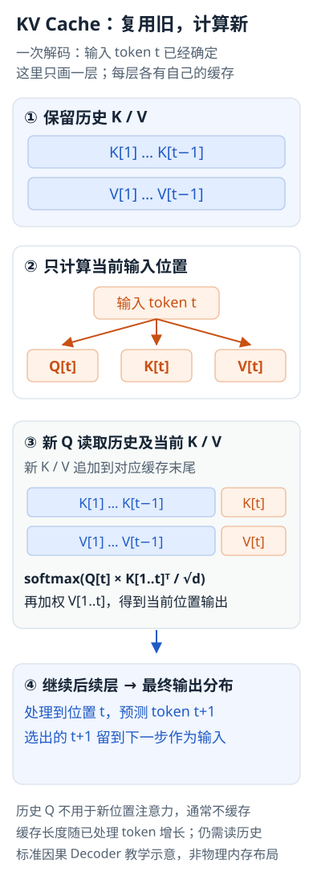

---
{
  "id": "Q-2718",
  "title": "KV Cache 缓存什么，怎样影响推理速度和显存？",
  "category": "llm",
  "topic": "推理优化与模型压缩",
  "type": "原理机制",
  "level": "进阶",
  "priority": "按岗位选读",
  "focus": "缓存复用与计算、显存的权衡。缓存各层历史 token 的 K/V，生成新 token 时复用，以显存换取较少的重复计算；缓存占用随序列长度和并发序列数增长。",
  "answerStatus": "ready",
  "updatedAt": "2026-10-19"
}
---

> 在面栈阅读：[KV Cache 缓存什么，怎样影响推理速度和显存？](https://mianstack.com/question/q-2718)

## 核心回答

KV Cache 缓存的是因果 Transformer 各层已经处理过的 token 的 Key 和 Value 张量。生成新 token 时，只计算这个新位置的 Q、K、V，再让新 Q 与历史及当前 K、V 做注意力，避免把整个前缀重新前向计算。历史 Q 不参与新位置的注意力，所以通常不用缓存。

它用显存换计算：减少重复的投影、前馈与注意力计算，但缓存会随上下文长度、并发序列数和层数增长。上下文很长时，读取历史 KV 的带宽和缓存容量又会成为瓶颈；KV Cache 不会让完整注意力的每一步都变成常数时间。

## 缓存为什么可以复用

因果掩码保证位置 i 不依赖未来 token。在模型权重、前缀 token、位置编号和计算设置相同时，追加后文不会改变历史位置的表示，因此各层的历史 K、V 保持有效。

预填充阶段一次处理输入前缀并建立缓存；解码阶段输入最新 token、追加其 KV，输出下一 token 的分布。这里“生成第 t+1 个 token”通常使用处理到第 t 个 token 后的输出，注意不要把预测位置与输入位置混为一谈。

若前缀被摘要替换、模板变化或权重切换，应从最早发生变化的位置重新建立受影响的缓存。缓存是模型中间状态，不是可以随意拼接的文本记忆。

把一个解码步展开，区分“输入当前 token”和“预测下一个 token”：



图展示标准因果解码中的一层注意力与后续处理。缓存复用仍要求模型、前缀、位置与计算设置一致；读取历史 KV 的成本随长度增加。

## 显存如何估算

普通 MHA/GQA、每层配置相同且 K/V 维度相同时，逻辑缓存可近似为：

```text
KV字节数 = 2 × B × T × L × H_kv × D_head × S
```

B 是同时保留的序列数，T 是每条序列已缓存的 token 数，L 是层数，H_kv 是 KV 头数，D_head 是每头维度，S 是每元素字节数；2 表示 K 和 V。不同长度请求应分别求和；分页、对齐、量化尺度等还会增加实际开销。

例如 B=1、T=4096、L=32、H_kv=8、D_head=128、FP16 每元素2字节，结果是 536,870,912 字节，即 512 MiB。若其他条件相同，H_kv 从8增加到32，缓存变为2 GiB。这是配置算例，不是某模型的实测。MLA等压缩结构应按实际缓存表示另算。

## 怎样优化与验证

- 控制有效上下文和最大输出长度，回收完成或取消请求的缓存。
- GQA/MQA减少KV头数，缓存量化减少每元素字节数；前者涉及模型结构，后者需验证精度、内核和反量化开销。
- 分页管理减少碎片，前缀缓存复用相同前缀；它们不等于减少每个独特token在模型中必需的逻辑KV。
- 比较同一模型、精度、输入输出长度下的首token时延、每token时延、吞吐、峰值显存和结果一致性，避免把不同负载的数字直接比较。

## 追问：为什么训练通常不采用同样的逐token缓存？

标准教师强制训练已知整个输入序列，可以用因果掩码并行计算各位置，并需要保存反向传播所需的计算图。推理解码式的可变缓存既破坏这种并行优势，也不能直接替代训练激活。

## 对应教程

- [1-1-大模型认知与工程概览](https://github.com/didilili/ai-agents-from-zero/blob/c05fb5979cf0aa3b6b4ed8c29f450f640fb9c18f/1-1-%E5%A4%A7%E6%A8%A1%E5%9E%8B%E8%AE%A4%E7%9F%A5%E4%B8%8E%E5%B7%A5%E7%A8%8B%E6%A6%82%E8%A7%88.md)：回看推理显存与Decode带宽瓶颈，本文进一步推导缓存内容和容量公式。

## 参考资料

- 国内：[wdndev：Llama 2代码详解：KV Cache与GQA](https://github.com/wdndev/llm_interview_note/blob/581d54dd9a72e1d0a4eb28ae50859db83901b783/02.大语言模型架构/llama%202代码详解/llama%202代码详解.md)：依据逐 token 预测中的历史状态，说明正文中 K/V 可复用而历史 Q 无需保存的原因。
- 国内：[WeThinkIn：大模型部署技术](https://github.com/WeThinkIn/AIGC-Interview-Book/blob/275fdf1eeb65e3b233081d3b8e74ff5d8eeb2e03/模型部署基础（精华版）/6.3大模型部署技术.md)：依据预填充与增量解码的计算访存分工，说明正文中缓存建立、追加和性能瓶颈的区别。
- 国内：[DeepSeek-AI：DeepSeek-V2](https://arxiv.org/html/2405.04434v5)：依据实际缓存表示与 KV 头数，说明正文中 MHA/GQA 占用估算及 MLA 不能直接套同一公式的边界。
- 国外：[Hugging Face：Caching v4.57.1](https://huggingface.co/docs/transformers/v4.57.1/cache_explanation)：依据逐层复用的因果条件与位置要求，说明正文中有效 KV 必须匹配模型、前缀和计算设置。
- 国外：[Vaswani等 / Google：Attention Is All You Need](https://arxiv.org/html/1706.03762v7)：用因果掩码和注意力公式说明新查询仍需读取历史键值。
