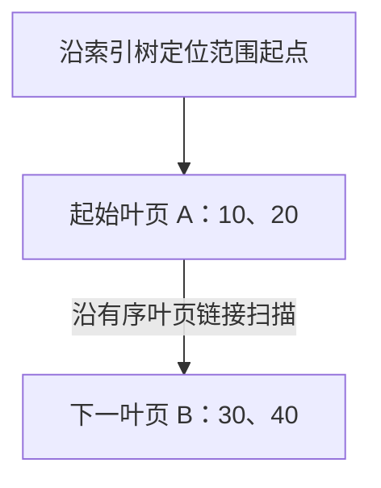

---
{
  "id": "Q-2752",
  "title": "InnoDB 为什么使用 B+ 树索引？",
  "category": "software",
  "topic": "数据库与 SQL",
  "type": "原理机制",
  "level": "进阶",
  "priority": "按岗位选读",
  "focus": "树高、页访问与范围扫描。B+树非叶页分支多使树较矮，叶页有序连接便于范围扫描；同时支持点查与增删改，但仍有页分裂与维护成本。",
  "answerStatus": "ready",
  "updatedAt": "2026-10-17"
}
---

> 在面栈阅读：[InnoDB 为什么使用 B+ 树索引？](https://mianstack.com/question/q-2752)

## 核心回答

InnoDB 使用 B+ 树组织普通索引，主要是为了兼顾**少量页访问完成定位、有序范围扫描，以及数据持续增删改**这几类需求。

1. **多路分支让树比较矮。** 索引以页组织，非叶子页主要保存索引键和子页定位信息，单页能指向许多子页。相比逐层只有两个分支的树，定位同样多的数据通常需要经过更少的层级，减少潜在的磁盘读取。
2. **叶子页按键有序，适合范围查询。** 找到范围起点后，可以沿叶子页链接继续扫描，不必为范围里的每条记录重新从根查找；索引顺序满足查询条件时，也有利于排序和分组。
3. **同一种结构能支撑点查与范围查。** 聚簇索引的叶子页保存行记录，二级索引的叶子记录保存索引列与对应主键；需要完整行时，再按主键访问聚簇索引。

它的优势来自页组织和访问模式的配合，不能简单概括成“时间复杂度最低”。插入、删除仍有维护页、分裂或合并的成本；树高也不等于实际磁盘读取次数，因为索引页可能已经在 Buffer Pool 中。

## 展开说明

### 为什么数据库更关心访问多少页

数据库不会为了比较一个索引键就单独从磁盘取几个字节，而是以页为单位管理数据。InnoDB 默认索引页大小为 16 KB，实例初始化时可以采用其他受支持的页大小。因此，一个页里能容纳多少索引项、一次读取后能排除多大的搜索范围，直接影响定位成本。

B+ 树把行记录或二级索引记录集中在叶子层。非叶子页不装入完整行，能把空间用于更多索引键和子页定位信息，形成较大的扇出。这里的比较条件是相近的页大小与键宽；不能脱离记录大小、填充程度，断言所有表都只有三层。

根页和常用内部页通常更容易被缓存。一次查询即使经过三层，也可能只有最后的叶子页需要从磁盘加载，甚至全部命中缓存。树高描述结构上的搜索路径，物理 I/O 还要结合缓存命中和实际访问的页判断。

### 范围查询为什么方便

范围扫描可以分成两段：先沿索引树定位第一条符合条件的记录，再沿叶子层继续读取。图中箭头表示这两段的访问顺序。

查 `id = 20`，从根定位到叶页 A，再在页内找到记录。查 `15 <= id <= 40`，先定位到第一条符合条件的记录 20，再沿叶页链接读取 30、40，直到超过上界或读完范围。这种顺序扫描避免了每条记录都重新走一次根到叶的路径。

叶页按索引键有序连接，指的是**逻辑顺序**，不保证这些页在磁盘上物理连续。联合索引还要按完整的键顺序理解；是否能利用索引完成排序，要看过滤条件、排序列和索引定义，不能只凭“用了 B+ 树”判断。

### 为什么不直接用哈希表、红黑树或 B 树

- **哈希表**适合等值定位，但哈希值不保留原键的大小顺序，难以直接支持有序范围扫描。范围条件可以通过扫描等其他方式处理，只是无法利用哈希定位获得同样的范围检索优势。
- **红黑树、AVL 树**解决了普通二叉搜索树可能退化的问题，但二叉分支限制了扇出。把这类结构直接用于大规模页存储，通常需要更多层级；它们在内存容器中的价值，与数据库普通索引的选择并不矛盾。
- **B 树**也是多路平衡树，也能做范围查询；区别在于它的内部节点也可保存数据，点查可能提前命中。B+ 树让内部页集中承担导航，把记录放在有序叶子层，更便于组织页式范围扫描。不能据此断言每次 B+ 树点查都比 B 树快。

选择 B+ 树是在常见数据库负载下取得综合收益，不是说其他结构没有用途。

### 聚簇索引与二级索引的叶子里分别是什么

聚簇索引的叶子记录保存行数据，通常以主键组织。二级索引还需要保存自己的索引列，例如 `idx_status_time(status, created_at)` 的叶子记录包含 `status`、`created_at` 和主键值，并非只有一个主键地址。

查询所需列被二级索引覆盖时，可以利用覆盖索引减少回表；需要其他列时，再用取得的主键到聚簇索引查找。因此，主键过宽也会增大二级索引占用，影响单页能容纳的记录数与缓存利用。

## 常见追问

### 不建主键，还会有聚簇索引吗？

会。没有显式主键时，InnoDB 会选择第一个所有键列均为 `NOT NULL` 的唯一索引；没有合适索引时，再生成隐藏的行标识组织聚簇索引。不能把“不声明主键”等同于“表没有聚簇组织”。

### B+ 树是不是写入也没有代价？

不是。写入需要找到相应页并维护索引项，页空间不足时可能分裂，删除后也可能触发页合并；二级索引越多，需要维护的结构通常也越多。是否值得增加索引，要结合查询收益、写入负载和存储成本判断。

## 参考资料

- 国内：[JavaGuide：MySQL 索引详解](https://javaguide.cn/database/mysql/mysql-index.html)：借鉴哈希、二叉树、B 树与 B+ 树的比较，解释正文中按访问模式选择索引，并采用聚簇、二级索引说明叶子记录与回表。
- 国内：[JavaGuide：树结构详解](https://github.com/Snailclimb/JavaGuide/blob/50f02a5984c062fe7221629d0a6a40ec15c26fd7/docs/cs-basics/data-structure/tree.md)：参考面试复盘中二叉搜索树、平衡树与多路树的对照，区分正文中保持平衡与提高页内扇出的作用。
- 国内：[小林 coding：为什么 MySQL 采用 B+ 树作为索引？](https://xiaolincoding.com/mysql/index/why_index_chose_bpuls_tree.html)：采用 B+ 树先定位起点再沿叶子扫描的过程，解释正文中点查与范围查询的数例。
- 国内：[小林 coding：揭开 Buffer Pool 的面纱](https://xiaolincoding.com/mysql/buffer_pool/buffer_pool.html)：借鉴数据读取与缓存页的说明，解释正文中树层级为何不能直接换算成磁盘读取次数。
- 国外：[MySQL 8.4：The Physical Structure of an InnoDB Index](https://dev.mysql.com/doc/refman/8.4/en/innodb-physical-structure.html)：依据索引页、默认页大小及页空间维护，解释正文中扇出、页分裂与合并的存储基础。
- 国外：[MySQL 8.4：Clustered and Secondary Indexes](https://dev.mysql.com/doc/refman/8.4/en/innodb-index-types.html)：依据聚簇索引选择及二级索引携带主键的规则，说明正文中叶子存储、回表和主键宽度的影响。
- 国外：[MySQL 8.4：Buffer Pool](https://dev.mysql.com/doc/refman/8.4/en/innodb-buffer-pool.html)：关于表与索引数据在内存中缓存的说明，为区分结构上的页访问与实际磁盘 I/O 提供依据。
