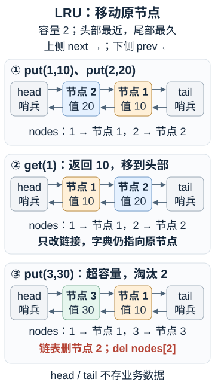

---
{
  "id": "Q-2758",
  "title": "如何实现 LRU 缓存，并保证查询与更新的效率？",
  "category": "coding",
  "topic": "链表、栈与队列",
  "type": "代码题",
  "level": "进阶",
  "priority": "按岗位选读",
  "focus": "哈希定位与链表淘汰。用哈希表定位双向链表节点，get或更新后移到头部，超容量删尾部并同步删哈希；平均查询和更新O(1)。",
  "note": "包含 O(1) 操作、自行实现双向链表与口述思路等不同要求；线程安全实现另见相关题。",
  "formatTags": ["现场编码"],
  "answerStatus": "ready",
  "updatedAt": "2026-10-17"
}
---

> 在面栈阅读：[如何实现 LRU 缓存，并保证查询与更新的效率？](https://mianstack.com/question/q-2758)

## 核心回答

**LRU（Least Recently Used）在容量不足时，淘汰距离上次使用最久的条目。** 为了高效查找和调整使用顺序，我会用哈希表与双向链表配合实现：

- **哈希表 `key → 节点`**：按 key 定位条目，节点保存 key、value 及前后指针。
- **双向链表**：维护最近使用顺序，头部最近使用，尾部最久未用。

三个关键操作是：

1. **读取 `get`**：命中后把节点移到头部，再返回值；未命中不改变顺序。
2. **写入 `put`**：已有 key 就更新原节点的值并移到头部；新 key 就创建节点，加入哈希表并放到链表头部。
3. **超容量淘汰**：删除链表尾部最久未使用的条目，并同步删除哈希表记录，保持两种结构一致。

哈希表必须保存**节点**，而不只是值，这样定位后就能通过前后指针直接摘除和插入，无须遍历链表。哈希查找平均 O(1)，这些链表操作只修改固定数量的指针，所以 `get`、`put` 的平均时间复杂度都是 O(1)。

## 容量为 2，逐步看谁被淘汰

下表从左到右表示“最近使用 → 最久未用”，只展示 key：

| 操作         | 返回值 | 操作后的顺序 | 原因                     |
| ------------ | ------ | ------------ | ------------------------ |
| `put(1, 10)` | —      | `[1]`        | 新条目放到最前           |
| `put(2, 20)` | —      | `[2, 1]`     | 2 比 1 更晚被使用        |
| `get(1)`     | 10     | `[1, 2]`     | 读取成功也算使用         |
| `put(3, 30)` | —      | `[3, 1]`     | 超容量，淘汰最久未用的 2 |
| `get(2)`     | -1     | `[3, 1]`     | 未命中，不改变顺序       |
| `put(1, 11)` | —      | `[1, 3]`     | 更新值，并刷新使用顺序   |
| `put(4, 40)` | —      | `[4, 1]`     | 超容量，淘汰 3           |

最容易错的是第三步：如果读取 1 后没有移动它，第四步就会误删 1，变成更接近按插入顺序淘汰。LRU 也不是看谁累计访问次数少，它只看最近一次使用的先后。

## 为什么需要双向链表？

哈希表只能告诉我们“节点在哪里”。要把它移到头部，还得把它从原位置摘掉。假设局部关系是 `P ↔ N ↔ S`，摘除 N 时，让 P 的 `next` 指向 S，再让 S 的 `prev` 指向 P。拿到 N 就能通过 `prev`、`next` 找到两侧节点，因此只改固定数量的指针；普通单向链表若没有额外记录前驱，还要从头寻找 P。

再把 N 接到头部，同样只改固定数量的指针。代码里的 `_touch` 就是“先摘除，再放到最前”。头尾各放一个不存业务数据的哨兵节点，这样空链表也始终是 `head ↔ tail`，插入首个节点、删除唯一节点都能复用同一套操作。

把写入 1、2，读取 1，再写入 3 的过程画成结构变化，可以同时看到链表顺序与哈希表的对应关系：

[](../assets/questions/Q-2758/q-2758-d1611878bb5c.svg)

图示借鉴[小林 coding 的 LRU 图解](https://www.xiaolincoding.com/interview/data.html#lru是什么-如何实现)中哈希表与链表同屏对照的方式，按本题容量 2 的例子重绘。节点 1 移动前后是同一个对象，`nodes[1]` 无须重新指向一个新节点。

淘汰时直接取 `tail.prev`。这个节点还要保存 key，才能同时执行 `del nodes[key]`；否则链表删掉了，哈希表可能还留着已经淘汰的记录。

## 完整参考实现

下面使用 Python 3，约定整数 key、value，容量按条目数计算；成功读取、插入和更新都算使用，未命中不改变顺序。本实现约定未命中返回 `-1`，`put` 不返回数据。容量为 0 时不保存条目，负容量抛出 `ValueError`；代码不做完整的运行时类型校验。

```python
class _Node:
    def __init__(self, key=0, value=0):
        self.key = key
        self.value = value
        self.prev = None
        self.next = None


class LRUCache:
    def __init__(self, capacity: int):
        if capacity < 0:
            raise ValueError("capacity must be non-negative")
        self.capacity = capacity
        self.nodes = {}
        self.head = _Node()  # 头哨兵，后面是最近使用的节点
        self.tail = _Node()  # 尾哨兵，前面是最久未使用的节点
        self.head.next = self.tail
        self.tail.prev = self.head

    def _remove(self, node):
        node.prev.next = node.next
        node.next.prev = node.prev
        node.prev = None
        node.next = None

    def _add_first(self, node):
        first = self.head.next
        node.prev = self.head
        node.next = first
        self.head.next = node
        first.prev = node

    def _touch(self, node):
        self._remove(node)
        self._add_first(node)

    def get(self, key: int) -> int:
        node = self.nodes.get(key)
        if node is None:
            return -1
        self._touch(node)
        return node.value

    def put(self, key: int, value: int) -> None:
        if self.capacity == 0:
            return
        node = self.nodes.get(key)
        if node is not None:
            node.value = value
            self._touch(node)
            return

        node = _Node(key, value)
        self.nodes[key] = node
        self._add_first(node)
        if len(self.nodes) > self.capacity:
            oldest = self.tail.prev
            self._remove(oldest)
            del self.nodes[oldest.key]


if __name__ == "__main__":
    cache = LRUCache(2)
    cache.put(1, 10)
    cache.put(2, 20)
    print(cache.get(1))  # 10；此时 2 最久未使用
    cache.put(3, 30)    # 淘汰 2
    print(cache.get(2))  # -1
    cache.put(1, 11)    # 更新 1，并把它移到最前面
    cache.put(4, 40)    # 淘汰 3
    print(cache.get(1))  # 11
    print(cache.get(3))  # -1
```

## 为什么能保持正确和高效

这份实现始终维护三个不变量：

1. **查找结构与顺序结构一致**：每个缓存 key 在字典中恰好对应一个真实链表节点，两个哨兵不进入字典。
2. **链表从头到尾按使用时间排列**：使用节点就把它移到头部，其他节点的相对顺序不变，因此 `tail.prev` 始终是淘汰对象。
3. **一次操作结束后条目数不超过容量**：插入后若超容量，立即从两个结构删除同一个最旧节点。

例如更新 key=1 时，代码复用原节点，只改 value 并移动位置；如果每次更新都另建节点，却没有删除旧节点，就会出现字典只指向新节点、链表里仍残留旧节点的问题。

复杂度的“平均”来自哈希表：不能承诺任意哈希碰撞下仍是最坏 O(1)。在通常的整数键、哈希表模型下，`get`、`put` 平均 O(1)，空间是 O(capacity + 1)，其中额外的常数是两个哨兵。

容量为 1 时，更新唯一节点仍会经过同一套摘除、插入逻辑；容量为 0 时直接跳过写入。`get` 未命中不会碰链表，命中合法值 -1 则照常移动节点。区分这些路径，才能同时验证返回结果与淘汰顺序。

## 常见追问

**只用 Python 字典行不行？**

普通 `dict` 保留的是插入顺序，读取和更新不会自动刷新为访问顺序。可以基于有序容器组织 LRU，例如 `OrderedDict.move_to_end` 负责刷新位置，`popitem(last=False)` 可以弹出最前端条目；最近使用放哪一端都可以，只要刷新与淘汰方向一致。题目要求手写时，用上面的节点结构展示快速定位与重排。

**Python 的 `lru_cache` 能直接用吗？**

它适合缓存函数调用结果：把可哈希的调用参数作为键，重复调用时复用返回值；这与题目要求显式 `get/put` 的键值缓存接口不同。它也适用于“最近访问过的结果很可能再次使用”的场景，批量扫描大量只用一次的数据仍可能挤掉热点条目。标准库实现有自己的并发保护，不代表这里手写的类也自动线程安全。

**缓存的合法值也可能是 -1，怎么办？**

这份实现仍能保存 -1，命中时也会刷新顺序；但调用者只看返回值，分不清它是未命中还是命中 -1。业务接口可以改为专用缺失对象、抛 `KeyError`，或返回额外的存在标志。上面代码保留这一约定。

**多线程可以直接共享这个缓存吗？**

不可以直接当作线程安全缓存。`get` 命中也会移动节点，属于写操作；要保护一次 `get` 或 `put` 内哈希表与链表的整体一致性，而不是只给 `put` 加锁。GIL 或单次字典操作的安全性，不能代替复合操作的同步。

**容量限制了条目数，就限制了内存吗？**

没有。这里的 `capacity` 只控制条目数，两个条目的 value 大小可能相差很大，哈希表和节点本身也有开销。若业务要求限制内存，需要另行定义条目权重、统计当前占用，并在超限时按策略淘汰；一次写入可能淘汰多项，不能直接沿用本实现“最多删一个节点”的处理。权重是对占用的估算，未必等于进程实际内存。

**加上过期时间，还是这套代码吗？**

LRU 顺序只反映最近使用时间，不等于过期顺序。增加 TTL 后，读取时还要判断是否过期；若要求主动及时清理，还需额外的过期管理机制。上面的实现只负责按条目容量淘汰。

## 参考资料

- 国内：[JavaGuide：LRU 缓存面试题总结](https://github.com/Snailclimb/JavaGuide/blob/50f02a5984c062fe7221629d0a6a40ec15c26fd7/docs/cs-basics/data-structure/lru-cache.md)“工程场景”——参考对条目数、内存占用和条目权重的区分，说明实际缓存的容量限制为何不一定只按条目计数；本题实现仍按条目数淘汰。
- 国内：[Hello 算法：4.2 链表](https://www.hello-algo.com/chapter_array_and_linkedlist/linked_list/)——结合双向链表的前驱、后继结构，解释为什么在链表中查找节点可能需要遍历，而已知节点后的摘除与插入只需修改前后指针。
- 国内：[小林 coding：数据结构与算法面试题](https://www.xiaolincoding.com/interview/data.html)中的“LRU 是什么？如何实现？”——对照哈希表保存节点、访问后刷新顺序的实现，解释 LRU 的查询和更新为何能达到平均 O(1)。
- 国外：[Python 官方文档：OrderedDict](https://docs.python.org/3/library/collections.html#collections.OrderedDict)——参考顺序调整、两端弹出和 LRU 示例，说明 `OrderedDict` 怎样支持缓存淘汰。
- 国外：[Python 官方文档：functools.lru_cache](https://docs.python.org/3/library/functools.html#functools.lru_cache)——参考函数结果缓存的接口约定，补充参数可哈希的要求，并说明其线程安全保证的范围。
