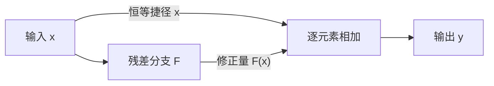

---
{
  "id": "Q-2952",
  "title": "残差连接解决什么问题，如何理解其作用？",
  "category": "llm",
  "topic": "模型架构与表示",
  "type": "原理机制",
  "level": "进阶",
  "priority": "按岗位选读",
  "focus": "恒等路径与深层优化。残差令输出为x+F(x)，给信息与梯度提供直接路径，使深层网络更易优化；它缓解优化退化，不意味着任意深度都不会梯度异常。",
  "answerStatus": "ready",
  "updatedAt": "2026-10-29"
}
---

> 在面栈阅读：[残差连接解决什么问题，如何理解其作用？](https://mianstack.com/question/q-2952)

## 核心回答

残差连接把一个模块写成 **y=x+F(x)**：输入 x 沿捷径保留下来，网络学习的是在它上面增加什么变化。相比让一串层从头学出完整映射，这种方式让接近恒等的映射更容易表示，并给信息和梯度提供直接通路，缓解深层网络难以优化、加深后训练误差反而上升的问题。

它主要改善深层优化，不等于消除过拟合，也不保证任意深度都不会梯度消失或爆炸。实际训练仍与归一化位置、初始化、学习率和残差分支的尺度有关。

## 学“修正量”为什么更容易

如果理想映射是 H(x)，可以让残差分支学习 F(x)=H(x)−x，再通过相加得到 H(x)。当这个模块暂时不需要改变输入时，F(x)接近0就能保留 x，而不必靠多层非线性变换重新学出恒等映射。

下面仅表示同维度的残差相加，未画激活函数、归一化或完整反向传播：



**相加要求两条分支形状兼容。** 如果通道数或维度变化，可以在捷径上使用投影来匹配；这时捷径已不是纯恒等。残差相加也不同于拼接：拼接会增加特征维度，相加通常保持维度。

## 对梯度有什么帮助，又有什么边界

对不带额外操作的 y=x+F(x)，关于输入的导数含有恒等项 I：

```text
dy/dx = I + J_F(x)
```

因此梯度不必全部经过残差分支的一长串导数相乘。但“多了一条直接路径”不代表梯度一定非零：用标量例子 F(x)=−x，输出恒为0，导数仍为0。深层网络还会受到其他路径和后续运算影响。

原始 `ResNet` 论文关注的退化现象是更深网络的**训练误差**反而更高，与只在测试集变差的过拟合要区分开。残差结构让深层网络更易优化，泛化仍需要单独评估。

## 放在 Transformer 里怎么理解

注意力子层和 `FFN` 子层都可以通过残差分支更新隐藏表示。原始 `Transformer` 使用相加后再做 `LayerNorm` 的结构；`Pre-LN` 则把归一化放进子层之前，示意为 y=x+F(LN(x))。两种顺序不能混写成同一张计算图。

例如 `MindSpore` 编码器层提供 `norm_first` 参数来选择归一化顺序，同时保持输入、输出形状一致。解释具体模型时，应按其实际计算图说明，不能只凭有残差就断言训练一定稳定。

## 参考资料

- 国内：[WeThinkIn：深度学习网络架构](https://github.com/WeThinkIn/AIGC-Interview-Book/blob/275fdf1eeb65e3b233081d3b8e74ff5d8eeb2e03/%E6%B7%B1%E5%BA%A6%E5%AD%A6%E4%B9%A0%E5%9F%BA%E7%A1%80%EF%BC%88%E7%B2%BE%E5%8D%8E%E7%89%88%EF%BC%89/03_%E6%B7%B1%E5%BA%A6%E5%AD%A6%E4%B9%A0%E7%BD%91%E7%BB%9C%E6%9E%B6%E6%9E%84.md)：采用深层退化、恒等映射与残差块的解释，区分训练优化困难和过拟合。
- 国内：[WeThinkIn：模型架构与工作原理](https://github.com/WeThinkIn/AIGC-Interview-Book/blob/275fdf1eeb65e3b233081d3b8e74ff5d8eeb2e03/%E5%A4%A7%E6%A8%A1%E5%9E%8B%E5%9F%BA%E7%A1%80/02_%E6%A8%A1%E5%9E%8B%E6%9E%B6%E6%9E%84%E4%B8%8E%E5%B7%A5%E4%BD%9C%E5%8E%9F%E7%90%86.md)：采用注意力、前馈层、残差与归一化的分工，把残差放回模型子层更新过程。
- 国内：[Datawhale：第二章 Transformer架构](https://github.com/datawhalechina/happy-llm/blob/main/docs/chapter2/%E7%AC%AC%E4%BA%8C%E7%AB%A0%20Transformer%E6%9E%B6%E6%9E%84.md)：采用预归一化残差块的计算顺序，给出与原始后归一化结构的对照。
- 国内：[MindSpore：TransformerEncoderLayer](https://www.mindspore.cn/docs/zh-CN/r2.9.0/api_python/nn/mindspore.nn.TransformerEncoderLayer.html)：采用2.9.0文档中的归一化顺序参数和输入输出形状约定，说明具体框架需要核对实际计算图。
- 国外：[He 等：Deep Residual Learning for Image Recognition](https://arxiv.org/html/1512.03385v1)：采用第3.1、3.2节的残差映射、逐元素相加和投影捷径，解释恒等路径及维度条件。
- 国外：[Vaswani 等：Attention Is All You Need](https://arxiv.org/html/1706.03762v7)：采用第3.1节各子层外的残差连接及相加后归一化，说明原始模型的结构位置。
