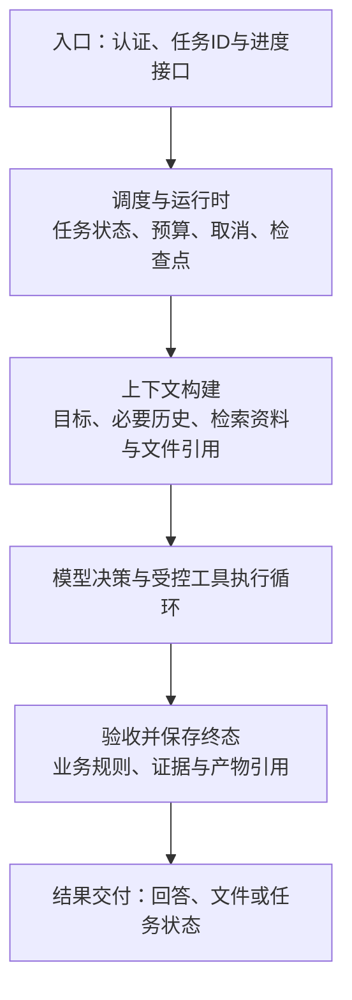
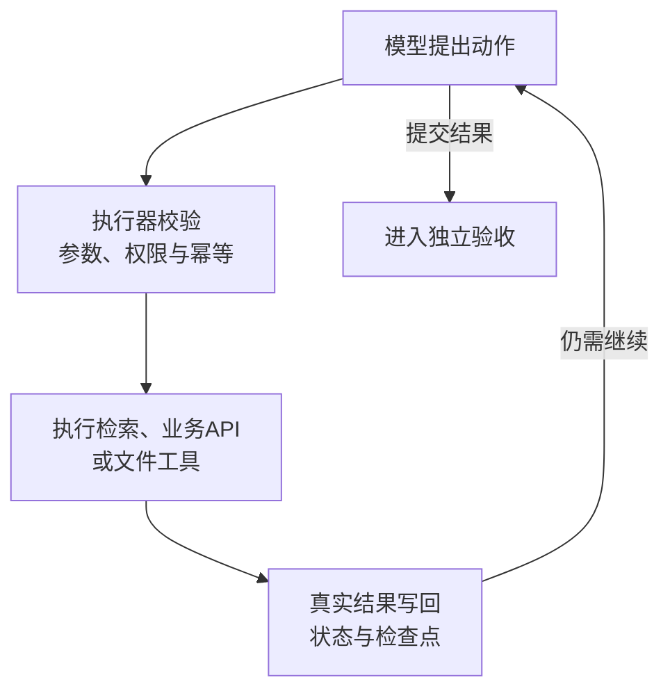

---
{
  "id": "Q-3346",
  "title": "设计生产级 AI Agent 架构，画出核心组件并说明数据流。",
  "category": "agent",
  "topic": "Agent 基础与运行循环",
  "type": "系统设计",
  "level": "进阶",
  "priority": "进阶补充",
  "focus": "生产组件职责与任务数据流。以任务状态连接会话入口、规划、模型与工具执行、记忆和产物，权限与监控贯穿链路；给检查点、取消、幂等和恢复的数据流。",
  "answerStatus": "ready",
  "updatedAt": "2026-11-18"
}
---

> 在面栈阅读：[设计生产级 AI Agent 架构，画出核心组件并说明数据流。](https://mianstack.com/question/q-3346)

## 核心回答

生产级 Agent 可以围绕**任务运行时**组织：入口负责身份和任务创建，上下文层准备当前决策需要的信息，模型提出动作，执行器校验并调用工具，结果写回状态，再继续决策或进入验收交付。任务存储、产物存储和观测贯穿这条链路。

生产约束要落在执行过程里：长任务可排队并持久保存进度，工具有权限、超时和幂等控制，取消能传到在途调用，恢复能区分已完成与结果未知的动作。业务成功由可验证的产物或结果决定；模型结束生成、`HTTP`请求返回与任务完成是不同事件。

## 核心组件与数据流

下面是一个可按规模裁剪的参考架构。资料和产物另存，状态中保留引用；Trace贯穿每次模型、工具与验收。等待输入时，运行时保存待办并暂停，有效输入到达后再恢复。

图中的执行循环可继续展开：

入口、运行时、执行器可以部署在同一服务中。队列和独立Worker适合较长任务、需要削峰或扩缩容时引入；这张图表达职责，不要求一开始拆成所有微服务。

## 一次请求如何经过这些组件？

以“读取资料，生成带来源的分析报告”为例：

1. **接收并建任务**：入口校验请求和身份，记录任务目标、资源范围及输出要求，返回任务ID。长任务前端可以随后订阅进度或查询状态。
2. **准备执行**：调度器分配执行资源，运行时读取任务状态和检查点。上下文构建器选取相关消息、资料与当前可用工具；大文件留在存储中，通过引用访问。
3. **决策与执行**：模型判断缺少什么资料，提出检索或读取请求。执行器检查参数和数据范围，再调用工具，把实际结果与调用ID关联后写回状态。需要独立研究多个方向时，可在这一层委派子Agent。
4. **验证并收敛**：检查来源是否支持结论、关键维度是否覆盖、报告文件是否可用。缺口明确且预算允许则继续补查；无法补齐时交付有依据的部分并标明未完成项，或进入失败/等待状态。
5. **保存与交付**：保存终态、产物引用和必要回执，再发送完成事件。界面断线重连时，读取权威任务状态，不只依靠曾经发送过的一条推送。

## 状态、记忆与知识怎样存？

任务状态存当前阶段、执行者、尝试次数、预算、等待对象与产物引用。图检查点保存继续执行需要的状态；长期记忆保存跨任务有价值的偏好或事实；知识库保存可检索文档。三者按用途读取，不能把全部数据都变成无限增长的聊天历史。

任务数据要能关联可信用户和资源，凭证由运行环境管理。日志可以记录输入范围、调用参数摘要、结果引用、耗时和错误，但应控制敏感正文的暴露范围。

## 如何处理恢复、取消与重复执行？

持久化检查点让新Worker知道从哪里继续；租约与版本控制避免同一任务被多个Worker同时接管。已经执行的外部动作还需幂等键和业务唯一约束：比如工单创建成功而本地回执未保存，恢复时先按业务键查询，不能再创建一张。

取消先阻止新增动作，再向模型、工具与子任务传播。对于无法立即中断的外部调用，记录它的执行句柄和结果未知状态，后续核对真实结果。前端关闭连接通常只意味着传输结束，是否取消后台任务应由产品语义和任务接口决定。

## 常见追问

**怎样评估是否达到生产要求？**

固定业务任务，检查目标完成、证据支持、权限拒绝和异常恢复，同时观察端到端延迟、工具错误、费用和排队时间。覆盖工具超时、断连、进程重启、重复请求及取消后迟到结果；基础设施正常不代表答案质量已经合格。

**必须有Planner、向量库和多Agent吗？**

不必须。简单任务由单Agent配少量工具完成即可；规划、检索和委派按任务需要增加。生产要求的重点是可控执行与可验证交付，并非组件数量。

## 对应教程

- [21-Agent智能体](https://github.com/didilili/ai-agents-from-zero/blob/96e115d510c76cec7e22598fe6f0449e99b344fd/21-Agent%E6%99%BA%E8%83%BD%E4%BD%93.md)：回看模型、工具、状态与反馈循环。
- [25-LangGraph高级特性](https://github.com/didilili/ai-agents-from-zero/blob/96e115d510c76cec7e22598fe6f0449e99b344fd/25-LangGraph%E9%AB%98%E7%BA%A7%E7%89%B9%E6%80%A7.md)：理解检查点和暂停恢复；本文补任务调度、幂等和权威状态。

## 参考资料

- 国内：[JavaGuide：AI工作流中的Workflow、Graph与Loop](https://github.com/Snailclimb/JavaGuide/blob/50f02a5984c062fe7221629d0a6a40ec15c26fd7/docs/ai/agent/workflow-graph-loop.md)：参考固定工作流与动态循环的组合，组织运行时路由、状态传递与有界回边。
- 国内：[JavaGuide：多Agent协作系统设计](https://github.com/Snailclimb/JavaGuide/blob/50f02a5984c062fe7221629d0a6a40ec15c26fd7/docs/ai/agent/multi-agent.md)：采用任务生命周期、并发接管、取消和副作用恢复，补足生产保障。
- 国内：[Datawhale Hello-Agents：第七章：构建你的Agent框架](https://github.com/datawhalechina/hello-agents/blob/36f583c233ea5cee4537ef93455702b55053af18/docs/chapter7/%E7%AC%AC%E4%B8%83%E7%AB%A0%20%E6%9E%84%E5%BB%BA%E4%BD%A0%E7%9A%84Agent%E6%A1%86%E6%9E%B6.md)：借鉴模型、消息、Agent与工具系统的职责解耦，确定架构组件。
- 国内：[AgentGuide作者adongwanai：Agent Harness Engineering](https://github.com/adongwanai/AgentGuide/blob/663d91056d20823e2a2084b8e6a88c7706e8aa85/docs/02-tech-stack/27-agent-harness-engineering.md)：参考上下文、工具、权限、预算、观测和验收，说明运行约束的执行位置。
- 国外：[LangChain：Persistence](https://docs.langchain.com/oss/python/langgraph/persistence)：核对线程检查点与跨线程Store分工，说明状态持久化和长期记忆不同。
- 国外：[Anthropic：Building effective agents](https://www.anthropic.com/research/building-effective-agents)：采用增强模型、环境反馈、任务验证及按需增加复杂度的原则，设计报告处理链。
