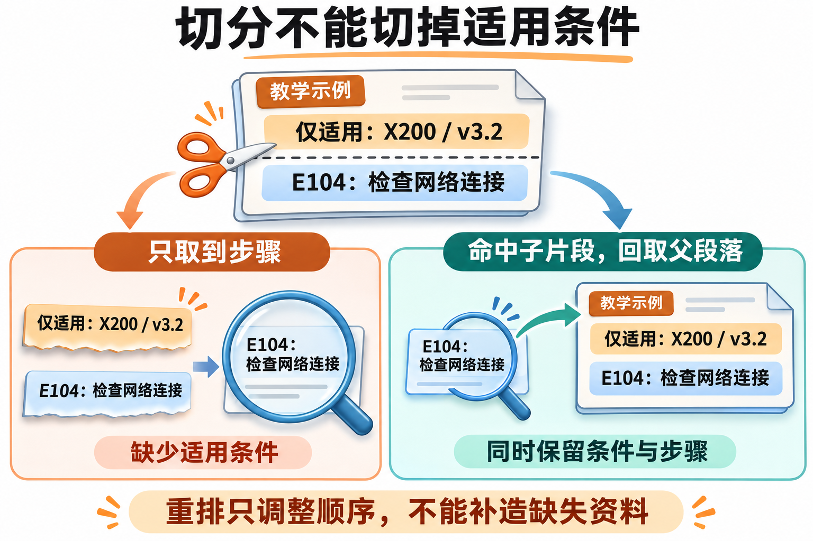

---
{
  "id": "Q-3692",
  "title": "RAG 检索优化有哪些常见策略，如何组合？",
  "category": "rag",
  "topic": "召回策略与检索",
  "type": "方案设计",
  "level": "进阶",
  "priority": "优先准备",
  "focus": "按检索错误组合优化手段。用失败样例定位瓶颈：表述偏差做查询改写，词面漏召回用混合检索，噪声用过滤与重排；固定样例逐项消融，验证组合是否有效。",
  "answerStatus": "ready",
  "updatedAt": "2026-11-04"
}
---

> 在面栈阅读：[RAG 检索优化有哪些常见策略，如何组合？](https://mianstack.com/question/q-3692)

## 核心回答

`RAG` 检索优化应先按失败样例定位瓶颈，再组合手段：**原文缺失或切坏，修数据与切分；问法对不上，做查询改写；单路漏召回，补关键词或向量通道；正确证据已召回但排后面，做重排；证据进入模型后仍答错，再查上下文组织和生成。**

一个可评估的链路是：资料解析与版本治理 → 按结构切分并保存来源 → 提取查询条件 → 按需多路召回与融合 → 候选重排 → 去重、补全必要上下文 → 带引用生成。它是可裁剪的组合，具体启用哪些环节由固定评估集决定。`Rerank` 只能重新排序已有候选，不能补出候选池中不存在的证据。

## 先判断错在哪一层

保留同一次请求的原问、查询条件、候选列表、重排结果、最终上下文和回答，逐层检查：

| 观察到的失败                               | 优先排查或尝试                           |
| ------------------------------------------ | ---------------------------------------- |
| 原文就没有正确知识，或解析后丢了表格、条件 | 补资料、修解析、清洗与更新流程           |
| 有正确原文，但候选池里找不到               | 检查切分、查询、过滤、嵌入模型与召回范围 |
| 正确证据在候选中，最后却被淘汰             | 检查融合、去重、候选上限及重排模型       |
| 已进上下文，回答仍漏条件或引用错           | 检查片段完整性、压缩、版本冲突与生成约束 |

如果必要资料不存在，就应说明缺失或补充资料；不能靠增加相似候选把缺失事实补成答案。

## 各种策略怎样配合

**先保证数据和切分可用。** 去掉重复页眉、乱码和失效副本，保留表格字段关系、标题层级与来源位置。按段落、章节、函数等结构切分，并对边界样例检查前提与结论是否被拆开。小块命中后缺少上下文时，可采用 `Parent-Child`，回取父段落；扩大后的内容仍要核对权限、版本与相关性。块大小和重叠量由评估决定。

下面用设备手册的教学片段说明：命中了处理步骤，也可能漏掉它的适用前提。

图中的设备条件和处理步骤仅为教学示例。父段落来自已有原文，回取时仍需检查版本、权限和相关性；重排只改变候选顺序，不能代替这次原文读取。

**查询优化解决表达与任务结构问题。** 对指代或口语表达做 `Query Rewrite`，保留原问、型号、时间等约束；必要条件未知时先澄清。问法多样可试 `Multi-Query`，复合问题可分解后分别找证据。`HyDE` 生成假设段落帮助定位真实材料，它只是检索入口，不能作为回答依据，也可能把查询带偏。

**多路召回补覆盖，融合负责合并。** 向量通道处理语义接近的内容，`BM25` 等词项检索补错误码、型号、专有词。对精确实体也可使用字段过滤。合并时按稳定文档或片段 ID 去重，`RRF` 可利用各路排名融合，避免直接相加不同尺度的原始分数。租户、权限和适用版本条件要在各路检索及后续原文读取中一致执行。

**重排与上下文处理解决“找到了却没用好”。** 常见 `Cross-Encoder` 将问题与候选片段共同输入，重新判断相关性。分别设置粗召候选数、重排保留数和最终上下文范围；扩大候选可能增加覆盖，也会增加噪声与耗时。最后去重、合并必要的相邻内容，压缩时保留条件、例外与引用位置。摘要不能替代可回查的原始证据。

## 一次组合示例与验证

以设备手册检索的设计示例说明：用户问“X200 升到 v3.2 后报 E104 怎么办”。如果向量召回只有联网故障概述，可先核对手册是否已更新、错误码是否解析完整，再补词项召回，并限制型号与固件版本。若正确处理步骤已经在候选中却排后，再比较重排；若步骤和适用条件被切开，再试父段落补全。只有实际存在问法偏差时，才增加查询改写。

验证时固定资料快照、问题集与期望证据，包含精确实体、同义问法、多跳、旧版本和无答案样例。召回看 `Recall@K` 与必要证据是否找全，排序看 `MRR` 或 `nDCG`，最终看答案正确性、证据支持和引用准确性，同时记录延迟与处理成本。每次只改变少量因素，做消融并在保留的测试集上回归，避免把只对几个样例有效的参数当成通用方案。

## 追问

**Top K 越大，效果一定越好吗？**

不一定。候选覆盖可能提高，但重排耗时、重复内容和干扰也会增加。先看正确证据是否因候选上限被截掉，再分别调整候选池和最终上下文，而非把更多候选全部交给模型。

**检索指标提高，为什么最终回答反而变差？**

可能只多命中了相关主题，没有补齐必要条件；也可能新引入旧版本、重复片段，或压缩时丢了例外。需要对照同一次请求的候选、上下文与引用，区分检索覆盖收益和生成阶段的回归。

## 对应教程

- [第 19 章：RAG 检索增强生成](https://github.com/didilili/ai-agents-from-zero/blob/c05fb5979cf0aa3b6b4ed8c29f450f640fb9c18f/19-RAG%E6%A3%80%E7%B4%A2%E5%A2%9E%E5%BC%BA%E7%94%9F%E6%88%90.md)：对照文档切分、混合检索、查询改写、重排，以及先分清检索错误和生成错误的排查方式。

## 参考资料

- 国内：[JavaGuide：RAG 优化](https://javaguide.cn/ai/rag/rag-optimization.html)：采用先查候选、再查排序、上下文与生成的诊断闭环，并据固定评估集选择优化项。
- 国内：[JavaGuide：RAG 文档处理](https://javaguide.cn/ai/rag/rag-document-processing.html)：采用结构解析、边界完整性与父子块的处理思路，说明应先修资料再调检索。
- 国内：[Datawhale：第八章 记忆与检索——高级检索策略](https://github.com/datawhalechina/hello-agents/blob/36f583c233ea5cee4537ef93455702b55053af18/docs/chapter8/%E7%AC%AC%E5%85%AB%E7%AB%A0%20%E8%AE%B0%E5%BF%86%E4%B8%8E%E6%A3%80%E7%B4%A2.md)：采用多查询与假设文档的扩展、检索、去重合并过程，说明它们解决的查询差异及证据边界。
- 国内：[小林：RAG 检索优化策略有哪些？](https://xiaolinnote.com/ai/rag/14_retrieval_opt.html)：借鉴索引、查询、召回、排序各自解决的问题，组织按症状裁剪的组合过程。
- 国外：[Elastic：Reciprocal rank fusion](https://www.elastic.co/docs/reference/elasticsearch/rest-apis/reciprocal-rank-fusion)：核对按各路排名融合不同相关度结果的机制，说明融合与候选窗口的作用。
- 国外：[Sentence Transformers：Retrieve & Re-Rank](https://www.sbert.net/examples/sentence_transformer/applications/retrieve_rerank/README.html)：核对先取候选、再共同编码问题与候选的两阶段过程，明确重排无法补回候选外证据。
