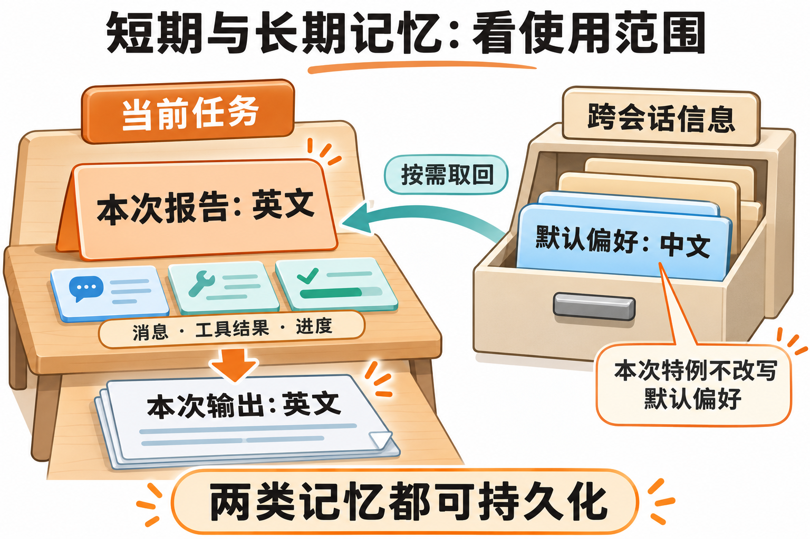

---
{
  "id": "Q-3740",
  "title": "短期记忆和长期记忆的设计与本质区别是什么？",
  "category": "agent",
  "topic": "记忆系统",
  "type": "比较选型",
  "level": "进阶",
  "priority": "按岗位选读",
  "focus": "当前工作状态与可复用事实。短期承载当前任务目标与进度，长期保可复用事实和偏好；两者都可持久化，区别是作用范围与更新检索，不是只按存内存还是磁盘。",
  "answerStatus": "ready",
  "updatedAt": "2026-11-04"
}
---

> 在面栈阅读：[短期记忆和长期记忆的设计与本质区别是什么？](https://mianstack.com/question/q-3740)

## 核心回答

短期记忆和长期记忆的本质区别是**服务的任务范围与信息生命周期**，而不只是“存多久”或“用不用向量库”。

- **短期记忆**保存当前会话或任务的消息、工具结果、执行进度，保证后续步骤能接上前文。实现上可用会话历史、结构化状态和检查点。
- **长期记忆**保存跨会话仍有用的用户偏好、项目事实或处理经验，需要选择性写入，并支持按范围检索、纠错、过期和删除。

例如，“这份报告用英文”属于当前任务约束；“以后报告默认用中文”适合保存为长期偏好。新任务开始时，系统取回适用的长期信息，与本次要求和当前状态一起构建上下文。两类记忆都可以落数据库；短期状态持久化后仍是短期记忆，长期信息只放在进程内也不能保证重启后保留。

## 设计时先分清三个对象

| 对象           | 保存什么                           | 什么时候使用               |
| -------------- | ---------------------------------- | -------------------------- |
| 完整会话记录   | 原始消息和工具轨迹                 | 回放、排障、恢复与证据追溯 |
| 当前模型上下文 | 当前步骤需要的指令、证据、近期消息 | 本轮推理时实际发送给模型   |
| 长期记忆记录   | 筛选后的偏好、事实与可复用经验     | 后续相关任务按需取回       |

三者不能直接画等号。数据库保存了一百轮消息，不代表每次都要发送一百轮；一条长期偏好被保存后，也要经过范围、相关性和有效性筛选，才进入本次上下文。

在 `LangGraph` 中，`Checkpointer` 按 `thread_id` 保存图的状态快照，支持同一线程的连续执行；`Store` 保存跨线程的键值信息，可按业务组织用户或项目命名空间。命名空间帮助组织数据，实际访问权限仍由应用检查。

## 一次偏好变更怎样处理

假设系统已有长期记录“报告默认中文”，这次用户要求英文：

图中工作台与档案柜表示信息的使用范围，两类记录都可以持久化。本次特例只改变这份报告的要求；明确提出长期变更时，再更新默认偏好。

1. 当前任务状态记录英文要求，用于本次报告生成。
2. 长期中文偏好仍保留，避免把一次特例误写成永久变更。
3. 用户明确说“以后都用英文”时，再更新长期记录，保留来源与适用范围。
4. 删除偏好时，同时处理相关索引、派生摘要或缓存，检查后续检索是否还会带回旧值。

订单是否发货、库存是否充足等实时业务状态，应在决策时查业务系统。历史记忆可以帮助识别对象，不能代替当前权威数据。

## 存储与评测分别怎么选

确定字段读取可用键值或关系查询；需要语义关联时再加向量检索。完整原文、检索索引和当前有效记录可以分别保存，不必把全部内容塞进一个向量库。

短期记忆重点验证会话连续、工具调用与结果配对、检查点恢复；长期记忆重点验证跨会话召回、作用域隔离、纠错和遗忘。两者都要检查内容是否进入正确的模型请求，不能只检查写库成功。

## 常见追问

**会话状态存进数据库，就变成长期记忆了吗？**

不会。数据库决定持久性，短期或长期描述使用范围。一个保存数月的故障任务检查点，仍可能只服务那一条任务。

**长期记忆是否必须用向量数据库？**

不必。语言偏好等确定字段可直接按键读取；相关经验检索可以组合关键词、向量和时间条件。选型取决于访问方式，而不是“长期”这个名称。

## 对应教程

- [16-记忆与对话历史（含Redis基础）：§1.1～1.3](https://github.com/didilili/ai-agents-from-zero/blob/c05fb5979cf0aa3b6b4ed8c29f450f640fb9c18f/16-%E8%AE%B0%E5%BF%86%E4%B8%8E%E5%AF%B9%E8%AF%9D%E5%8E%86%E5%8F%B2%EF%BC%88%E5%90%ABRedis%E5%9F%BA%E7%A1%80%EF%BC%89.md)：回看历史保存、重新注入与参数训练的区别。
- [25-LangGraph高级特性：§2.4、2.6～2.8](https://github.com/didilili/ai-agents-from-zero/blob/c05fb5979cf0aa3b6b4ed8c29f450f640fb9c18f/25-LangGraph%E9%AB%98%E7%BA%A7%E7%89%B9%E6%80%A7.md)：回看线程检查点、跨线程Store和存储后端的分工。

## 参考资料

- 国内：[JavaGuide：Agent记忆系统](https://github.com/Snailclimb/JavaGuide/blob/50f02a5984c062fe7221629d0a6a40ec15c26fd7/docs/ai/agent/agent-memory.md)：借鉴短期状态与跨会话信息的划分，解释为什么存储介质和使用范围要分别判断。
- 国内：[WeThinkIn：记忆与上下文工程](https://github.com/WeThinkIn/AIGC-Interview-Book/blob/275fdf1eeb65e3b233081d3b8e74ff5d8eeb2e03/AI%20Agent%E5%9F%BA%E7%A1%80/05_Agent%E8%AE%B0%E5%BF%86%E4%B8%8E%E4%B8%8A%E4%B8%8B%E6%96%87%E5%B7%A5%E7%A8%8B%E9%AB%98%E9%A2%91%E8%80%83%E7%82%B9.md)：参考信息来源、适用范围和更新治理，组织偏好变更、实时状态与删除检查。
- 国内：[Datawhale：记忆与检索](https://github.com/datawhalechina/hello-agents/blob/36f583c233ea5cee4537ef93455702b55053af18/docs/chapter8/%E7%AC%AC%E5%85%AB%E7%AB%A0%20%E8%AE%B0%E5%BF%86%E4%B8%8E%E6%A3%80%E7%B4%A2.md)：采用临时历史与外部记忆工具的分工，说明保存完整历史不等于本轮全部发送。
- 国内：[zero2Agent：记忆与上下文](https://github.com/ranxi2001/zero2Agent/blob/0c0eb7693105d281b146bb98f3a7f30da6f1ceea/learn-agent-interview/04-memory-context/index.md)：参考关键约束外置、原文可回查和按需取回，说明当前英文要求怎样与既有偏好共同使用。
- 国外：[LangGraph：Checkpointers](https://docs.langchain.com/oss/python/langgraph/checkpointers)：依据线程检查点的作用，解释会话状态持久化后仍服务同一线程。
- 国外：[LangGraph：Stores](https://docs.langchain.com/oss/python/langgraph/stores)：依据跨线程存储、命名空间与持久后端说明，解释长期信息的组织和读取。
