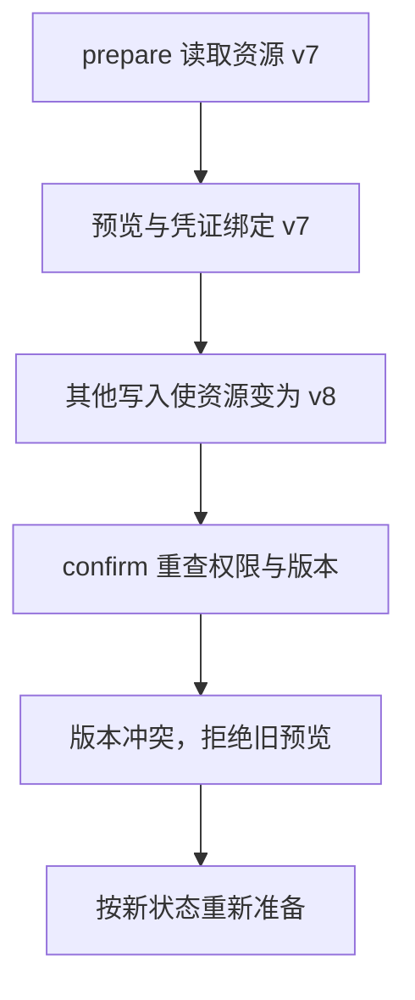

---
{
  "id": "Q-3905",
  "title": "如何对有副作用的工具实施分级授权、两阶段提交和执行期零信任校验？",
  "category": "ai_engineering",
  "topic": "安全、权限与人工介入",
  "type": "系统设计",
  "level": "深入",
  "priority": "按岗位选读",
  "focus": "副作用分级与执行时授权。按可逆性、范围与成本授权，准备预览后确认执行通常是业务两阶段而非数据库2PC；执行前再验身份、参数和当前状态，模型不能自升权限。",
  "answerStatus": "ready",
  "updatedAt": "2026-10-19"
}
---

> 在面栈阅读：[如何对有副作用的工具实施分级授权、两阶段提交和执行期零信任校验？](https://mianstack.com/question/q-3905)

## 核心回答

可按工具的**可逆性、影响范围和成本**分级：普通只读查询按既定权限执行；可回退的局部写入限制资源和数量；删除、支付、对外发送等高影响动作按业务策略取得明确授权。分级规则由服务端执行，不能由模型自行提升权限。

这里的“两阶段”通常指业务上的**准备预览，再确认执行**，并不自动等于数据库分布式事务2PC。执行时仍要重新检查用户、资源、参数、策略和当前状态；曾经通过一次检查，不代表之后的任意调用都可信。

## prepare与confirm怎样落地

准备阶段解析结构化参数，检查资源权限和业务条件，返回将修改的对象、范围与预期影响。服务端保存短期操作记录或签发完整性受保护的确认凭证，绑定用户/租户、工具版本、参数摘要、资源版本、有效期和幂等号。

确认阶段校验凭证与本次请求完全匹配，重新检查用户权限、资源状态和策略；对象在预览后被修改时，应按版本冲突重新处理，而不是执行已失效的预览。确认凭证的消费与业务提交需要可靠衔接，防止重放造成多次副作用。

已在明确范围内授权的低风险批处理可以按既定策略继续，不需要为每一步重复询问。越出资源、数量或风险范围时，再走相应授权路径；授权拒绝应作为终态或可解释的失败，不能换参数绕过。

只看已经需要确认的操作：若预览之后资源版本改变，确认时应识别冲突。

图展示版本冲突这一条路径。版本未变也仍需其他业务检查，校验与提交必须可靠衔接；普通已授权操作无需机械增加确认。

## 执行期还检查什么

文件工具校验解析后的真实路径与允许目录，数据库工具限制用户可访问的租户、表和字段，外部请求限制目标及凭证用途；执行凭证按最小权限签发。模型输出、工具描述和检索内容都作为数据处理，不能成为授权来源。

审计记录请求主体、操作摘要、授权决定、执行结果与关联ID，敏感内容做必要脱敏。预览成功也不等于一定可回滚，外部邮件或付款等动作应按其真实补偿能力设计失败处理。

## 参考资料

- 国内：[JavaGuide / Snailclimb：LLM/Agent 安全实战](https://github.com/Snailclimb/JavaGuide/blob/50f02a5984c062fe7221629d0a6a40ec15c26fd7/docs/ai/system-design/llm-security.md)：退款工具的例子说明模型即使受外部内容误导，也应被资源级鉴权和隔离限制影响。
- 国内：[JavaGuide / Snailclimb：MCP详解](https://github.com/Snailclimb/JavaGuide/blob/50f02a5984c062fe7221629d0a6a40ec15c26fd7/docs/ai/agent/mcp.md)：依据本地文件与远程服务的权限边界，说明正文中统一工具接入后仍需逐项执行资源级授权。
- 国内：[zero2Agent / ranxi2001：故障容错与安全控制](https://github.com/ranxi2001/zero2Agent/blob/0c0eb7693105d281b146bb98f3a7f30da6f1ceea/learn-agent-interview/03-fault-tolerance/index.md)：借鉴受控补丁的预览、字段白名单与版本校验，说明正文中模型提议如何经过 prepare 与 confirm 成为受控写入。
- 国外：[OWASP：LLM06:2025 Excessive Agency](https://genai.owasp.org/llmrisk/llm062025-excessive-agency/)：最小能力与执行身份的建议说明工具范围应由服务端限制，高影响动作需要有针对性的授权控制。
- 国外：[AWS Builders’ Library：Making retries safe with idempotent APIs](https://aws.amazon.com/builders-library/making-retries-safe-with-idempotent-APIs/)：依据客户端请求标识与原子执行记录，说明正文中确认消费和业务提交需可靠衔接，避免超时重试产生重复副作用。
