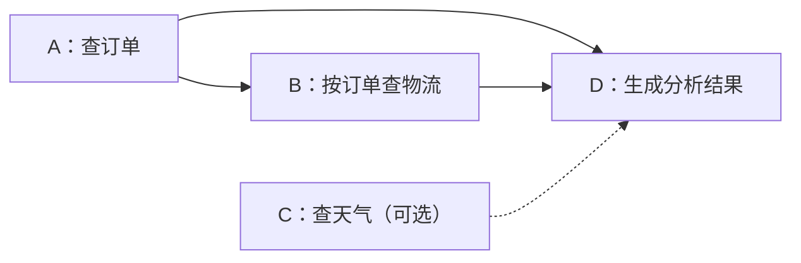

---
{
  "id": "Q-4277",
  "title": "有依赖关系的工具如何并行执行并处理失败？",
  "category": "agent",
  "topic": "工作流、状态与执行恢复",
  "type": "系统设计",
  "level": "进阶",
  "priority": "按岗位选读",
  "focus": "DAG依赖与失败传播。按依赖调度就绪节点并限制并发，成功后解锁后继；失败区分安全重试、阻断下游与可选降级，已发生的副作用按业务补偿并报告状态。",
  "answerStatus": "ready",
  "updatedAt": "2026-10-29"
}
---

> 在面栈阅读：[有依赖关系的工具如何并行执行并处理失败？](https://mianstack.com/question/q-4277)

## 核心回答

先把工具调用组织成有向无环图 `DAG`：节点是一次调用，边表示后一个调用需要前一个调用的结果。**只并行运行依赖已经满足的节点**，用并发上限和超时控制资源；节点成功后保存结果，再解锁后继，需要多个输入的节点要显式等齐。

失败时先判断影响范围和是否适合重试。临时故障且调用可安全重复，可以有限重试；必要依赖失败就阻断相应下游，可选信息缺失则按业务规则降级。取消尚未开始或仍可协作取消的工作，可以减少浪费，但**取消等待不代表远端操作停止，更不代表已经完成的写入被回滚**。最终返回每个分支的实际状态，需要补偿的副作用单独处理。

## 用一个依赖图说明哪些调用能并行

以下是假设的订单分析任务，箭头只表示数据依赖：

`A` 和 `C` 无数据依赖，可以同时开始；`B` 要等 `A` 返回订单信息。`D` 必须等订单和物流都成功；天气是可选项，可以约定在截止时间前有结果就加入，否则明确省略。虚线表示可选输入，并不要求在天气失败后阻断整项任务。

这也说明“拓扑上入度为零”只是最初的就绪条件。执行过程中要维护依赖是否成功、结果是否可用以及分支是否已终结，不能只看到前驱“不再运行”就释放后继。

## 调度器需要保存什么

每个节点至少保存依赖、输入输出、状态、尝试次数和截止时间。可以区分 `pending`、`running`、`succeeded`、`failed`、`blocked`、`cancelled`；远端写操作超时但结果未知时，还需要保留“待确认”状态。

调度过程是：

1. 校验依赖图无环，并检查工具、参数和资源是否可用。
2. 将当前就绪节点放入队列，在全局或工具级并发限制内启动。
3. 节点完成后先保存可供下游使用的结果，再更新其后继的依赖状态。
4. 必要前驱失败且不再重试时，将受影响后继标为阻断；无依赖关系的分支是否继续，按任务的部分完成策略决定。

并发分支写共享状态时，也要规定合并方式。例如按节点编号分别存结果，再统一汇总；不能让两个分支读同一个旧值后互相覆盖。进程内可以用锁或明确的状态归并函数，跨进程需要相应的持久化与一致性机制。

`asyncio.gather()` 能等待一组调用，但不会自动分析输入依赖、设计状态合并或处理业务补偿。`Python 3.11` 起的 `asyncio.TaskGroup` 在一个子任务发生普通异常时，会取消同组其余任务并等待它们结束；这种组级策略也不等于业务依赖图的失败传播规则。

## 重试之前先判断这次调用是否已经生效

| 失败情形                               | 处理重点                                                                   |
| -------------------------------------- | -------------------------------------------------------------------------- |
| 参数错误、权限拒绝、确定的业务校验失败 | 修正输入或结束分支，重复调用通常无益                                       |
| 限流、暂时不可用，且重复调用安全       | 在总时间预算内退避重试，限制次数；支持时遵循服务端等待提示                 |
| 查询超时                               | 按查询是否有副作用、剩余时间决定重试或降级                                 |
| 扣款、创建订单等写操作超时             | 先用业务请求号查询状态；有幂等协议才据此安全续试，不能把超时当作“没有执行” |

幂等键要绑定同一个业务意图和请求参数，并由接收端实施去重、结果复用或唯一性约束；只在日志里写一个随机编号不会自动产生幂等性。每次技术重试可有不同的 `attempt_id`，但应保留相同的业务幂等标识。

## 取消、回滚和补偿是三件事

`asyncio` 的取消通常在协程下一次可取消的等待点抛出 `CancelledError`，清理放在 `finally` 中。已经在线程池执行的函数一般不能靠取消对应的 `Future` 强行停止；远端服务是否停止，更取决于它是否支持取消协议。

例如 `AWS Step Functions` 的并行状态失败后，已经调用的 `Lambda` 函数仍可能继续运行。这说明编排器结束某个分支，并不证明外部副作用没有发生。

如果分支已经创建资源，后续又失败，可以按业务定义撤销资源、释放预留或进入人工核对；这属于补偿操作。补偿也可能失败，应记录并重试或交给后续处理。只有处在同一事务边界内且事务保证覆盖相关写入时，才能依赖事务回滚，不能把多服务补偿说成一次原子回滚。

最终结果应说明哪些节点成功、哪些失败或被阻断、哪些结果未知，以及补偿进度。这样调用方才能继续处理，而不是只收到一个掩盖部分成功的“执行失败”。

## 对应教程

- [《从零开始构建 AI Agents》：LangGraph API——图与状态](https://github.com/didilili/ai-agents-from-zero/blob/main/23-LangGraphAPI：图与状态.md)：回看节点、状态归并与运行时调度。本文进一步区分数据依赖、显式汇合及外部副作用；画出多条边本身不保证所有框架都按“等齐输入”执行。

## 参考资料

- 国内：[Guide：Workflow、Graph 与 Loop](https://github.com/Snailclimb/JavaGuide/blob/50f02a5984c062fe7221629d0a6a40ec15c26fd7/docs/ai/agent/workflow-graph-loop.md)：借鉴节点、边、状态归并以及失败分类的说明，展开就绪调度、共享状态和有限重试；业务补偿另行说明其不具备原子回滚保证。
- 国内：[Datawhale：构建你的 Agent 框架](https://github.com/datawhalechina/hello-agents/blob/36f583c233ea5cee4537ef93455702b55053af18/docs/chapter7/%E7%AC%AC%E4%B8%83%E7%AB%A0%20%E6%9E%84%E5%BB%BA%E4%BD%A0%E7%9A%84Agent%E6%A1%86%E6%9E%B6.md)：采用工具注册表配合线程池和 `asyncio.gather()` 的示例，解释“能并发调用”与“能按依赖调度”之间还差哪些职责。
- 国内：[阿里云：错误处理](https://www.alibabacloud.com/help/zh/serverless-workflow/latest/error-handling)：参考任务及并行状态的重试、捕获和退避机制，说明重试应有边界，并在重试耗尽后转入明确的失败路径。
- 国内：[腾讯云：工作流编排](https://intl.cloud.tencent.com/zh/document/product/1254/72136)：采用连线表达输出到输入依赖、无依赖分支可并行以及环路校验的机制，解释示例中工具的启动次序。
- 国外：[Python：协程与任务](https://docs.python.org/3/library/asyncio-task.html)：核对 `TaskGroup` 的异常传播、取消等待和协程清理条件，避免把取消描述为强制终止。
- 国外：[AWS：Parallel workflow state](https://docs.aws.amazon.com/step-functions/latest/dg/state-parallel.html)：使用并行状态失败后已启动 `Lambda` 仍可能继续运行的明确约定，解释编排结束与副作用停止之间的区别。
- 国外：[Python：concurrent.futures](https://docs.python.org/3/library/concurrent.futures.html#concurrent.futures.Future.cancel)：依据正在执行的 `Future` 无法取消的约定，限定线程池工具的取消能力。
