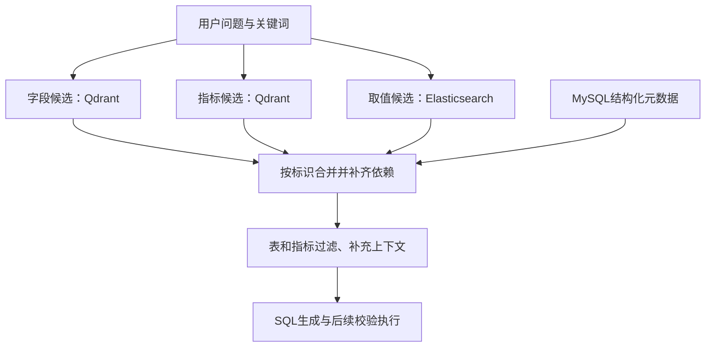

---
{
  "id": "Q-4364",
  "title": "介绍项目中检索召回的完整流程。",
  "category": "rag",
  "topic": "召回策略与检索",
  "focus": "查询到候选与上下文的链路。用具体查询说明索引准备、关键词与多路召回、合并去重和关系补齐，再检查筛选后进入SQL生成的信息。",
  "type": "项目深挖",
  "level": "进阶",
  "priority": "按岗位选读",
  "answerStatus": "ready",
  "updatedAt": "2026-11-04"
}
---

> 在面栈阅读：[介绍项目中检索召回的完整流程。](https://mianstack.com/question/q-4364)

## 核心回答

以下以电商智能问数项目为例，介绍检索链路与模块分工。

> 项目检索的对象是表字段、指标定义和字段取值，目的是为自然语言生成SQL提供准确的数据库上下文。技术上，`Qdrant` 负责字段与指标的语义检索，`Elasticsearch` 负责字段取值检索，`MySQL` 保存可按标识查询的结构化元数据，`LangGraph` 编排处理流程。
>
> 离线先同步元数据，建立字段、指标和取值索引。在线收到问题后，先抽取关键词，再并行召回三类候选；随后去重、补齐指标依赖字段，把取值归到对应字段，并补充相关表的主外键。候选经过表和指标过滤、补充必要上下文后，才进入SQL生成。
>
> 我负责召回结果合并模块。比如问“华北地区销售总额”，不仅要找到金额口径与地区值，还要把订单表和地区表关联所需的字段带全。验证时分别检查每路候选、合并结果和模型最终输入，再核对生成SQL，区分漏召回、合并丢失和生成错误。

## 先准备哪些可检索资料

| 资料           | 关键内容                           | 后续用途                     |
| -------------- | ---------------------------------- | ---------------------------- |
| 字段信息       | 字段标识、所属表、类型、描述与别名 | 找到问题涉及的列             |
| 指标信息       | 名称、计算口径及依赖字段           | 确定“销售总额”怎样计算       |
| 字段取值       | 值及其对应字段标识                 | 把“华北地区”映射到实际候选值 |
| 结构化表与关系 | 表、字段及主外键元数据             | 合并时补齐依赖和关联信息     |

字段与指标描述向量化后建立索引；真实取值进入全文检索索引。记录原始描述和稳定标识，才能把候选反查成结构化元数据。元数据变更时，应同步对应索引，避免新表结构与旧描述并存。

## 沿着“华北地区销售总额”走一遍

1. **理解与抽词**：保留原问题，抽取“销售总额”“华北地区”等关键词，必要时扩展别名；时间或金额口径不明时先确认，不能由扩词改变任务。
2. **字段召回**：用关键词匹配字段描述，得到金额字段、地区字段等候选，并保留所属表和字段标识。
3. **指标召回**：匹配“销售总额”的已登记定义，获取计算表达与依赖字段。不能直接假定它在每个项目中都等于同一口径的GMV。
4. **取值召回**：检索“华北”的候选记录，保留值与字段的对应关系。全文匹配产生的是候选；结果是否符合用户对象仍需核对。
5. **合并补齐**：按字段标识去重，反查缺失的指标依赖字段，将取值加入对应字段的示例，再按表分组并补齐主外键。
6. **筛选与构建上下文**：过滤无关表和指标，补充必要信息，形成SQL生成需要的表结构与指标上下文，保留来源和当前有效版本。

图中重点是三路候选如何汇合，SQL生成位于检索与上下文构建之后：

这不是把三份文本直接拼接。模型需要知道“华北属于哪个字段”“金额口径依赖哪些列”“两张表如何连接”，合并模块负责补出这些关系。

## 怎样验证检索与合并

准备能覆盖别名、相似字段、多个地区值、多表指标和元数据更新的固定样本。每条保存原问题、各路候选、合并输出以及实际发送给模型的上下文。

若最终SQL漏了地区条件，先看取值是否被召回、是否归到正确字段、过滤后是否仍进入模型输入；不能直接归咎于模型。如果候选已正确、进入上下文后仍生成错误，才继续检查提示词和SQL生成。

还要检查候选数量、关键字段覆盖、最终查询正确性及各环节延迟。增加候选或重排可作为改进方向，但需要用同一组样本比较；原链路中的合并与表/指标过滤，不等于已经配置了独立的重排模型。

## 常见追问

**为什么不用一套向量检索解决全部问题？**

字段描述和指标别名适合语义匹配，真实取值还需要稳定映射到具体字段。分路后可分别优化候选质量，再用结构化元数据补关系。这是本项目的数据组织选择，不是所有数据库问答都必须使用三套存储。

**检索命中就能保证SQL正确吗？**

不能。命中候选不代表口径正确或关联完整，合并、过滤和生成都可能引入错误。语法校验也不能证明业务含义正确，需要与问题条件、指标定义和对照结果一起检查。权限限制还应在可信数据访问与执行层落实。

## 对应教程

- [实战项目-电商问数/9-字段与指标检索能力构建：字段与指标向量索引](https://github.com/didilili/ai-agents-from-zero/blob/c05fb5979cf0aa3b6b4ed8c29f450f640fb9c18f/%E5%AE%9E%E6%88%98%E9%A1%B9%E7%9B%AE-%E7%94%B5%E5%95%86%E9%97%AE%E6%95%B0/9-%E5%AD%97%E6%AE%B5%E4%B8%8E%E6%8C%87%E6%A0%87%E6%A3%80%E7%B4%A2%E8%83%BD%E5%8A%9B%E6%9E%84%E5%BB%BA.md)：回看Qdrant索引与检索对象的组织。
- [实战项目-电商问数/11-关键词抽取与多路召回：§1～3与三路召回](https://github.com/didilili/ai-agents-from-zero/blob/c05fb5979cf0aa3b6b4ed8c29f450f640fb9c18f/%E5%AE%9E%E6%88%98%E9%A1%B9%E7%9B%AE-%E7%94%B5%E5%95%86%E9%97%AE%E6%95%B0/11-%E5%85%B3%E9%94%AE%E8%AF%8D%E6%8A%BD%E5%8F%96%E4%B8%8E%E5%A4%9A%E8%B7%AF%E5%8F%AC%E5%9B%9E.md)：回看关键词、字段/指标/取值三路的输入与输出。
- [实战项目-电商问数/12-召回信息合并与上下文构建：§3、§5.1～5.7](https://github.com/didilili/ai-agents-from-zero/blob/c05fb5979cf0aa3b6b4ed8c29f450f640fb9c18f/%E5%AE%9E%E6%88%98%E9%A1%B9%E7%9B%AE-%E7%94%B5%E5%95%86%E9%97%AE%E6%95%B0/12-%E5%8F%AC%E5%9B%9E%E4%BF%A1%E6%81%AF%E5%90%88%E5%B9%B6%E4%B8%8E%E4%B8%8A%E4%B8%8B%E6%96%87%E6%9E%84%E5%BB%BA.md)：回看按字段标识去重、依赖补齐、取值归属与主外键补充。

## 参考资料

- 国内：[JavaGuide：RAG文档处理](https://github.com/Snailclimb/JavaGuide/blob/50f02a5984c062fe7221629d0a6a40ec15c26fd7/docs/ai/rag/rag-document-processing.md)：借鉴结构化切分、原文和元数据关联的说明，解释为什么检索记录要保留描述与稳定标识。
- 国内：[JavaGuide：RAG优化策略](https://github.com/Snailclimb/JavaGuide/blob/50f02a5984c062fe7221629d0a6a40ec15c26fd7/docs/ai/rag/rag-optimization.md)：参考按失败阶段诊断和固定样本比较的方法，组织召回、合并、上下文与生成的分段检查。
- 国内：[小林面试笔记：检索召回效果优化](https://xiaolinnote.com/ai/rag/14_retrieval_opt.html)：借鉴词面与语义匹配及资料完整性的分析，解释字段、指标和取值为什么分路检索。
- 国内：[Datawhale：记忆与检索](https://github.com/datawhalechina/hello-agents/blob/36f583c233ea5cee4537ef93455702b55053af18/docs/chapter8/%E7%AC%AC%E5%85%AB%E7%AB%A0%20%E8%AE%B0%E5%BF%86%E4%B8%8E%E6%A3%80%E7%B4%A2.md)：采用检索工具与记忆/应用逻辑分开的说明，组织检索候选进入下游上下文的边界。
- 国外：[Sentence Transformers：Retrieve & Re-Rank](https://sbert.net/examples/sentence_transformer/applications/retrieve_rerank/README.html)：依据候选检索与重排的两阶段分工，说明表/指标过滤不能直接说成已部署重排模型。
- 国外：[Elastic：Match query](https://www.elastic.co/docs/reference/query-languages/query-dsl/query-dsl-match-query)：依据text字段全文查询会先分析输入的机制，说明取值全文检索得到候选而非自动保证精确业务匹配。
