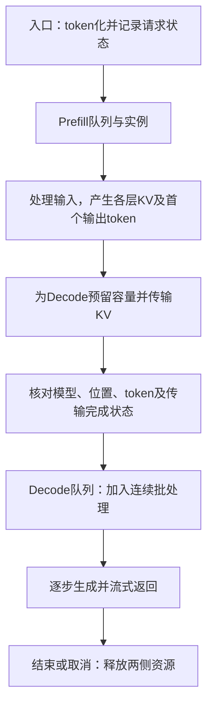

---
{
  "id": "Q-4716",
  "title": "什么是 Prefill 与 Decode 分离，为什么要分离部署？",
  "category": "llm",
  "topic": "推理优化与模型压缩",
  "type": "原理机制",
  "level": "进阶",
  "priority": "按岗位选读",
  "focus": "阶段负载差异与 KV 迁移。Prefill 对提示 token 并行计算，decode 每次生成一个 token、频繁读取权重与 KV；分开调度可减少两阶段互相干扰，但需要承担 KV 传输和跨节点调度成本。",
  "answerStatus": "ready",
  "updatedAt": "2026-11-18"
}
---

> 在面栈阅读：[什么是 Prefill 与 Decode 分离，为什么要分离部署？](https://mianstack.com/question/q-4716)

## 核心回答

`Prefill`与`Decode`分离部署，是让**处理输入的阶段和持续生成的阶段在不同推理实例或资源池中运行**，并将`Prefill`产生的`KV Cache`交给`Decode`继续使用。它不只是给一次调用划分两个名称，而是改变请求路由、队列、资源配比和中间状态传输。

`Prefill`能并行处理许多已知输入token，通常较易利用大矩阵计算；`Decode`每条序列每轮推进少量新token，在常见低批量设置下更容易受权重和KV访存限制。混跑时，长`Prefill`会挤占已有`Decode`的执行时间，两阶段还被迫共用资源与并行策略。分离可独立控制首token延迟TTFT和逐token延迟ITL/TPOT，代价是额外模型副本、KV传输、队列和故障处理；**吞吐收益必须结合具体实现与SLO验证。**

## 一次请求怎样跨过两个资源池

具体系统可以边算各层边传输，首token也可按接口约定提前返回。关键是`Decode`必须拿到一致的token、位置、所需层缓存和采样状态，才能从正确位置继续。仅把prompt文本发给`Decode`、在那里重新`Prefill`，不能实现预期的阶段复用。

两侧模型权重、`Tokenizer`、模板、位置编码、Adapter与KV精度/布局必须兼容；不同张量并行配置可能需要重排缓存。块号是实例内的地址映射，不是另一台机器可直接解引用的物理地址，因此除了数据，还需要传输映射和请求关联信息。

## 为什么共置会互相干扰

长`Prefill`会占据计算单元、`HBM`带宽、kernel执行时间和临时内存，已有`Decode`不能独占每轮时间片；`Decode`的大量常驻KV又压缩了`Prefill`可用显存。即使`Prefill`偏计算、`Decode`偏访存，两者也不是天然互不竞争。

分离以后，`Prefill`可选择利于输入吞吐或TTFT的并行度，`Decode`可选择利于缓存容量和ITL的批量与并行方式，并独立扩缩容。直接给共置系统加卡也会增加容量，但没有自动解除同实例中的阶段干扰与资源策略绑定。公平比较应固定总GPU、模型和请求分布。

两阶段的瓶颈是工作负载相关的：短`Prefill`未必算力饱和，大批`Decode`也可能进入计算或通信受限。判断应看实际profiling，不能把“P永远计算密集、D永远访存密集”当定律。

## KV传输与资源比例怎样估

假设32层、8个KV头、头维128、`BF16`，每token缓存128KiB；8192token提示约产生1GiB KV。若有效链路带宽为25GiB/s，仅传输数据的理想下限约40ms，尚未计排队、布局变换和同步。长提示、较多KV头或低带宽会放大这笔成本；共享前缀命中和分层流水传输可改变实际传输量或等待时间。

资源比例按输入长度、输出长度、到达率和SLO来定：长输入偏多时关注`Prefill`等待，长输出偏多时`Decode`序列驻留更久、KV和生成压力更大。分别测每个池在目标延迟下的服务能力，再调实例数，不能固定套用1:1。

准入也要跨阶段协同：`Prefill`完成时若`Decode`没有空间，已经消耗的计算可能被浪费。路由应考虑`Decode`预留量、KV传输队列和未来负载，设置有界等待、取消和超时清理，防止一侧过度生产。

## 什么时候值得做

在高并发、长输入与持续生成互相影响、尾延迟要求明确且网络足够好的服务中值得比较；低流量、短请求或单机紧张场景，额外副本和传输可能更贵。

`vLLM`当前官方文档把Disaggregated Prefilling标为实验功能，重点是分别调TTFT/ITL和控制尾ITL，并明确该功能本身不提高吞吐。`DistServe`、`Mooncake`等完整系统则研究在特定负载、网络和SLO下提高goodput，即满足延迟要求的有效请求数。不能把论文系统的收益直接套到任意`vLLM`配置。

**与`Chunked Prefill`的区别？** `Chunked Prefill`在同一调度体系中把输入切小块，减少大`Prefill`对`Decode`的阻塞；PD分离把阶段放到不同实例并传KV。它们可以结合，也应作为同硬件预算下的候选方案比较。

## 参考资料

- 国内：[华为：LLM DataDist开发指南Python](https://www.hiascend.com/doc_center/source/zh/CANNCommunityEdition/81RC1alpha002/devguide/acce/llmdatadistdevpython/CANN%E7%A4%BE%E5%8C%BA%E7%89%88%208.1.RC1.alpha002%20LLM%20DataDist%E5%BC%80%E5%8F%91%E6%8C%87%E5%8D%97%20%28Python%29%2001.pdf)：依据§2、§4分配/拉取/异步传输流程，说明P到D必须交接KV及请求元数据。
- 国内：[月之暗面与清华大学：Mooncake](https://arxiv.org/html/2407.00079v3)：采用分层传输、Decode连续批处理和容量复核，说明预留、背压与Prefill完成后仍可能无生成槽位。
- 国内：[北京大学与UCSD：DistServe](https://arxiv.org/html/2401.09670v1)：依据阶段干扰和资源策略解耦的设计，区分固定GPU预算下的SLO goodput与无条件吞吐承诺。
- 国内：[小林：KV Cache与Prompt Caching](https://xiaolinnote.com/ai/llm/kv_cache_prompt_caching.html)：采用历史K/V复用条件，说明只传prompt并重算不能复用Prefill成果。
- 国外：[vLLM：Disaggregated Prefilling](https://docs.vllm.ai/en/latest/features/disagg_prefill/)：按当前实验功能文档核对分别调TTFT/ITL、尾ITL控制及不提高吞吐的实现边界。
- 国外：[Hugging Face：KV cache strategies](https://huggingface.co/docs/transformers/main/en/kv_cache)：采用不同缓存布局、静态容量、滑动窗口和精度的限制，说明跨实例交接必须兼容实际缓存实现。
