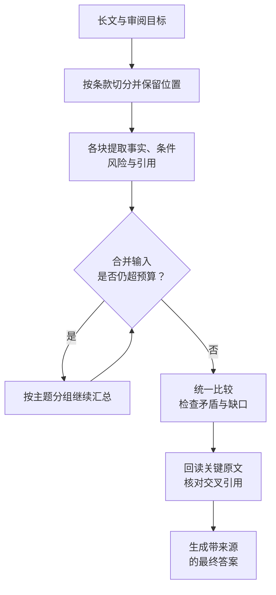

---
{
  "id": "Q-7196",
  "title": "输入超过模型上下文窗口时，有哪些处理方式？",
  "category": "agent",
  "topic": "上下文工程",
  "type": "方案设计",
  "level": "基础",
  "priority": "按岗位选读",
  "focus": "输入预算与信息保留。按任务选择截断、分块处理、摘要压缩、检索或更长窗口模型，说明各自可能遗漏的信息及如何验证跨段任务仍能完成。",
  "answerStatus": "ready",
  "updatedAt": "2026-11-18"
}
---

> 在面栈阅读：[输入超过模型上下文窗口时，有哪些处理方式？](https://mianstack.com/question/q-7196)

## 核心回答

输入超过上下文窗口时，先确认超长的是旧对话，还是**本次新文档或工具结果本身**。旧历史可以裁剪或摘要；新材料本身超限，清空历史也可能无效，需要缩小读取范围、检索相关片段、分块处理后汇总，或者选择更大窗口的模型。

方案由任务决定：只回答局部问题，用检索；要覆盖整份长文，用分块抽取与分层汇总；要跨章节比较，先提取带来源的结构化记录，再统一核对。每一次调用，包括摘要和最终合并，都要独立满足所用模型的输入与输出预算。

## 先算完整请求，而不是只算文档

上下文会包含系统规则、工具定义、历史消息、当前输入、检索结果和工具返回，还需要为输出留空间。具体上限按目标模型和接口核对，不只看产品家族宣传的窗口大小。

例如作为预算算例，设输入与输出合计最多32,000 token，预留输出4,000和余量2,000，系统规则与工具定义占3,000，则历史、文档和当前问题合计还有23,000。若新文档就有40,000，删除旧历史也放不下。

超限时不应静默截去尾部：尾部可能正好有例外条款、结论或否定条件。先明确哪些内容未处理，再调整读取与处理策略。

## 按任务选择处理方法

| 任务               | 处理方式                                 | 关键检查                             |
| ------------------ | ---------------------------------------- | ------------------------------------ |
| 查一条合同规定     | 按章节或检索定位条款，补读定义和引用条款 | 是否遗漏例外及交叉引用               |
| 总结整份长报告     | 各块提取要点，再按主题分层合并           | 是否覆盖全部块及重要反证             |
| 比较多个合同的条款 | 每份抽取统一字段、条件和位置，再比较     | 定义、单位与适用对象是否一致         |
| 分析大型代码库     | 搜索入口、类型、调用方与测试，逐步阅读   | 修改依赖是否完整，代码是否为当前版本 |
| 工具返回巨大结果   | 服务端过滤、分页、聚合，全文外置         | 过滤是否改变问题需要的数据范围       |
| 长对话继续执行     | 阶段摘要＋近期完整交互＋关键状态         | 更正、任务约束和未完成动作是否保留   |

更大窗口可以减少切分和汇总，但仍需评估任务效果、时延与成本；能放下不代表模型一定能准确利用每一段。

## 长文分块后如何得到最终答案？

以一份长合同的全面审阅为例，先按章节、条款和语义边界切分，保留章节编号、页码或位置；必要的重叠用于延续跨块句子，但不保证所有跨章节依赖都已解决。

各块输出尽量采用统一字段，例如“条款类型、主体、义务、期限、例外、来源位置”，不要只生成一段泛泛摘要。最终汇总既保留共同结论，也保留冲突和未覆盖项；依据不足时补读，而不是让合并模型补造缺失条款。

这类分块并行再合并常称为 `Map-Reduce`。逐块带着当前结论继续修订的 `Refine` 方式也可用，但存在顺序影响与摘要逐步漂移。无论采用哪种，最终合并的输入也可能继续超限，因此需要分层汇总或按主题分别处理。

## 检索与全文分治怎样选？

检索适合目标明确、答案集中在少数位置的问题；全面审阅或“列出所有例外条款”需要覆盖整个材料，不能只取相关性最高的少量片段。

分治可能丢掉全局关系，例如一个章节定义术语、另一个章节规定例外。可以先维护全局定义表和交叉引用，再让各块带着必要定义处理，最后核对跨章节关系。原文外置要保留可回读的版本与位置，只留网址不等于保留当时内容。

验证时分别看覆盖率、关键条件与来源是否保留、最终答案是否符合任务，以及完整处理成本。减少输入token只是工程指标之一。

## 对应教程

- [1-2-提示词工程基础](https://github.com/didilili/ai-agents-from-zero/blob/96e115d510c76cec7e22598fe6f0449e99b344fd/1-2-%E6%8F%90%E7%A4%BA%E8%AF%8D%E5%B7%A5%E7%A8%8B%E5%9F%BA%E7%A1%80.md)：回看上下文窗口与资料过多时的提示词边界；本文进一步展开长文分治和汇总。
- [16-记忆与对话历史（含Redis基础）](https://github.com/didilili/ai-agents-from-zero/blob/96e115d510c76cec7e22598fe6f0449e99b344fd/16-%E8%AE%B0%E5%BF%86%E4%B8%8E%E5%AF%B9%E8%AF%9D%E5%8E%86%E5%8F%B2%EF%BC%88%E5%90%ABRedis%E5%9F%BA%E7%A1%80%EF%BC%89.md)：回看按会话读历史、注入消息和写回的链路；本文进一步组织窗口、摘要与原文存档。

## 参考资料

- 国内：[Guide / JavaGuide：AI Agent 记忆系统](https://github.com/Snailclimb/JavaGuide/blob/50f02a5984c062fe7221629d0a6a40ec15c26fd7/docs/ai/agent/agent-memory.md)：采用短期状态、长期存储以及缩减、卸载、隔离的划分，解释消息保存与本轮模型输入的不同职责。
- 国内：[Guide / JavaGuide：上下文工程是什么](https://github.com/Snailclimb/JavaGuide/blob/50f02a5984c062fe7221629d0a6a40ec15c26fd7/docs/ai/agent/context-engineering.md)：采用预算、按需加载和任务质量评估的方法，说明何时保留原文、何时压缩以及怎样验证取舍。
- 国内：[WeThinkIn：Agent记忆与上下文工程高频考点](https://github.com/WeThinkIn/AIGC-Interview-Book/blob/275fdf1eeb65e3b233081d3b8e74ff5d8eeb2e03/AI%20Agent%E5%9F%BA%E7%A1%80/05_Agent%E8%AE%B0%E5%BF%86%E4%B8%8E%E4%B8%8A%E4%B8%8B%E6%96%87%E5%B7%A5%E7%A8%8B%E9%AB%98%E9%A2%91%E8%80%83%E7%82%B9.md)：采用完整交互单元、摘要覆盖区间与更正处理，说明窗口边界、摘要更新和状态连续性。
- 国内：[Datawhale：第九章 上下文工程](https://github.com/datawhalechina/hello-agents/blob/36f583c233ea5cee4537ef93455702b55053af18/docs/chapter9/%E7%AC%AC%E4%B9%9D%E7%AB%A0%20%E4%B8%8A%E4%B8%8B%E6%96%87%E5%B7%A5%E7%A8%8B.md)：对照ContextBuilder的分区、预算和字符裁剪实现，解释按token管理输入及结构完整不等于语义完整。
- 国外：[Anthropic：Effective context engineering for AI agents](https://www.anthropic.com/research/effective-context-engineering-for-ai-agents)：采用压缩、结构化笔记和按需回读的机制，说明长任务怎样保留决策与未完成事项。
- 国外：[LangChain：Short-term memory](https://docs.langchain.com/oss/python/langchain/short-term-memory)：依据短期状态、消息裁剪与摘要机制，说明摘要替换旧消息和近期工具交互应保持有效结构。
