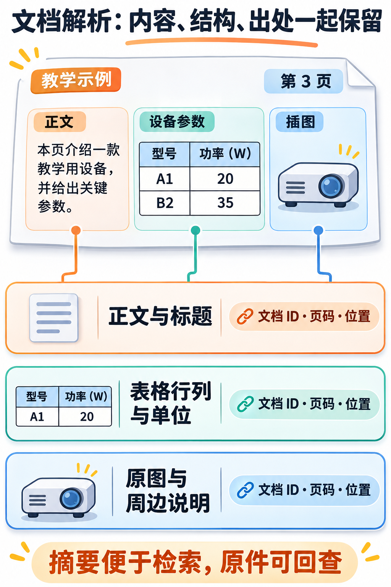

---
{
  "id": "Q-9729",
  "title": "RAG 中文档图片和表格如何解析并保留结构？",
  "category": "rag",
  "topic": "多模态文档处理",
  "type": "方案设计",
  "level": "进阶",
  "priority": "按岗位选读",
  "focus": "内容提取与原文定位。按图表类型选择文本提取、视觉理解或表结构恢复，保留标题、页码与段落关系，验证检索和生成能正确使用这些信息。",
  "answerStatus": "ready",
  "updatedAt": "2026-11-18"
}
---

> 在面栈阅读：[RAG 中文档图片和表格如何解析并保留结构？](https://mianstack.com/question/q-9729)

## 核心回答

RAG处理图片和表格，关键是**先恢复文档元素及其结构，再建立可检索表示，并保留原件与出处**，不能只把整页内容转成一段文本。

解析时先识别标题、段落、图表区域和阅读顺序：可复制文字直接提取，扫描件结合`OCR`；表格保留单元格、表头、单位和合并关系；图片保留原图、图注及周边说明，按需要补充视觉描述。索引时可以使用文本说明或多模态向量，但检索结果应能回到同版本的原表、原图和页码。

例如设备手册写“A1，20W”，检索文本还应说明20对应功率，而不是重量。回答具体数值时，要核对表头、行列和单位；复杂图表再取回原件进行视觉理解或结构化计算，摘要本身不能代替原始证据。

## 从一页文档得到三类关联材料

下面是一页教学设备手册的示意：正文、参数表和插图各自解析，仍保留属于同一页的关系。下方表格卡片只展示A1这一行，实际解析还应保存原表的B2行。

文档解析器的职责不止识字，还包括确定阅读顺序、元素类型和位置。例如双栏`PDF`若被左右交替读取，或表格的列被打乱，即使文字识别正确，也可能丢失语义。`Word`和`Excel`能直接取得的段落、表格或单元格结构，应优先利用，再对嵌入图片补视觉处理。

工程上可以采用版面分析、文字识别、表格识别等模块组合，也可以采用文档视觉模型。`PP-StructureV3`体现了版面分析、元素处理和结果组织的分工；视觉模型则可以理解更丰富的版面关系，但仍可能误识别数字或补出原图不存在的内容。选哪条路线，需要用实际文档比较质量与成本。

## 表格怎样保留行列和合并关系？

简单矩形表可以保存为`Markdown`或二维数组，但复杂表还需要更丰富的结构：

| 原表特征             | 需要保存什么                                         | 为什么仅存纯文本不够                             |
| -------------------- | ---------------------------------------------------- | ------------------------------------------------ |
| 多级表头、合并单元格 | 行列位置、跨行跨列范围、每个数据单元格对应的表头路径 | 一个数字可能同时受“地区—年份—收入”等多层标题约束 |
| 单位与脚注           | 单位、倍率、适用条件及它们作用的行列                 | “20万元”和“20元”不能只靠数字本身判断             |
| 跨页续表             | 原表ID、页码、行序号及续表关系                       | 分页不等于业务上换了一张表                       |
| 空白或缺失值         | 区分空值、识别失败、合并继承及真实的0                | 擅自补0或向下填充，可能改动数据含义              |

可以用带`rowspan/colspan`的`HTML`，或包含单元格坐标、跨度与表头路径的`JSON`保存复杂结构。导出成`CSV`便于计算，但普通`CSV`不直接表达合并单元格及版面关系，因此不应成为复杂原表唯一的保留形式。

超长表需要拆分时，按行组生成检索片段，补上必要表头、单位和相关注释，并关联原表ID。检索命中片段后可回取完整表或相关区域；不要让切分器把“A1”“20”“功率（W）”分别变成无法关联的三段。结构切分可进一步看[如何避免切块破坏原有结构](https://mianstack.com/question/q-7906)。

## 图片为什么不能只做OCR？

`OCR`主要识别文字。流程图的箭头方向、折线图的坐标轴、图例对应和设备示意图的位置关系，还需要视觉或专门的结构识别。

可以为原图生成包含对象、关系及主题的文本说明，参与关键词和向量检索；当问题依赖外观或空间信息时，再评估适配任务的多模态向量与视觉模型。文本摘要便于搜索，但可能省略细节，也可能识别错误，因此应保留原图、图注、相邻说明和位置。

例如问题是“蓝色曲线在第二季度是否回落”，只索引“季度趋势图”通常不够。需要取回原图，结合图例、横轴和对应数据判断；若要求精确数值，优先使用可信的原始数据表，无法可靠读取时说明缺口。

## 入库、检索和回答怎样衔接？

为每个元素保存文档ID、版本、页码或单元格范围、位置、元素ID及权限。表格片段再关联所属表ID，图片描述关联原图ID。这样可以同时维护两类材料：

- **用于检索的表示**：正文、表格行组的带表头文本、图像说明，或相应的多模态向量。
- **用于核实的原始材料**：原文件、原图区域、完整结构表及其位置。

例如查询“A1的功率是多少”，先通过文本说明或表格片段定位设备参数表，再读取A1行与功率列，核对单位W，最后给出20W并引用第3页。若问题要求汇总多行，先核对数据结构，再通过确定性计算得到结果，避免仅凭模型根据表格摘要心算。

这种关联也要参与更新：新版本替换后，检索文本、结构数据和原件引用需一致；回取原图或整表时继续校验权限，不能只控制文本索引。

## 怎样确认解析结果可以使用？

准备包含双栏、扫描件、合并表头、跨页续表、公式和图例的代表文档，逐层检查：

1. **解析结果**：阅读顺序是否正确，单元格是否错位，数字、符号、单位、表头和脚注是否对应；公式需要保留表达式或原图，不能把错误识别结果直接用于计算。
2. **检索结果**：用户问某型号、某指标或图中关系时，是否能找到完整的必要证据，而非只命中宽泛摘要。
3. **最终回答**：答案能否回到正确版本和位置；涉及数值时，与原表或可信计算结果是否一致。

自动比较结构与数值可以发现部分错误，关键数值和难例仍需对照原件。无法可靠恢复的区域应保留原图、记录识别状态，并限制其作为确定答案的依据。

## 常见追问

**统一转成Markdown不就行了吗？**

它适合作为统一的阅读或检索格式，但不保证复杂行列、合并单元格、图形关系都被保留。应同时保存结构化中间结果和原件；转换格式与恢复语义是两件事。

**为什么不把所有页面直接交给视觉模型？**

少量复杂文档可以评估这种方式，但仍要处理分页、引用定位、数值核对、上下文和成本。批量知识库通常会根据文档类型和质量要求选择解析路线，而不是预设单一路线对所有文件最优。

## 对应教程

- [第19章：RAG检索增强生成](https://github.com/didilili/ai-agents-from-zero/blob/96e115d510c76cec7e22598fe6f0449e99b344fd/19-RAG%E6%A3%80%E7%B4%A2%E5%A2%9E%E5%BC%BA%E7%94%9F%E6%88%90.md)：第2.2节介绍加载器、`Document`正文与元数据，以及按格式和解析精度选择工具；本文进一步展开图表结构与原件关联。

## 参考资料

- 国内：[JavaGuide：RAG文档处理与切分策略](https://github.com/Snailclimb/JavaGuide/blob/50f02a5984c062fe7221629d0a6a40ec15c26fd7/docs/ai/rag/rag-document-processing.md)：参考版面解析、图片描述与表格表示，区分检索文本和原始材料。
- 国内：[小林面试笔记：RAG落地的难点](https://xiaolinnote.com/ai/rag/20_hardest_parts.html)：参考复杂`PDF`、扫描件和表格错位场景，将解析错误与后续检索问题分开排查。
- 国内：[WeThinkIn：AI多模态下游应用](https://github.com/WeThinkIn/AIGC-Interview-Book/blob/275fdf1eeb65e3b233081d3b8e74ff5d8eeb2e03/AI%E5%A4%9A%E6%A8%A1%E6%80%81%E5%9F%BA%E7%A1%80%EF%BC%88%E7%B2%BE%E5%8D%8E%E7%89%88%EF%BC%89/6_AI%E5%A4%9A%E6%A8%A1%E6%80%81%E4%B8%8B%E6%B8%B8%E5%BA%94%E7%94%A8%E9%AB%98%E9%A2%91%E8%80%83%E7%82%B9.md)：参考模块化解析与视觉模型路线，以及小字、表格和数字识别的质量边界。
- 国内：[PaddleOCR：PP-StructureV3](https://www.paddleocr.ai/latest/version3.x/pipeline_usage/PP-StructureV3.html)：核对版面分析、元素处理和结果组织的模块职责。
- 国外：[Unstructured：Chunking](https://docs.unstructured.io/open-source/core-functionality/chunking)：核对先解析元素再分块、表格独立处理及超长表格拆分的行为。
- 国外：[Docling：Export tables](https://docling-project.github.io/docling/_generated/examples/export_tables/)：核对解析后表格对象可导出数据表和`HTML`等形式，说明多种表示应按用途保留。
